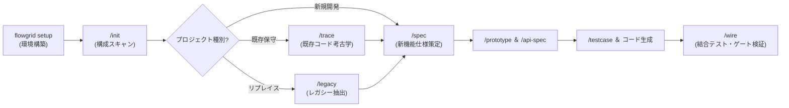

<p align="center">
  <a href="./README.md"><b>English</b></a> |
  <a href="./README.vi.md"><b>Tiếng Việt</b></a> |
  <a href="./README.zh-CN.md"><b>简体中文</b></a> |
  <b>日本語</b>
</p>

<!-- flowgrid-catalog -->
**[ドキュメント目次 (CATALOG.md)](CATALOG.md)**
<!-- /flowgrid-catalog -->

> [!IMPORTANT]
> 📚 **参考ドキュメント:**
> 
> - 📖 **[プロジェクト公式ドキュメント (GitHub)](https://github.com/ShanYuCoder/flowgrid-docs)** — GitHub リポジトリで直接閲覧可能な詳細ドキュメント。
> - ⚙️ **ワークフロー [workflows/](https://github.com/ShanYuCoder/flowgrid-docs/tree/main/workflows/)** — 各開発フェーズおよび運用ガイドライン。

# FlowGrid

**FlowGrid** は、**SSOT（Single Source of Truth：信頼できる唯一の情報源）** モデルに基づいてソフトウェア開発プロセスを標準化する **CLI + AI ハーネス（Harness）** プラットフォームです。**AI エージェント**（Cursor、Gemini/Antigravity、Claude Code、Codex、OpenCode など）と協調して作業するチーム向けに設計されています。

**「AI は人間を支援するためにある」** — 開発者や担当者に複雑な YAML の手動作成を強要することはありません。

```text
生の要件（箇条書き / 画面キャプチャ / レガシーコード）
  → AI が仕様バンドル + 中間表現 (IR) を標準化し Markdown を生成
  → コピペ防止ガード (Anti-Copy-Paste Guard) により共通カタログ (CMN-*) を集約
  → インタラクティブ・プロトタイプ作成 + BA / QA / Dev によるレビュー
  → 自動コード生成: E2E Playwright テスト / バックエンド API / 結合連携
```

### 1. AI による T 型チーム（T-Shaped Team）の能力拡張
AI は人間のエンジニアを置き換えるのではなく、専門領域を横断して拡張するテコ（*T 型人材*）として機能し、部門間の壁やコミュニケーションのボトルネックを解消します:
- **エンジニア（要件定義 BA 能力の拡張）:** AI によるドメイン分析と対話型レビュー（`/grill-bqa`）を活用し、会議を待たずに仕様の精度をシニア BA の **70〜80%** 水準まで自律的に引き上げます。
- **ビジネス担当 / BA（プロトタイプ実装能力の拡張）:** 実現可能性の検討段階で、エンジニアの手を借りずに業務要件を直接クリック可能な動的画面へ落とし込みます。
- **QA テスター（自動化エンジニアへの拡張）:** 構造化されたテスト仕様書（`TC-*.yaml`）から AI が実動する **E2E Playwright** コードを自動生成し、手動テスターから自動化エンジニアへのシフトを支援します。

### 2. 早期フィードバック・プロトタイプ原則 (Early Feedback Prototype)
- **手戻りを防ぐ早期の認識一致:** 静的なモックアップ作成や実装後の仕様ズレ発覚を待つことなく、AI が仕様書から直接**実際に操作可能な動的プロトタイプ**（HTML/Vue/React）を即座に生成します。
- **ステークホルダーとの仕様確定:** 設計段階で PO、BA、顧客が実際の操作感を体験し、即座にフィードバックを反映できます。
- **手戻りリスクの 80% を削減:** 業務理解の齟齬や不要な操作ステップを、低コストなプロトタイプ段階で事前に解消します。

### 3. 品質ループの完結：E2E 自動テスト
- **テスト仕様書からコードを自動生成:** テストケース・マトリクス（`TC-*.yaml`）に基づき、AI が **Playwright による E2E テスト**（`*.spec.ts`）を自動生成します。
- **リグレッション検証の負担をゼロへ:** リリースごとの反復的な手動回帰テストを排除し、システム拡張時にも既存機能の健全性を保証します。

### 4. コピペ重複コードの根絶：反コピペガード (Anti-Copy-Paste Guard)
- **重複コードの蔓延を防止:** 既存システムの改修やリプレイスにおいて、類似コードのコピー＆ペースト（確認モーダル、ページング、エクスポート処理が各所に乱立）を根絶します。
- **共通モジュール化の徹底:** `/init` スキルが重複コードを自動検出して**共通カタログ**（`CMN-UI-*`, `CMN-API-*`, `CMN-DTO-*`）へ集約。`shared/` 配下での一元管理を強制し、エンジニアや AI によるレガシーコードの安易なコピペを禁止します。

### 5. ツールが担保する「量」 — 人間が決定する「質」
FlowGrid は、ツールの自動検証と人間の意思決定の境界を明確に定義しています:
- **ツールが「量」（網羅性・構造・カバレッジ）を担保:**
  - 決定論的スクリプト（`flowgrid audit *`, `cases:gate`）が、仕様書の記載項目、スキーマ、未確定事項（`gaps[]`, `confirms[]`）の漏れを網羅的に検出します。
- **人間が「質」（正確性・深さ・妥当性）を最終決定:**
  - **AI が提案:** AI がアーキテクチャの選択肢を提示し、論点を提起します。
  - **チームが審議して確定:** エンジニアやリードが AI の提案を批判的にレビュー（`grill`）し、最適なアプローチを確定させて完成版 SSOT とします。

### 6. 運用指針: 完全な標準フレームワーク — リスクに応じた柔軟な運用
FlowGrid はエンドツーエンドの標準工程を提供しますが、**形骸化した官僚的プロセスを強制しません**:
- **簡易機能 / 小規模 / 低リスク:** チーム判断で工程を適宜短縮（仕様書の簡略化、プロトタイプや E2E のスキップ）し、リリース速度を最優先できます。
- **基幹機能 / 複雑 / 高リスク領域:** バグの発生しやすい重要機能では、全工程を厳格に適用します:
  - 詳細仕様（`/spec`） ➔ 論理レビュー（`/grill`） ➔ プロトタイプ ➔ API 規約 ➔ テスト仕様 ➔ **E2E 自動テスト**。

---

## 1. CLI のインストール

**必要環境:** Node.js **≥ 24**（Linux / macOS / WSL / Git Bash）。

```bash
export FLOWGRID_GITHUB_TOKEN=github_pat_XXXXX
export FLOWGRID_REF=latest

curl -fsSL \
  https://raw.githubusercontent.com/ShanYuCoder/flowgrid-docs/main/scripts/install-from-release.sh \
  | bash -s -- "$FLOWGRID_GITHUB_TOKEN"
```

*バージョン固定（任意）:*
```bash
export FLOWGRID_REF=v0.2.3
```

*アンインストール:*
```bash
flowgrid uninstall
```

---

## 2. ワークスペースの初期化 (`flowgrid setup`)

セットアップコマンドを実行してワークスペースを作成・初期化します:

```bash
# 新規ワークスペースを作成してスケルトンを展開
flowgrid setup my-workspace

# またはカレントディレクトリを初期化
flowgrid setup
```

CLI が Arc42 準拠の標準 SSOT 構造を自動生成します:
- **`source-code/`**: 開発中のアクティブなソースコード・リポジトリ（Submodule）。
- **`source-legacy/`**: 調査・考古学用の既存システムコード（**完全読み取り専用 READ-ONLY**）。
- **`registries/`**: 共通コンポーネント、システム機能、デザイン定義（Design Tokens）のカタログ。
- **`architecture/`**, **`overview/`**, **`surfaces/`**, **`qa/`**: Arc42 準拠のドキュメント群。
- **Harness & MCP config**: AI エージェント用スキルおよび MCP サーバー設定の同期。

### アダプター別スターターテンプレート

`source-code/` にリポジトリを配置する際、FlowGrid 規約があらかじめ組み込まれた公式テンプレートを活用できます:

| 役割 | スタック | 参考テンプレート |
| --- | --- | --- |
| フロントエンド | `nuxt4` | [base-nuxt4](https://github.com/ShanYuCoder/base-nuxt4) |
| フロントエンド | `nextjs` | [base-nextjs](https://github.com/ShanYuCoder/base-nextjs) |
| フロントエンド | `dotnet-line` | [base-line](https://github.com/ShanYuCoder/base-line) |
| バックエンド | `nestjs` | *(フルスタック Monorepo)* [base-nextjs-nestjs](https://github.com/ShanYuCoder/base-nextjs-nestjs) または [base-nuxt4-nestjs](https://github.com/ShanYuCoder/base-nuxt4-nestjs) — API は `server/` / `apps/api` |
| バックエンド | `fastapi` | [base-fast-api](https://github.com/ShanYuCoder/base-fast-api) |
| バックエンド | `laravel` | [base-laravel](https://github.com/ShanYuCoder/base-laravel) |
| バックエンド | `dotnet-integration` | [base-donet](https://github.com/ShanYuCoder/base-donet) |
| フルスタック | `nextjs` + `nestjs` | [base-nextjs-nestjs](https://github.com/ShanYuCoder/base-nextjs-nestjs) |
| フルスタック | `nuxt4` + `nestjs` | [base-nuxt4-nestjs](https://github.com/ShanYuCoder/base-nuxt4-nestjs) |

すべてのベースリポジトリは GitHub の `ShanYuCoder` オーガナイゼーションで公開されています。

---

## 3. AI エージェントとのエンドツーエンド開発フロー

AI エージェント（Cursor, Antigravity, Claude Code 等）でワークスペースを開き、以下のワークフローを実行します:



| ステップ | コマンド / スキル | 説明 |
| :--- | :--- | :--- |
| **1. セットアップ** | `flowgrid setup [name]` | スケルトン初期化、MCP およびエージェントハーネス設定。 |
| **2. 構成分析** | `/init` | ワークスペースをスキャンし、共通モジュール（`CMN-*`）を抽出、反コピペガードを起動。 |
| **2.1. 計画策定** | `/help-plan` | `inition-inventory.md` と現状を分析し、新要件に対する段階的なアクションプランを策定。 |
| **2.2. テンプレート学習** | `build-template-code` | 最もクリーンなモジュール（Golden Sample）を分析し、プロジェクト専用のコード生成テンプレートを構築。 |
| **3. コード考古学** | `/trace` *(保守)*<br>`/legacy` *(リプレイス)* | • `/trace`: `source-code` をスキャンし仕様を逆引き生成。<br>• `/legacy`: `source-legacy` を読み取り専用で解析し、仕様・ルールを抽出。 |
| **4. 仕様詳細化** | `/spec`, `/grill-bqa` | 機能単位で詳細仕様（Leaf Bundle）を作成し、業務ロジックを批判的レビュー。 |
| **5. プロトタイプ＆API** | `/prototype`, `/api-spec` | 動的 HTML プロトタイプを生成し、API 規約（`01-backend-spec.yaml`）を確定。 |
| **6. テスト自動化** | `/testcase`, `testcase:gen` | テストケース表（`TC-*.yaml`）を作成し、E2E Playwright テストを自動生成。 |
| **7. 結合・監査** | `/wire` | フロントエンドと実 API を接続し、仕様 ↔ 実装の整合性監査をパスして完了。 |

---

## 4. システム診断

ハーネススキルおよびワークスペース設定の整合性をチェックします:

```bash
flowgrid doctor
```
