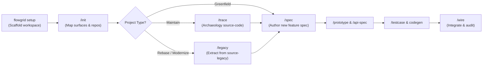

<!-- flowgrid-catalog -->
**[Danh mục tài liệu](CATALOG.md)**
<!-- /flowgrid-catalog -->

<p align="center">
  <b>English</b> |
  <a href="./README.vi.md"><b>Tiếng Việt</b></a> |
  <a href="./README.zh-CN.md"><b>简体中文</b></a> |
  <a href="./README.ja.md"><b>日本語</b></a>
</p>

> [!IMPORTANT]
> 📚 **REFERENCE DOCUMENTATION:**
> 
> - 📖 **[Project Docs (GitHub)](https://github.com/ShanYuCoder/flowgrid-docs)** — Read and explore documentation directly on GitHub.
> - ⚙️ **Directory [workflows/](https://github.com/ShanYuCoder/flowgrid-docs/tree/main/workflows/)** — Detailed SDLC development phases and operational workflows.

# FlowGrid

**FlowGrid** is a **CLI + AI Harness** platform standardizing software development processes under the **SSOT (Single Source of Truth)** paradigm, designed for teams collaborating with **AI Agents** (Cursor, Gemini/Antigravity, Claude Code, Codex, OpenCode, etc.).

**AI serves humans** — never forcing developers or stakeholders to write raw complex YAML from scratch:

```text
Raw Requirements (bullet points / screenshots / legacy code)
  → AI standardizes bundle + IR + renders Markdown
  → Eliminates duplicate code via Anti-Copy-Paste Guard (Common Catalog CMN-*)
  → Interactive Prototype + BA / QA / Dev review
  → Automated Codegen: E2E Playwright / BE / Wire + safety net
```

### 1. Expanding T-Shaped Team Capabilities with AI
AI does not replace human developers; it serves as a force multiplier to broaden cross-functional expertise (*T-shaped*), breaking silos and communication bottlenecks:
- **Dev (Expanding BA skills):** Leverage AI to perform domain analysis and adversarial grilling (`/grill-bqa`), elevating requirement clarity to **70–80%** of a seasoned BA without blocking on meetings.
- **BA (Expanding Dev skills):** Transform business requirements into interactive visual prototypes without relying on frontend engineers during feasibility phases.
- **QA (Expanding Automation skills):** From structured test scenarios (`TC-*.yaml`), leverage AI to generate production-ready **E2E Playwright** code, transitioning manual testers to test automation engineers.

### 2. Early Feedback Prototype Principle
- **Align behavior as early as possible:** Instead of waiting weeks for UI/UX wireframes or discovering misalignment only after code completion, AI generates **Interactive Living Prototypes** (HTML/Vue/React) directly from specs.
- **Lock UI & Flow with Stakeholders:** Enable POs, BAs, and clients to click through real interactions, testing usability and providing immediate feedback during the design phase.
- **Eliminate 80% of rework risks:** Logic flaws, redundant steps, and misunderstood business rules are resolved on disposable prototypes before writing production code.

### 3. Closing the Quality Loop with Automated E2E Testing
- **Automated tests from Testcase Specs:** From the testcase scenario matrix (`TC-*.yaml`), AI automatically scaffolds complete **E2E Playwright** suites (`*.spec.ts`).
- **Eliminating Regression Fatigue:** Fully removes repetitive manual regression cycles before every release, guaranteeing existing features remain robust as the codebase scales.

### 4. Eradicating Duplicated Code with Anti-Copy-Paste Guard
- **Stop legacy copy-paste sprawl:** In brownfield maintenance and modernization projects, code is frequently copy-pasted across dozens of modules (e.g., identical Confirm Modals, paginators, export handlers rewritten in 4–5 different places).
- **Enforced Common Sharing:** Skill `/init` automatically detects code duplicates into a unified **Common Catalog** (`CMN-UI-*`, `CMN-API-*`, `CMN-DTO-*`). The platform enforces consolidation into `shared/`, forbidding both Developers and AI Agents from copy-pasting legacy code into new modules.

### 5. Tool Enforces <span style="color: #0284c7; font-weight: bold;">"QUANTITY"</span> — Humans Decide <span style="color: #16a34a; font-weight: bold;">"QUALITY"</span> for SSOT
FlowGrid draws a clear line between automated machine verification and human critical thinking:
- **Tool ensures "QUANTITY" (Completeness, structure & coverage):**
  - Deterministic scripts (`flowgrid audit *`, `cases:gate`) audit whether documentation contains all required fields, schemas, and traces.
  - From UI parameters (styling, positions, triggers), API contracts, error codes, to QA risk registers (`gaps[]`, `confirms[]`), tooling detects structural omissions without exception.
- **Humans determine "QUALITY" (Accuracy, depth & viability):**
  - **AI analyzes & proposes:** AI explores options, suggests architectures, and raises interactive clarifying questions.
  - **Humans critique & arbitrate:** Team members (BA, Dev, QA, Lead) act as the final decision-makers — grilling AI proposals (`grill`), selecting optimal approaches, and formalizing the final SSOT.

### 6. Operational Principle: Standardized Framework — Risk-Adaptive Execution
FlowGrid provides a complete end-to-end SSOT lifecycle, **without forcing teams into rigid bureaucratic dogmatism**:
- **Simple features / Small scope / Low risk:** Teams can proactively streamline steps (concise specs, skip prototype, skip E2E test) to accelerate release velocity.
- **Critical features / High complexity / High-risk hotspots:** For complex or high-risk business logic, teams **must strictly adhere to the full cycle**:
  - Detailed Leaf Spec (`/spec`) ➔ Adversarial Review (`/grill`) ➔ Interactive Prototype ➔ API Contract ➔ Testcase Matrix ➔ **Automated E2E Test Suite**.

---

## 1. CLI Installation

**Requirements:** Node.js **≥ 24** (Linux / macOS / WSL / Git Bash).

```bash
export FLOWGRID_GITHUB_TOKEN=github_pat_XXXXX
export FLOWGRID_REF=latest

curl -fsSL \
  https://raw.githubusercontent.com/ShanYuCoder/flowgrid-docs/main/scripts/install-from-release.sh \
  | bash -s -- "$FLOWGRID_GITHUB_TOKEN"
```

*Pin a specific version (optional):*
```bash
export FLOWGRID_REF=v0.2.3
```

*Uninstall:*
```bash
flowgrid uninstall
```

---

## 2. Initialize Workspace (`flowgrid setup`)

Run the setup command to initialize a new or existing workspace:

```bash
# Create a new workspace directory and scaffold structure
flowgrid setup my-workspace

# Or initialize inside the current directory
flowgrid setup
```

The CLI automatically establishes the standardized Arc42 SSOT hierarchy:
- **`source-code/`**: Submodule repositories for active application source code.
- **`source-legacy/`**: Submodule repositories for legacy archeology code (**Strictly READ-ONLY**).
- **`registries/`**: Shared catalogs for Components, Capabilities, and Design Tokens.
- **`architecture/`**, **`overview/`**, **`surfaces/`**, **`qa/`**: Arc42-compliant SSOT documentation.
- **Harness & MCP config**: Synchronizes AI Agent skills and MCP server configuration.

### Reference Starter Templates by Adapter

When adding repositories into `source-code/`, you can clone or fork from official starter templates pre-integrated with FlowGrid conventions:

| Role | Adapter / Stack | Reference Base |
| --- | --- | --- |
| Frontend | `nuxt4` | [base-nuxt4](https://github.com/ShanYuCoder/base-nuxt4) |
| Frontend | `nextjs` | [base-nextjs](https://github.com/ShanYuCoder/base-nextjs) |
| Frontend | `dotnet-line` | [base-line](https://github.com/ShanYuCoder/base-line) |
| Backend | `nestjs` | *(fullstack monorepo)* [base-nextjs-nestjs](https://github.com/ShanYuCoder/base-nextjs-nestjs) or [base-nuxt4-nestjs](https://github.com/ShanYuCoder/base-nuxt4-nestjs) — API in `server/` / `apps/api` |
| Backend | `fastapi` | [base-fast-api](https://github.com/ShanYuCoder/base-fast-api) |
| Backend | `laravel` | [base-laravel](https://github.com/ShanYuCoder/base-laravel) |
| Backend | `dotnet-integration` | [base-donet](https://github.com/ShanYuCoder/base-donet) |
| Fullstack | `nextjs` + `nestjs` | [base-nextjs-nestjs](https://github.com/ShanYuCoder/base-nextjs-nestjs) |
| Fullstack | `nuxt4` + `nestjs` | [base-nuxt4-nestjs](https://github.com/ShanYuCoder/base-nuxt4-nestjs) |

All base repositories are **public on GitHub** under organization `ShanYuCoder`.

---

## 3. End-to-End Workflow with AI Agents

Open your workspace in your AI Agent (Cursor, Antigravity, Claude Code, etc.) and follow the guided workflow:



| Step | Command / Skill | Description |
| :--- | :--- | :--- |
| **1. Setup** | `flowgrid setup [name]` | Initializes skeleton, configures MCP and harness for AI agent. |
| **2. Discover** | `/init` | Scans workspace, maps surfaces, isolates **Common Catalog** (`CMN-*`) and enables **Anti-Copy-Paste Guard**. |
| **2.1. Action Plan** | `/help-plan` | Analyzes `inition-inventory.md` and current status to generate phased Action Plans for new requirements. |
| **2.2. Train Templates** | `build-template-code` | Analyzes **Golden Sample** (cleanest existing module) to generate custom codegen templates adhering to project architecture. |
| **3. Archaeology** | `/trace` *(Maintain)*<br>`/legacy` *(Rebase)* | • `/trace`: Scans `source-code` to reverse-engineer specs.<br>• `/legacy`: Reads `source-legacy` (Read-Only) to extract specs and templates into `source-code`. |
| **4. Specification** | `/spec`, `/grill-bqa` | Authors Leaf Bundle specs per feature/screen with business logic grilling. |
| **5. Design & API** | `/prototype`, `/api-spec` | Generates interactive HTML prototypes and formalizes API contracts (`01-backend-spec.yaml`). |
| **6. Testing** | `/testcase`, `testcase:gen` | Builds test matrix (`TC-*.yaml`) and automatically generates E2E Playwright suites. |
| **7. Integration** | `/wire` | Wires frontend to real backend APIs, audits spec ↔ code alignment, and verifies gates. |

---

## 4. Diagnostics & Health Check

Verify the integrity of harness skills and workspace configuration:

```bash
flowgrid doctor
```
