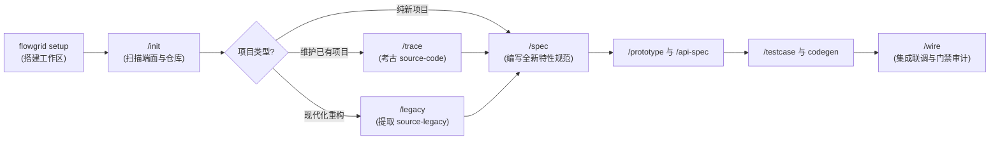

<p align="center">
  <a href="./README.md"><b>English</b></a> |
  <a href="./README.vi.md"><b>Tiếng Việt</b></a> |
  <b>简体中文</b> |
  <a href="./README.ja.md"><b>日本語</b></a>
</p>

<!-- flowgrid-catalog -->
**[文档目录](CATALOG.md)**
<!-- /flowgrid-catalog -->

> [!IMPORTANT]
> 📚 **参考文档：**
> 
> - 📖 **[项目文档 (GitHub)](https://github.com/ShanYuCoder/flowgrid-docs)** — 直接在 GitHub 仓库中查阅详细文档。
> - ⚙️ **工作流目录 [workflows/](https://github.com/ShanYuCoder/flowgrid-docs/tree/main/workflows/)** — 研发各阶段及规范化运作流程。

# FlowGrid

**FlowGrid** 是一个面向人机协同开发、基于 **SSOT（Single Source of Truth，单一真实数据源）** 理念构建的 **CLI + AI Harness** 研发平台，专为与 **AI Agent**（Cursor、Gemini/Antigravity、Claude Code、Codex、OpenCode 等）协作的高效敏捷团队设计。

**AI 赋能人类，而非让人类陷入繁重的手工文档编写**：

```text
原始业务需求（要点笔记 / 设计截图 / 遗留系统代码）
  → AI 规范化生成需求包 (Bundle) + 中间表示 (IR) + 渲染 Markdown
  → 反复制粘贴防护机制（Anti-Copy-Paste Guard）沉淀通用目录 (CMN-*)
  → 交互式原型 (Prototype) + 业务(BA)/测试(QA)/开发(Dev) 多方评审
  → 自动化代码生成：E2E Playwright 测试 / 后端 API / 联调脚手架
```

### 1. AI 驱动的跨职能 T 型团队（T-Shaped Team）
AI 并不是替代开发者，而是作为专业领域的杠杆，拓宽各角色的能力边界（*T-shaped*），消除部门间壁垒与沟通摩擦：
- **开发者（扩展需求分析 BA 能力）：** 利用 AI 进行业务逻辑推演与对抗性质询（`/grill-bqa`），在无需等待产品经理开会的情况下，自主将需求梳理至资深 BA 的 **70–80%** 严谨度。
- **产品/业务人员（扩展前端原型开发能力）：** 在可行性分析初期，直接将业务叙述转化为可交互的前端界面，无需等待研发排期。
- **QA 测试人员（扩展自动化测试能力）：** 从结构化测试用例（`TC-*.yaml`）出发，借助 AI 自动生成工业级 **E2E Playwright** 自动化测试代码，实现从手工测试到自动化专家的平滑转型。

### 2. 早期反馈原型原则 (Early Feedback Prototype)
- **尽早统一交互认知：** 告别漫长低效的静态 UI/UX 评审或在研发完工后才发现理解偏差。AI 直接根据规范生成**真实可点击的交互式原型**（HTML/Vue/React）。
- **与业务干系人锁定界面与流转：** 产品经理与客户可在设计阶段真实点击操作、体验交互流程并即时提供反馈。
- **规避 80% 的返工风险：** 所有逻辑盲点、多余操作与理解误区都在低成本原型阶段彻底解决，杜绝在生产代码编写后推倒重来。

### 3. 闭环质量保证：E2E 自动化测试
- **用例文档直通代码：** 基于测试矩阵文档（`TC-*.yaml`），AI 自动生成对应的 **Playwright E2E** 端到端测试脚本（`*.spec.ts`）。
- **释放回归测试压力：** 彻底终结每次发版前繁琐耗时的人工重复回归，确保系统持续演进时不破坏已有功能。

### 4. 彻底消除重复代码：反复制粘贴守卫 (Anti-Copy-Paste Guard)
- **遏制垃圾代码蔓延：** 在遗留系统维护与重构项目中，代码往往被跨模块大量复制（例如同一个确认弹窗、分页器或导出逻辑在 4–5 个不同地方重复编写）。
- **强制沉淀通用资产：** `/init` 技能自动识别重复逻辑并归集至**通用资产目录**（`CMN-UI-*`, `CMN-API-*`, `CMN-DTO-*`），强制规范收口于 `shared/` 模块，严禁开发人员与 AI 盲目复制粘贴遗留代码。

### 5. 工具保障<span style="color: #0284c7; font-weight: bold;">“数量与完整度”</span> — 人类掌控<span style="color: #16a34a; font-weight: bold;">“质量与深度”</span>
FlowGrid 清晰界定了机器自动化与人类思维的边界：
- **工具保障“数量”（完备性、格式结构与覆盖率）：**
  - 确定性检查脚本（`flowgrid audit *`, `cases:gate`）自动审计文档要素是否齐全、格式是否合规。
  - 从 UI 属性、API 契约、错误码，到 QA 风险台账（`gaps[]`, `confirms[]`），工具精准捕捉所有遗漏项。
- **人类裁定“质量”（准确性、深度与业务合理性）：**
  - **AI 分析并提出建议：** AI 提供架构选型、逻辑方案并主动提问引导。
  - **团队主导质询与终审：** 研发团队（BA、Dev、QA、架构师）拥有最高决策权——通过质询（`grill`）推敲 AI 提案，拍板最佳方案并沉淀为 SSOT。

### 6. 运行准则：标准完备 — 按需裁剪
FlowGrid 提供了完整的端到端生命周期，**但不推崇教条主义的僵化流程**：
- **简单功能 / 范围小 / 风险低：** 团队可主动精简步骤（简写规范、跳过原型、省略 E2E 测试），加快上线迭代。
- **核心模块 / 复杂度高 / 高风险热点：** 面对核心易错业务，必须严格遵循完整生命周期：
  - 模块细化（`/spec`） ➔ 逻辑质询（`/grill`） ➔ 交互原型 ➔ API 契约 ➔ 测试矩阵 ➔ **自动化 E2E 测试**。

---

## 1. CLI 安装

**环境要求：** Node.js **≥ 24**（Linux / macOS / WSL / Git Bash）。

```bash
export FLOWGRID_GITHUB_TOKEN=github_pat_XXXXX
export FLOWGRID_REF=latest

curl -fsSL \
  https://raw.githubusercontent.com/ShanYuCoder/flowgrid-docs/main/scripts/install-from-release.sh \
  | bash -s -- "$FLOWGRID_GITHUB_TOKEN"
```

*指定版本安装（可选）：*
```bash
export FLOWGRID_REF=v0.2.3
```

*卸载工具：*
```bash
flowgrid uninstall
```

---

## 2. 初始化工作区 (`flowgrid setup`)

运行初始化命令创建新工作区或为当前项目注入规范：

```bash
# 创建新工作区目录并初始化脚手架
flowgrid setup my-workspace

# 或在当前目录直接初始化
flowgrid setup
```

CLI 将自动创建标准 Arc42 SSOT 结构：
- **`source-code/`**：主开发源码子模块仓库目录。
- **`source-legacy/`**：遗留考古典籍源码仓库目录（**严格只读 READ-ONLY**）。
- **`registries/`**：组件库、系统能力及设计规范字典（Design Tokens）。
- **`architecture/`**, **`overview/`**, **`surfaces/`**, **`qa/`**：符合 Arc42 标准的 SSOT 文档体系。
- **Harness & MCP config**：同步 AI Agent 技能库与 MCP Server 配置文件。

### 官方基础适配模板

当把代码仓库引入 `source-code/` 时，可参考或 Fork 官方预集成了 FlowGrid 规范的基础模版：

| 角色 | 适配栈 | 参考模版仓库 |
| --- | --- | --- |
| 前端 | `nuxt4` | [base-nuxt4](https://github.com/ShanYuCoder/base-nuxt4) |
| 前端 | `nextjs` | [base-nextjs](https://github.com/ShanYuCoder/base-nextjs) |
| 前端 | `dotnet-line` | [base-line](https://github.com/ShanYuCoder/base-line) |
| 后端 | `nestjs` | *(全栈 Monorepo)* [base-nextjs-nestjs](https://github.com/ShanYuCoder/base-nextjs-nestjs) 或 [base-nuxt4-nestjs](https://github.com/ShanYuCoder/base-nuxt4-nestjs) — API 位于 `server/` / `apps/api` |
| 后端 | `fastapi` | [base-fast-api](https://github.com/ShanYuCoder/base-fast-api) |
| 后端 | `laravel` | [base-laravel](https://github.com/ShanYuCoder/base-laravel) |
| 后端 | `dotnet-integration` | [base-donet](https://github.com/ShanYuCoder/base-donet) |
| 全栈 | `nextjs` + `nestjs` | [base-nextjs-nestjs](https://github.com/ShanYuCoder/base-nextjs-nestjs) |
| 全栈 | `nuxt4` + `nestjs` | [base-nuxt4-nestjs](https://github.com/ShanYuCoder/base-nuxt4-nestjs) |

所有基础模板均开源托管于 GitHub 组织 `ShanYuCoder`。

---

## 3. 与 AI Agent 协同的全流程工作流

在 AI Agent（Cursor, Antigravity, Claude Code 等）中打开工作区，按流程协同：



| 步骤 | 命令 / 技能 | 说明 |
| :--- | :--- | :--- |
| **1. Setup** | `flowgrid setup [name]` | 初始化骨架，配置 MCP 与 Agent 技能。 |
| **2. Discover** | `/init` | 扫描工作区，映射端面，抽取通用组件库（`CMN-*`）并开启反复制代码守卫。 |
| **2.1. 制定计划** | `/help-plan` | 分析 `inition-inventory.md` 与当前现状，为新需求生成分步可落地的执行计划。 |
| **2.2. 训练模版** | `build-template-code` | 学习**黄金样例**（代码最整洁的模块），自动生成符合项目专属架构的代码生成模版。 |
| **3. 代码考古** | `/trace` *(维护)*<br>`/legacy` *(重构)* | • `/trace`：扫描 `source-code` 提炼逆向规范。<br>• `/legacy`：以只读方式阅读 `source-legacy`，提取业务规则与模版迁移至新代码库。 |
| **4. 需求细化** | `/spec`, `/grill-bqa` | 编写细粒度功能规范，对抗性推敲业务逻辑。 |
| **5. 原型与接口** | `/prototype`, `/api-spec` | 生成高保真 HTML 交互原型，敲定 API 契约文档（`01-backend-spec.yaml`）。 |
| **6. 测试保障** | `/testcase`, `testcase:gen` | 构建测试用例矩阵（`TC-*.yaml`），自动生成 E2E Playwright 测试脚本。 |
| **7. 联调集成** | `/wire` | 前端对接真实后端 API，执行规范与代码一致性审计，完成质量门禁。 |

---

## 4. 系统自检

诊断工作区配置与技能运行环境健康状态：

```bash
flowgrid doctor
```
