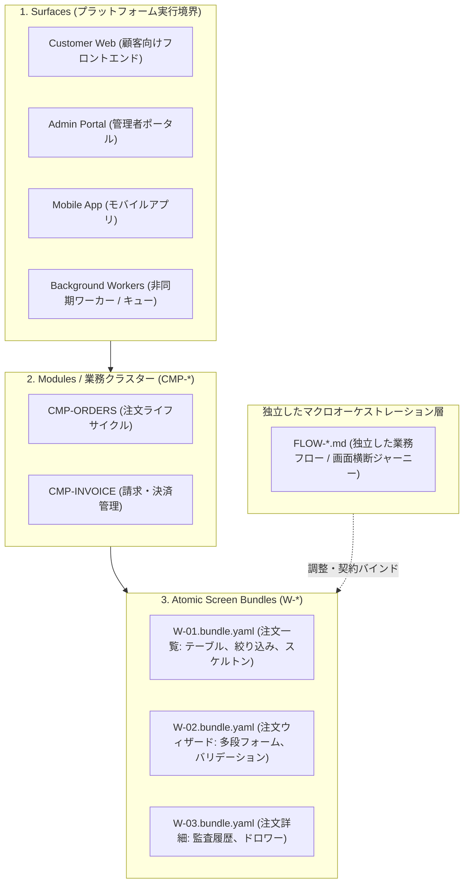
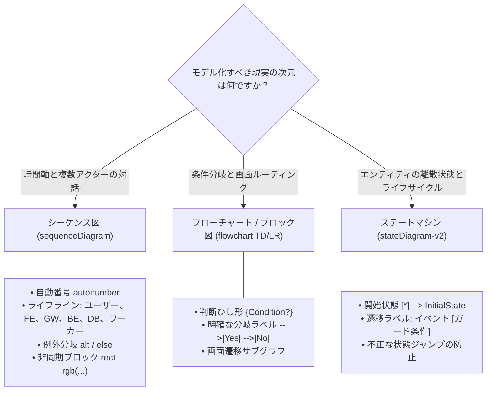

# FlowGrid アーキテクチャの強みと優位性

> **エグゼクティブサマリー:** FlowGrid は、高信頼性が求められるエンタープライズ本番システム向けに設計された AI エンジニアリングおよび SSOT（Single Source of Truth：信頼できる唯一の情報源）プラットフォームです。従来のモノリシック仕様書（Monolithic Spec）アプローチとは異なり、FlowGrid は 3 層構造の疎結合階層、第一級市民としての独立した業務フローオーケストレーション、構造化 DSL によるコード生成、および確定的な静的監査ゲートを強制します。

---

## 1. 3 層構造の疎結合階層 vs. モノリシック仕様書の罠

### モノリシック仕様書（Monolithic Spec）が抱える致命的な欠陥
従来のアジャイル開発や単純なプロンプト駆動のアプローチでは、3〜5 画面、複数のポップアップ、一覧テーブル、API エンドポイント、および権限マトリクスを**単一の巨大なドキュメント**に詰め込む傾向があります。

このやり方は以下のような致命的な構造的欠陥を生み出します：
* **コンテキストの飽和と汚染（Context Saturation & Pollution）：** AI エージェントやエンジニアが画面 A を実装しようとする際、画面 B, C, D を含む数千行の不要な情報を読み込むことで、コンテキストウィンドウが不要なトークンで溢れます。これによりハルシネーション（幻覚）が発生し、要件の抜け落ちや画面間の状態漏洩が引き起こされます。
* **希薄化する業務フロー（User Flow）：** 画面間のデータ受け渡しや業務の流れが、HTML/CSS のタグや生 SQL カラム定義の山に埋もれて見えなくなります。
* **画面と画面の「境界」における仕様の欠落：** 画面遷移の合間に生じる事象（リロード時の状態保持、ディープリンク、同時実行制御、ネットワーク切断）が完全に無視されます。

### FlowGrid の厳格な階層的分離
FlowGrid は、ソフトウェア構造を明確な 3 つの階層に分離します：

1. **Surfaces:** 実行環境およびデプロイの明確な境界（Web、管理者ポータル、モバイル、バックグラウンドサービス）。
2. **Modules (`CMP-*`):** 高凝集な業務ドメインの境界（注文、請求、IAM）。
3. **Atomic Screen Bundles (`W-*.bundle.yaml`):** **単一の画面**に極限までフォーカス。ワイヤーフレーム構造、テーブル列、フォーム項目、および単一画面内の状態（L2 `interactionCases`: 入力検証エラー、モーダル開閉、Loading/Empty/Error 状態）を定義。
4. **Dedicated User Flows (`FLOW-*.md`):** 画面のレイアウト定義を汚染することなく、システム全体の神経系を司る独立したオーケストレーション層。

---

## 2. 独立した業務フロー（`FLOW-*.md`）：マクロオーケストレーションの徹底

FlowGrid は、業務フローを補助的なメモではなく、**最優先の SSOT アーキテクチャ成果物**として扱います。フローは 3 つの階層に分類されます：

* **サーフェス横断フロー（`architecture/03-user-flows/FLOW-*.md`）：** 複数の独立したアクターや実行基盤間で責任が移譲されるジャーニー（例：Web での注文 ➔ 管理者ポータルでの承認 ➔ 決済 Webhook ➔ 倉庫出庫ワーカー）。
* **モジュール内業務フロー（`surfaces/<surface>/<module>/user-flows/FLOW-*.md`）：** Step 1 が発生するモジュールが所有する UI ユーザーフロー（Step 1 オーナーシップ原則：Step 1 がモジュールの帰属を決定する）。

### エンタープライズ 6 セクション標準仕様
すべての FlowGrid User Flow は、以下の 6 セクション構成を遵守する必要があります：
1. **コンテキスト ＆ 業務認可マトリクス:** トリガーイベント、アクター一覧、画面ごとの RBAC/ABAC 権限、職務分掌（Separation of Duties - SoD）の定義。
2. **多階層ユーザーストーリーチェーン:** セットアップストーリー、メインストーリー、追跡ストーリー、および自律的に動作する**システムストーリー（背景処理）**。
3. **業務ルール（`BR-*`）とステートマシン:** 網羅的な業務ルール表と、厳格な Mermaid `stateDiagram-v2` による状態遷移。
4. **ステップ別詳細仕様:** ユーザー操作、フィールドごとのデータ受け渡し契約（Data Handoff）、および非同期ワーカーの再試行・フォールバック規約。
5. **トレーサビリティマトリクス:** ユーザーストーリー ↔ 画面 `[W-*]` ↔ API `[API-*]` ↔ シーケンス図 ↔ 自動テストの 1:1 対応表。
6. **画面横断業務シーケンス図:** `autonumber`、非同期ワーカーブロック `rect rgb(...)`、および例外分岐 `alt / else` を備えた Mermaid `sequenceDiagram`。

---

## 3. 5 大エッジケース盲点（Corner-Case）追跡プロトコル

モノリシック仕様書が本番環境で障害を起こす根本原因は、画面遷移の境界条件を無視することにあります。FlowGrid は**5 つの致命的な盲点**を体系的に排除します：

| 致命的なエッジケース盲点 | モノリシック仕様書の現状 | FlowGrid アーキテクチャの解決策 |
| :--- | :--- | :--- |
| **1. リロード / 戻る操作時の状態消失** | 無視。ステップ 3 で F5 を押すと null ポインタでクラッシュするか、ステップ 1 に戻り入力が全消失。 | **状態永続化契約:** 永続化方針（`URL クエリパラメータ`、`sessionStorage`、`サーバー側下書き ID`）とディープリンク復帰ガードを明記。 |
| **2. 同時更新と競合上書き** | 考慮なし。2 人の管理者が同一レコードを操作した際、後から保存したデータで暗黙に上書き。 | **同時実行制御プロトコル:** 楽観的ロック（`version` / `updated_at`）、冪等性キー（`X-Idempotency-Key`）、および `409 Conflict` 時の自動再取得 UI ハンドラを強制。 |
| **3. 画面間アクター連携と通知の欠落** | プッシュ通知やメールが 100% 届く前提。配信障害時に後続タスクが放置される。 | **永続ワークリストパターン:** 画面間連携の受け取り側には、通知障害に依存しない一覧タスクキュー（Worklist）を必ず構築。 |
| **4. 部分的失敗と Saga トランザクション補償** | 成功系（Happy Path）のみ記述。決済は通ったが在庫引き当てに失敗し、データが不整合に陥る。 | **Saga 補償トランザクション規約:** シーケンス図に `alt / else` を必須とし、自動返金、引当解除、監査ログ出力を定義。 |
| **5. 画面間データ受け渡しの型不整合** | 曖昧な表現（「画面 2 にユーザー情報を渡す」）により、結合時に型エラーが発生。 | **フィールド別 Data Handoff 契約表:** 送信元フィールド、伝送手段、宛先画面プロパティ、およびパラメータ欠落時のフォールバック処理を厳格定義。 |

---

## 4. 厳格なダイアグラム意思決定マトリクス

FlowGrid は、モデリング対象の「本質的な次元」に基づいて図の表記法を選択し、恣意的な作図を排除します：

* **シーケンス図（`sequenceDiagram`）：** $\ge 2$ 個のライフラインが時間軸に沿って対話する場合に必須。API 通信、Webhook、キュー処理に適用。
* **フローチャート（`flowchart TD/LR`）：** 複雑な業務判定ロジック（`IF / ELSE`）、割引計算ルール、画面遷移マップに適用。
* **ステートマシン（`stateDiagram-v2`）：** エンティティの状態遷移（例：注文：`DRAFT ➔ SUBMITTED ➔ PAID / CANCELLED ➔ COMPLETED`）に適用し、DB データの完全性を保護。

---

## 5. 構造化 DSL とマルチスタックコード生成エンジン

FlowGrid は、機械可読な DSL を用いて人間の設計と実装コードを直結します：

* **中間表現（Intermediate Representation `ir/`）：** 要件を構造化された AST として保持するため、AI エージェントがディレクトリ構成やフレームワークの癖を推測する必要がありません。
* **テンプレート生成エンジンの 4 層品質標準（`engines/template-builder/`）：**
  1. *契約不変条件（Contract Invariants）:* 厳格なプロパティ型、初期値、標準レスポンスエンベロープ（`{ data, error, meta }`）を抽出。
  2. *4 大標準 UI 状態（4 Canonical States）:* `Loading`（スケルトン）、`Empty`（アクション付き空表示）、`Error`（再試行アラート）、`Success / Active` をコードに自動埋め込み。
  3. *依存性の注入とスロット分離（IoC & Slots）:* 共通部品（`shared/`）内に業務エンドポイントをハードコードせず、スロット経由で動的注入。
  4. *標準テスト治具（Golden Test Seams）:* テンプレート生成時にテストスタブを同梱し、`testcase:gen` で即座に自動テストを実行可能。
* **マルチスタック対応:** Nuxt, Next.js, NestJS, Laravel, FastAPI, .NET をネイティブサポート。

---

## 6. 確定的な静的メカニカル監査ゲート

LLM の自己評価（ハルシネーションや甘い判定が起きやすい）に頼る一般的なツールとは異なり、FlowGrid は **Node.js による確定的な静的スクリプト監査**を実施します：

* `flowgrid audit flow <path>`: アクターの欠落、データ受け渡し契約の不備、非同期タイムアウトの未処理を自動検出。
* `flowgrid audit spec <path>`: 契約リンクの切断、テスト治具の欠落、未マッピング項目を検査。
* `flowgrid cases:gate`: テストマトリクスのシナリオ網羅率 100% を機械的に検証。

---

## 総合比較マトリクス

| 評価軸 | モノリシック仕様書アプローチ | FlowGrid プラットフォーム |
| :--- | :--- | :--- |
| **アーキテクチャ構造** | 機能ごとに 1 つの巨大ドキュメント | 3 層疎結合（Surfaces ➔ Modules ➔ Atomic Screens） |
| **業務フローの扱い** | 二の次（UI 説明文の間に埋没） | 最重要独立 SSOT 成果物（`FLOW-*.md`）による 3 階層管理 |
| **エッジケース対応** | 属人的で抜け漏れが多発 | 5 大盲点追跡プロトコル（F5、競合ロック、Saga 回戻し） |
| **図の品質** | 曖昧、例外系の欠落 | 数学的次元に基づく意思決定マトリクス（`sequence` 等） |
| **コード生成** | 自由記述プロンプトによる推測 | 構造化 DSL（`ir/`）＋ 4 層品質適合アダプター |
| **品質保証** | 目視による手作業レビュー | CLI による確定的メカニカル監査（`audit flow` 等） |
