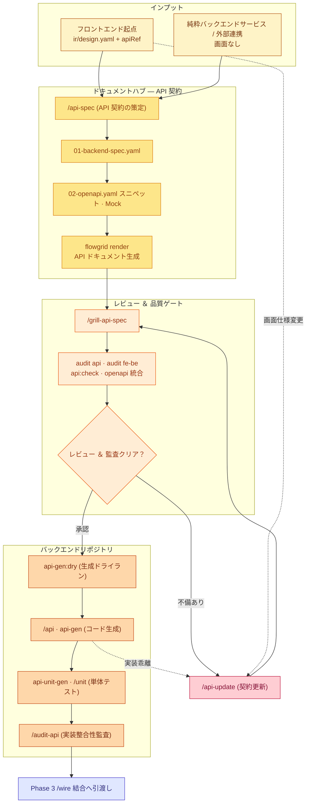

# 開発ワークフロー — Backend バックエンド開発レーン

**SSOT 適用範囲：** **バックエンド開発レーン (Backend Lane)** ——API 契約ファイル（`01-backend-spec.yaml`）、OpenAPI 生成、API レビュー (`/grill-api-spec`)、バックエンドコード生成、単体テスト、およびフロントエンドとの契約整合性監査。

**マクロ構成：** [index.md](./index.md) · Phase 2 実装フェーズ · 実 API 結合：[wire.md](./wire.md)。

---

## 1. バックエンド開発コアサイクル (Phase 2c)

---

## 2. バックエンド開発の標準ステップ

1. **API 契約の策定 (`/api-spec`):**
   - `api/<seq>/01-backend-spec.yaml` にエンドポイント、HTTP メソッド、リクエスト DTO バリデーション、レスポンス構造を定義。
2. **API 契約のレビュー (`/grill-api-spec`):**
   - 未処理の例外ステータス（400/409/422）、アクセス制御脆弱性（IDOR）、インデックス設計、冪等性を精査。
3. **妥当性検証と OpenAPI ドキュメントレンダリング:**
   - `flowgrid api:check` でスキーマを機械検証。
   - `flowgrid openapi_gen` および `flowgrid openapi_render` を実行して Swagger 定義を出力。
4. **バックエンドコードの自動生成 (`flowgrid api-gen`):**
   - 技術スタック（NestJS, Laravel, FastAPI, .NET）に応じた Controller、Service、DTO、ORM 雛形を一括生成。
5. **単体テストコードの生成 (`flowgrid api-unit-gen`):**
   - Pytest, PHPUnit, Vitest などの単体テスト雛形を自動作成。
6. **整合性監査 (`/audit-api` および `flowgrid audit fe-be`):**
   - 実装コードが `01-backend-spec.yaml` と完全に一致していることを確定的に検証。
