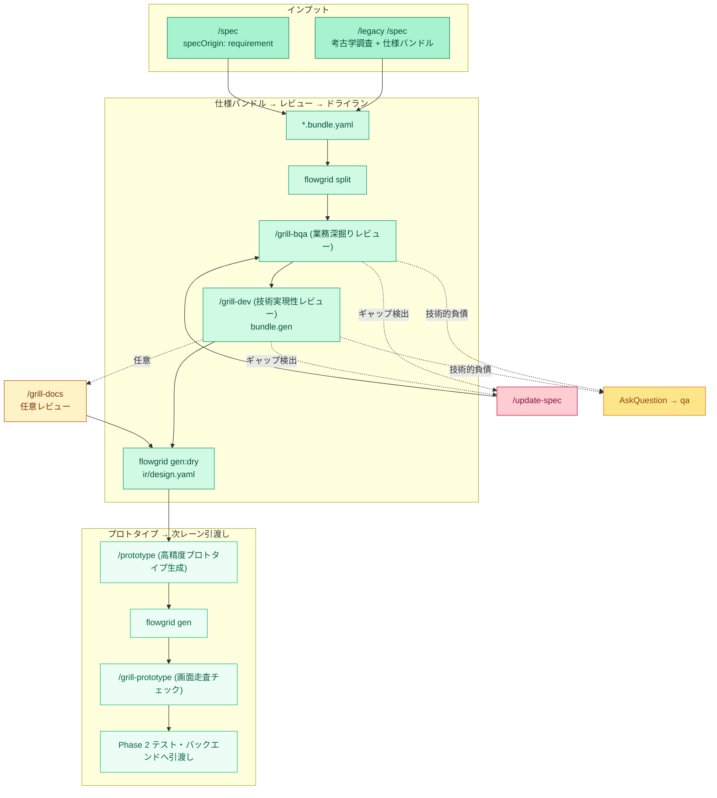

# 開発ワークフロー — Design 設計レーン

**SSOT 適用範囲：** **設計レーン (Design Lane)** のマクロ全体像——要求分析・画面仕様策定から業務レビュー済みプロトタイプ、そしてコード生成ドライラン（Codegen Dry-Run）まで。

**マクロ構成：** [index.md](./index.md) · Phase 0 セットアップ：[phase-0-setup.md](./phase-0-setup.md) · 業務レビュー ＆ 確定：[grill-and-human-review.md](./grill-and-human-review.md)。

---

## 1. 設計フェーズのコアサイクル (Phase 1)

---

## 2. 実践手順一覧

| 番号 | タスク内容 | 担当役割 | スキル / ゲート例 |
| :--- | :--- | :--- | :--- |
| **0b** | ERD 設計（新規エンティティ・テーブル追加時） | アーキテクト / データエンジニア | `/db-erd` → `common/db-erd.md` |
| **1** | スコープ、モジュール、業務フロー分析と API 共通定義 | リード / BA | `/overview`, `/module`（`W-*` 確定）, `/user-flow` |
| **2** | 画面仕様バンドル策定と IR 変換（DB バインド含む） | BA / エンジニア | `/spec`, `/legacy /spec`, ERD 突合, `split` + `render` |
| **3** | 業務的 ＆ 技術的レビュー (Grill) | BA + エンジニア | `/grill-bqa`, `/grill-dev`（バンドル更新ごとに `split` を再実行） |
| **4** | コード生成準備完了の検証（Dry-run） | エンジニア | `ir/design.yaml` に対し `flowgrid gen:dry` を実行 |
| **5** | UI プロトタイプ作成（Mock API）と共通部品登録 | フロントエンド | `flowgrid gen` ➔ `/prototype` ➔ レジストリ検証 |
| **6** | プロトタイプ UI チェックリスト走査 | フロントエンド / BA | `/prototype` 完了後に `/grill-prototype` を実施 |

---

## 3. 設計レーンにおけるレビューの重点項目

- **業務ロジックの深さ：** 5 段階バリデーション、楽観的ロックバージョン、HTTP ステータスマトリクス（409 競合、422 不正、403 権限エラー）、API 再利用戦略。
- **動的プロトタイプでの検証：** 4 大 UI 状態（Loading、Empty、Error、Success）の完全モック、長文テキスト折り返し、ページネーション、早期の `data-testid` 付与。
- **コンフリクトゼロの API 設計：** 共通 API は LCA 配下の `common/yaml/` に一元配置し、個別画面からは `#reuse-api` で参照のみ行うことで、複数人並行開発時の Git コンフリクトを 100% 回避。
