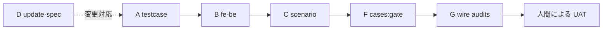
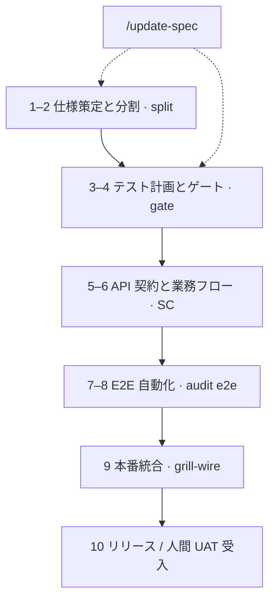

# 品質ゲートと完了判定マイルストーン (Quality Gates)

**SSOT 対象範囲：** `flowgrid audit *` および `cases:gate` を**いつ**実行すべきかの定義、安全なフェーズ移行の制御、および成果物の完全性チェーン（Bundle ↔ TC ↔ フロント・バックエンド契約 ↔ 業務シナリオ）の維持。

**本ドキュメントの対象外：** コマンドオプションの詳細リファレンス → [references/cli-and-commands.md](../references/cli-and-commands.md#監査および-harness-pr-自動化ワークフロー)。

**コンテキスト：** [index.md](./index.md#full-cycle) · 人間による対話型レビュー：[grill-and-human-review.md](./grill-and-human-review.md) · 設計リーフの承認：[design-leaf-signoff.md](./design-leaf-signoff.md) · 連携とリリース：[wire.md](./wire.md)。

---

## ゲート実行のタイミング (レーン別) {#when-to-run}

| マイルストーン | 推奨コマンド / スキル | 結果のレビュー責任者 |
|---|---|---|
| `/spec`, `/update-spec` 完了後 | `flowgrid audit spec` (`--type`) | BA / 開発レビュー担当 |
| API 契約レビュー時 (Docs) | `/grill-api-spec` · `audit api` | バックエンド開発 + BA |
| 統合連携前のバックエンド検証 | `/audit-api` · `audit api` | バックエンド開発 |
| テストケース設計の完了前 | `cases:check`, `audit testcase` (+ `--bundle`) | QA エンジニア |
| テストハブのリリースゲート | `cases:gate` (`--strict`, `--docs-root`) | QA + `/grill-testcase` |
| 統合前の E2E 自動検証 | スコープ付き `test:e2e` · `audit e2e` | フロントエンド開発 + QA |
| **`/wire` 統合完了後** | **`/grill-wire`** または `audit e2e` + `audit fe-be` + `audit scenario` | フロントエンド開発 + QA |
| PO とのテストマトリクス整合 | `/test` グリーン通過後の `/grill-test` | QA / フロントエンド開発 |
| レガシー資産の移行状況監査 | `audit legacy` | テックリード |
| **リーフノードのマージ / UAT 受入前** | [§ 機能ノードのクローズ手順](#close-one-function) ステップ 1–10 · 人間によるサインオフ | リード / PM / QA |

ツールチェーンがゲートを**暗黙的に自動実行することはありません** —— チームメンバーが適切な節目で自発的にコマンドを呼び出します。ステップをスキップするとプロセス上のリスクが蓄積します（詳細は [grill-and-human-review.md](./grill-and-human-review.md) を参照）。

---

## 標準デリバリーサイクルのリファレンスフロー

### 新機能 / 新画面の作成フロー

```text
/spec → audit spec → grill-bqa / grill-dev → split (バンドル修正やレビュー毎に再実行)
→ /testcase (バンドル SSOT, Schema v2, トレーサビリティ準拠) — レビュー第 1 弾後に並行開始可
→ cases:gate [--strict] + FLOWGRID_DOCS_ROOT
→ testcase:gen → Playwright (e2e-root)
→ (チーム方針) リリース前の人間による探索的 E2E ウォークスルー
```

### 仕様変更リクエスト (Change Request - CR)

```text
/update-spec → audit spec (スキル内で自動強制) → split
→ UX やコード生成設定が変更された場合は grill-bqa / grill-dev を再実行
→ 影響を受ける W-* の TC を更新 / バンドル影響範囲の再評価
→ cases:gate --strict
→ /grill-testcase (ゲート出力結果の確認)
→ コード生成 + テスト修正 + 手動ウォークスルー
→ すでに統合済みの場合は、TC/仕様修正後に `/grill-wire` を再実行
```

### 統合後の仕様乖離への対応

```text
UAT や検証環境で受入基準 (AC) との実装差異が発覚
→ Docs で /update-spec (または /api-update) を実行 —— フロントエンドコードのみでの独断修正は禁止
→ split/render 再実行 → シナリオマトリクスが変化した場合は /grill-testcase を実行
→ フロントエンドで /wire または /test 実行 → /grill-wire で収束を確認
→ 人間によるリーフ承認 (ステップ 10)
```

---

## SSOT 成果物完全性チェーン {#ssot-chain}

テストケース作成方針：`/testcase` は **`*.bundle.yaml`** を直接参照します。バンドルが存在しないか `flowgrid check` で差分が検出された場合は直ちに作業を停止し、Docs 側で Split を実行して同期します。

| フェーズ | 実装エンジン / スキル | 目的・検証内容 |
|---|---|---|
| **A** | `audit testcase --bundle` | シナリオ / AC / ユーザー操作 ↔ TC の 100% 追跡性 |
| **B** | `audit fe-be` + grill-dev | `apiRef` ↔ `01-backend-spec` の API 契約一致性 |
| **C** | `audit scenario` + `/scenario` | `FLOW` / SC 内の `screens[]` ↔ `cases/**` の網羅率 |
| **D** | `/update-spec` 規約 | 差分設計 ↔ `userStories` / AC の同期確認 |
| **F** | `cases:gate`, TC schema v2 | テストハブ公開時の厳格な品質ブロック |
| **G** | `/wire` + `/grill-wire` | 統合後の `audit e2e` + `fe-be` + `scenario`；計画 ↔ 実 API の整合 |
| **E** | *(DevOps 任意自動化)* | CI パイプラインでの `check`, `cases:gate`, `doctor`, スコープ付き `audit e2e` |



---

## 10 ステップ機能クローズの全体像 {#close-leaf-overview}



---

## 単一機能ノード (`W-*`) のクローズチェックリスト {#close-one-function}

単一の**リーフノード**（画面または API シーケンス）を成果物として完成とみなす前に推奨される検証項目：

| # | マイルストーン | コマンド / スキル | 検証・レビュー基準 |
|---|---|---|---|
| 1 | 仕様と業務レビュー | `flowgrid audit spec` (`--type`) · `/grill-bqa` · `/grill-dev` | `gaps[]` / confirms の確認、関係者との合意形成 |
| 2 | 中間データ (IR) 同期 | `flowgrid split` · `flowgrid check` | テストやコード生成の前に Bundle ↔ `ir/*` を同期 |
| 3 | テスト計画の立案 | `/testcase` · `/grill-testcase` | `cases:check` · `audit testcase --bundle` エラーゼロ |
| 4 | テスト品質ゲート | `cases:gate --strict` + `FLOWGRID_DOCS_ROOT` | Schema v2 準拠、100% のトレーサビリティと観点マトリクス |
| 5 | バックエンド契約整合 | `audit api` · `audit fe-be` | `apiRef` ↔ `01-backend-spec.yaml` の完全一致 |
| 6 | 画面横断フロー (SC 対象時) | `audit scenario` | `screens[]` 全画面が `TC-*.yaml` または `QA-*` でカバーされていること |
| 7 | E2E 自動化実装 | `testcase:gen` · `/test` · `/grill-test` | TC マトリクス ↔ PO 受入 ↔ `*.spec.ts` の整合 |
| 8 | 計画と実装の突合 | `flowgrid audit e2e` (`--e2e-root`, `--tests-docs`) | テスト計画ハブと実際の Playwright スイートの一致 |
| 9 | 本番 API 統合連携 | `/wire` · 統合後のスコープ内 E2E | `/grill-wire` または `audit e2e` · `audit fe-be` · `audit scenario` |
| 10 | リリース / UAT 承認 | バンドル受入基準 (AC) に基づく手動受入確認 | **人間**による要件充足の最終確認。新要件発生時はステップ 10 **前**に `/update-spec` を実行 |

> **監査合格 ≠ リリース可能：** 致命的ギャップがゼロの JSON 監査結果が出ても、PM/QA による正式な UAT サインオフの代替にはなりません。

---

## 監査コマンドと成果物の対応マトリクス

| コマンド | 主な検証対象 |
|---|---|
| `audit spec` | バンドルの完全性と UX アフォーダンス (`UX_*`, `confirms`) |
| `audit api` | バックエンド API YAML 契約の妥当性 |
| `audit testcase` | TC v2 スキーマ検証および `--bundle` とのクロスリファレンス |
| `audit fe-be` | バンドルの `apiRef` とバックエンド仕様の一致性 |
| `audit scenario` | SC 業務フロー内の画面とテストケースの網羅状況 |
| `audit flow` | `FLOW-*.md` 業務ジャーニーの整合性 |
| `audit e2e` | tests-docs の `TC-*.yaml` ↔ Playwright テストコード |
| `audit legacy` | レガシー資産の再利用指数 |
| `cases:gate` | スキーマ + TC 監査 + バンドル追跡 + マトリクス観点の統合検証 |
