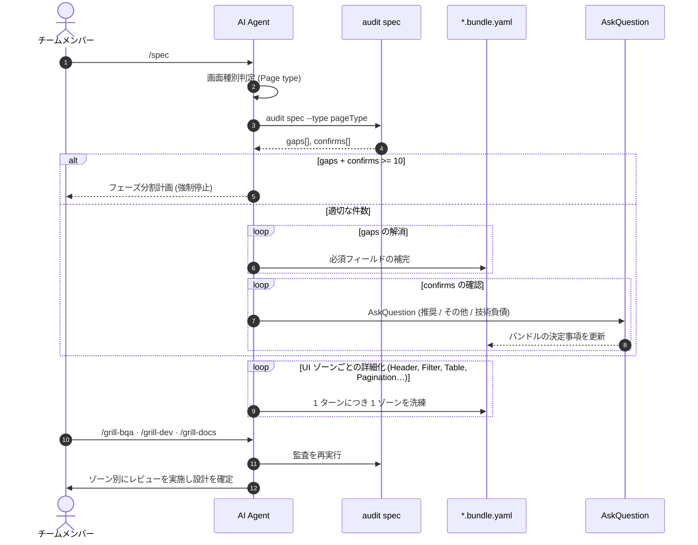
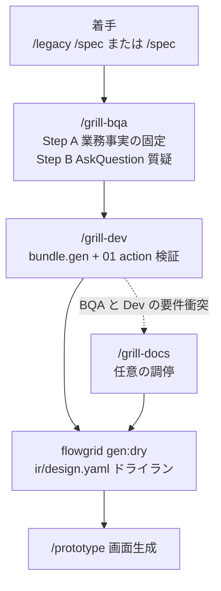
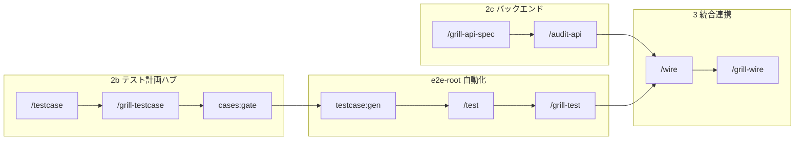

# 業務レビュー (Grill)・人間の責務と意思決定

**SSOT 対象範囲：** チームメンバーによる**レビュー・質疑応答（Grilling）・最終意思決定**；AI はプロダクトオーナー (PO) の役割を代行しません；**定性的レビュー**（ドメインロジックの深掘り）と**定量的自動監査**（決定論的スクリプトによる `gaps[]` / `confirms[]` の検出）の明確な分離。

**本ドキュメントの対象外：** CLI 監査コマンドの引数一覧 → [references/cli-and-commands.md](../references/cli-and-commands.md#監査および-harness-pr-自動化ワークフロー) · QA タグの分類規則 → [artifacts/index.md](../artifacts/index.md)。

**関連レーン：** [design.md](./design.md) · [backend.md](./backend.md) · [test.md](./test.md) · [wire.md](./wire.md) · ゲートマイルストーン：[gates.md](./gates.md#close-one-function)。

---

## 根底にある基本思想

**ツールチェーンは SSOT、スキル、決定論的監査、および標準エラーコードを提供する —— チームメンバー（人間）はワークフローを誠実に実行し、ギャップを解釈して最終決定を下す。**

AI は YAML や中間データ (IR) の**標準化**を担い、人間は Markdown 仕様書や画面プロトタイプの**妥当性検証**を担います。メンバーがレビューや監査をスキップしたり、形式的にゲートを通過させたりした場合、ツールチェーンが欠陥ゼロを保証することは**絶対にありません**。

| ツールチェーンの役割 (製品機能) | チームの役割 (人間のプロセス) |
|---|---|
| スキル `/spec`, `/update-spec`, `/testcase`, `flowgrid audit *`, `cases:gate`, `testcase:gen` の提供 | 適切なフェーズでスキルを実行し、JSON ギャップ出力を精読して業務仕様を深く質疑する |
| AskQuestion 選択ダイアログと `qa` 課題管理 | 「推奨案 / 別案 / **技術的負債として記録**」の意思決定 · チーム運用：[qa-team.md](./qa-team.md) |
| `/update-spec` とスキル内の自動再監査 | 要件変更時に `TC-*.yaml` を再同期し、探索的 E2E ウォークスルーを実施する |

| 典型的なプロセスの破綻シナリオ | 主たる説明責任者 |
|---|---|
| スキルが求めている監査や質疑応答をスキップした | 担当エンジニア ＋ テックリード |
| `/update-spec` 実行後にテストケースや追跡性の同期を怠った | 変更の発行者 ＋ QA |
| Playwright のテストマトリクスが形骸化し、正常系のみになっている | テスト作成者 ＋ `/grill-test` レビュー担当 |
| 実 API 連携後に `/grill-wire` の実行を怠った | フロントエンド ＋ QA（`FEBE_*` の契約不整合が流出） |
| UAT で問題が出たが「自動監査が通っているから」と強行マージした | PM / リード —— 自動監査は人間の受入判定の代替にはならない |
| スキップされた手順が原因で本番バグが発生した | 開発プロセス全体の課題 —— ツールは自動でバグをゼロにはできない |

---

## 定量的スクリプト vs 定性的 Agent レビュー

```text
       SPEC / TC / API 業務要件
                  │
        ┌─────────┴─────────┐
        ▼                   ▼
   決定論的自動監査        AI AGENT 業務レビュー
   gaps[] · confirms[]    ドメイン論理、UI ゾーン分割、
   UX_* · FEBE_* 契約     UI ↔ API ↔ TC のクロス整合性
```

| 監査出力 | 対処アクションと担当 |
|---|---|
| `gaps[]` (必須欠落項目) | Agent がバンドル/YAML を補完（またはエンジニアが指針を提示） |
| `confirms[]` (確認推奨項目) | **AskQuestion** ダイアログで質問ごとに確認 —— 3 つ以上の選択肢（**技術負債として記録** を含む） |
| `gaps[]` + `confirms[]` **≥ 10** | **強制停止 (Hard Stop)** —— フェーズ分割計画（各回 3〜5 項目）を策定し、チャットの氾濫を防止 |

`flowgrid audit spec` 実行前に画面種別を判定します：`gen.codegen.profile` の読込またはプロンプトからの推論 —— 必ず `--type` を渡します。

| プロンプトのキーワード | 推論される `pageType` |
|---|---|
| list, table, index, grid, 一覧, 検索 | `list` |
| create, new, form, input, 新規作成, 登録フォーム | `create` |
| detail, view, inspect, 詳細, 閲覧 | `detail` |
| login, auth, signin, ログイン, 認証 | `auth` |
| CRUD, entity management, マスタ管理 | `admin-crud` |

---

## `/spec` 業務質疑応答シーケンス (ゾーン分割)



### ゾーン単位の分析 (コンテキスト消失防止)

大規模で複雑な画面の場合：**1 つのプロンプトですべてを一度に設計してはなりません** —— 必ず **ゾーン (Zone)** に分解します（一覧画面の例：Header 領域 → 検索・絞り込みツールバー → データテーブル → ページネーション・空状態表示）。

---

## 設計レビューチェーン (BQA → Dev → Dry → Prototype) {#design-grill-chain}



**未決事項の扱い：** バンドルや YAML の `openQuestions` に未解決の質問を残してはなりません。AskQuestion でその場で確定させるか、即答できない場合は `qa/<SHORT>_NNNN.yaml` に起票し、`/qa-resolve` で追跡します。

---

## ロール別レビュー機能の概要

| スキル | 主なレビュー観点 |
|---|---|
| `/grill-bqa` | ドメインロジック、バリデーション、ユーザーストーリー、UX アフォーダンス |
| `/grill-dev` | `bundle.gen`、操作イベント、`#gen:*`、`#needs-component`、IR 分割整合 |
| `/grill-docs` | BQA のビジネス要件と Dev の技術的要件の衝突を調停 |
| `/grill-prototype` | UI の再現度、モック境界、`data-testid` の付与状況 |
| `/grill-api-spec` | ドキュメントハブ上の API YAML 契約の妥当性 |
| `/audit-api` | 統合前にバックエンド実装コードと `01` 契約の一致を検証 |
| `/grill-test` | Spec ↔ TC ↔ Playwright の観点マトリクスの一致確認 |
| `/grill-wire` | 統合後の監査チェーン：`audit e2e` + `fe-be` + `scenario` |
| `/grill-testcase` | tests-docs の YAML 計画の検証（仕様漏れを Docs にフィードバック） |

---

## 設計以降のレビュー連鎖 (テスト · API · 統合) {#post-design-grill}



| フェーズ | 定性レビュー (Grill) | 定量監査 (Audit) | 人間の意思決定ゲート |
|---|---|---|---|
| **計画** | `/grill-testcase` — AC とマトリクス網羅率 | `cases:gate`, `audit testcase --bundle` | QA：正常系だけでなく全業務例外が網羅されているか |
| **自動化** | `/grill-test` — PO 構造と testId の堅牢性 | `audit e2e` | Dev + QA：脆弱なセレクタがなく仕様通りか |
| **契約** | `/grill-api-spec` | `audit api`, `audit fe-be` | BE + Dev：正確なフィールド型と HTTP ステータス |
| **統合** | HANDOFF の `#wire-only` 検証 | `/grill-wire` フルチェーン | 認証バイパスやモックの残存を絶対にリリースしない |

---

## 人間のサインオフ vs 自動監査の合格 {#human-signoff}

| 観点 | 自動監査 / 品質ゲート (ツール) | 人間のサインオフ (チーム) |
|---|---|---|
| **本質的な問い** | 成果物は SSOT スキーマに合致しているか？ | 顧客や PO が実際の挙動に満足しているか？ |
| **出力結果** | `gaps[]`、終了コード 0 | UAT 受入確認書、マージ承認、リリース合意 |
| **担当責任者** | Agent ＋ JSON を解析する Dev/QA | PM、BQA、エンジニアリングリード |
| **実行時期** | 監査を要する各スキルの実行直後 | **マイルストーン 10**（リーフクローズ直前） |

**スクリプトが合格しても人間が UAT を承認していない場合** → マイルストーン 10 で必ず**停止状態を維持**してください。ツールの合格結果をそのままリリースの最終保証と誤認してはなりません。
