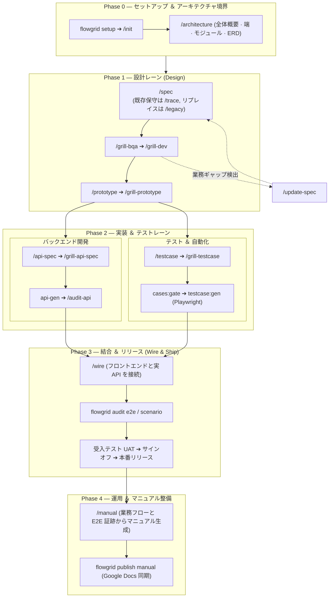

# 開発ワークフロー全体像 (Workflows Overview)

本文書は、[Phase 0 セットアップ](./phase-0-setup.md) から [Wire 統合連携](./wire.md)、そして最終リリース承認に至るソフトウェア開発のライフサイクル全体を体系的に解説します：

- **プロジェクト初期化 ＆ 環境構築 (Phase 0):** Greenfield（新規）、Maintain（保守）、Rebase（リプレイス）の 3 つのシナリオ別手順は [Phase 0 — セットアップ](./phase-0-setup.md) を参照。
- **機能完了判定チェックリスト (`W-*`):** [gates § 単一機能の完了](./gates.md#close-one-function)（**10 のマイルストーン**、ステップ 10 = UAT/リリース）——業務レビューおよび品質監査における公式基準。
- **業務レビュー (Grill) vs 監査 (Audit)、ゾーン分割分析：** [grill-and-human-review.md](./grill-and-human-review.md)。
- **フェーズ別専門レーン：** [Design 設計](./design.md) ➔ [Backend バックエンド](./backend.md) ➔ [Test テスト](./test.md) ➔ [Wire 統合連携](./wire.md)。

---

## 1. エンドツーエンド機能開発ライフサイクル

すべての機能仕様または画面（`W-*` リーフノード）は、標準化された 4 段階のフェーズを経て本番リリースされます：

| 開発フェーズ | 中核となる関心事 | 主な責任者 | 詳細ガイド |
| :--- | :--- | :--- | :--- |
| **Phase 0: セットアップ ＆ 境界画定** | リポジトリ構造生成、Surfaces マッピング、システム基盤設計、モジュール境界 | テックリード / アーキテクト | [Phase 0 セットアップ](./phase-0-setup.md) · [アーキテクチャ設計](./architecture-data.md) |
| **Phase 1: 設計レーン (Design)** | 単一画面仕様策定、徹底的な業務レビュー (Grill)、対話型プロトタイプ検証 | BA / フロントエンドエンジニア | [Design 設計](./design.md) |
| **Phase 2: 実装 ＆ テストレーン** | バックエンド API 契約の確定、テストシナリオ作成、E2E 自動化コード生成 | バックエンドエンジニア / QA | [Backend](./backend.md) · [Test](./test.md) |
| **Phase 3: 結合 ＆ リリース (Wire)** | フロントエンドと実 API の結合、回帰 E2E テスト実行、UAT 承認サインオフ | フロントエンド / QA / PO | [Wire 統合連携](./wire.md) · [Gates](./gates.md) |
| **Phase 4: 運用 ＆ ドキュメント** | ユーザー操作マニュアルの自動生成、ヘルプセンター連携 | BA / カスタマーサポート | [マニュアル生成](./build-user-manual.md) |

---

## 2. フェーズ別実行要点

### Phase 0: セットアップ ＆ 境界画定
- **骨格生成：** `flowgrid setup [name]` を実行し、SSOT 構造（`source-code/`, `source-legacy/`, `registries/`, Arc42 設計書）を展開。
- **構成スキャン：** スキル `/init` でリポジトリを検出、Surfaces をマッピングし `platform-repos.local.json` を初期化。
- **アーキテクチャ定義：** 画面仕様の作成前に、`/architecture`, `/overview`, `/surfaces`, `/module`, `/db-erd` を用いてシステムの技術境界を確定。

### Phase 1: 設計レーン (Design)
- **仕様策定：**
  - *新規開発 (Greenfield):* `/spec` で完全な仕様バンドル（`<slug>.bundle.yaml`, `ir/design.yaml`, `ir/spec.yaml`）を記述。
  - *既存保守 (Maintain):* `/trace` で `source-code/` 配下の既存実装と暗黙知を調査。
  - *リプレイス (Rebase):* `/legacy` で `source-legacy/` から読み取り専用でロジックを抽出。
- **徹底的な業務レビュー (Grill):** `/grill-bqa`（業務の深掘り）と `/grill-dev`（技術的実現可能性）を実施。
- **対話型プロトタイプ：** `/prototype` で動く画面モックを生成し、コーディング前にステークホルダーと UX を検証。

### Phase 2: 実装 ＆ テストレーン (Backend & Test)
- **バックエンド API：**
  - `/api-spec` で `api/<seq>/01-backend-spec.yaml` に API 契約を定義。
  - `/grill-api-spec` で契約をレビューし、`api-gen` で雛形を生成、`/audit-api` で検証。
- **テスト自動化：**
  - QA が `/testcase`, `/scenario`, `/grill-testcase` を用いてテストシナリオを策定。
  - `cases:gate` で網羅性を検証後、`testcase:gen` で Playwright E2E 自動テストコードを生成。

### Phase 3: 結合 ＆ リリース (Wire & Ship)
- **実 API 結合 (Wire):** フロントエンドエンジニアが `/wire` を実行し、UI を本物の API に接続。
- **回帰テスト監査：** Playwright E2E を実行し、`flowgrid audit e2e` で仕様と実装の完全一致を検証。
- **UAT 承認とリリース：** 受入テストを実施して品質基準を満たしていることを確認し、画面をクローズ。

---

## 3. T 型チームの役割分担マトリクス

役割は肩書ではなく、**担当する成果物（Artifacts）** に基づいて定義されます：

| 役割 | 主な担当範囲 | 中核成果物 (Artifacts) | 推奨スキル ＆ コマンド |
| :--- | :--- | :--- | :--- |
| **アーキテクト / リード** | システム全体設計、モジュール境界、デプロイ構成 | `overview/`, `architecture/`, `FLOW-*` | `/architecture`, `/overview`, `/surfaces`, `/module`, `/db-erd` |
| **ビジネスアナリスト (BA)** | 業務要件、受入基準、未決事項の明確化 | 画面仕様バンドル、動的プロトタイプ | `/spec`, `/grill-bqa`, `/prototype` |
| **ソフトウェアエンジニア (Dev)** | 画面技術設計、API 契約、本番コード | `ir/design.yaml`, `01-backend-spec.yaml`, 本番コード | `/spec`, `/grill-dev`, `/api-spec`, `/api`, `/wire` |
| **QA / テストエンジニア** | テストマトリクス、テストケース、E2E 自動化 | `TC-*.yaml`, Playwright E2E (`*.spec.ts`) | `/testcase`, `/scenario`, `testcase:gen`, `/test` |
