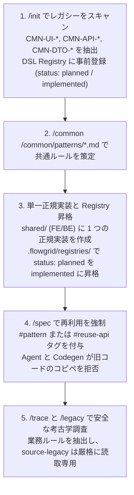
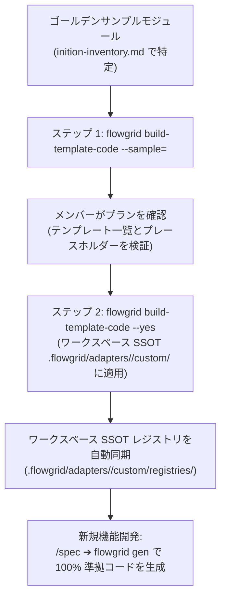

# Phase 0 — セットアップ ＆ プロジェクト初期構築

本文書は、`flowgrid setup` コマンドを用いた環境初期化（Phase 0）の具体的手順と、**3 つの典型的な実戦開発シナリオ**における標準プロセスを解説します：
1. **Greenfield（完全新規開発）：** ゼロから新しいプロダクトを立ち上げる場合。
2. **Maintain（既存保守改修）：** 既存コードベースを継続的に開発・保守する場合。
3. **Rebase / Modernization（システム刷新・リプレイス）：** レガシーシステムを刷新し新技術へ移行する場合。

---

## Phase 0 意思決定フローチャート

```mermaid
flowchart TD
  START(["開始: flowgrid setup [workspace]"]) --> CHOICE{"プロジェクトの種別？"}

  %% 分岐 1: Greenfield
  CHOICE -->|1. Greenfield<br/>(完全新規プロダクト)| GF_DOCS["ビジョン、アーキテクチャ記述<br/>Surfaces 構成を定義"]
  GF_DOCS --> GF_REPO["source-code/ 配下に<br/>新規リポジトリを作成"]
  GF_REPO --> GF_INIT["/init を実行<br/>(リポジトリと端をマッピング)"]
  GF_INIT --> NEXT_PHASE

  %% 分岐 2: Maintain
  CHOICE -->|2. Maintain<br/>(既存コード保守)| MT_REPO["既存リポジトリを<br/>source-code/ 配下に配置"]
  MT_REPO --> MT_INIT["/init を実行<br/>(構成スキャン ＆ 認識)"]
  MT_INIT --> MT_NEXT["設計フェーズへ進む:<br/>/trace で既存コードを調査"]
  MT_NEXT --> NEXT_PHASE

  %% 分岐 3: Rebase
  CHOICE -->|3. Rebase<br/>(システム刷新・移行)| RB_LEGACY["旧コードを source-legacy/ 配下に配置<br/>(厳格に読取専用 READ-ONLY)"]
  RB_LEGACY --> RB_EXTRACT["/extract-legacy を実行<br/>(レガシーモジュールを抽出)"]
  RB_EXTRACT --> RB_NEW["source-code/ 配下に<br/>新技術スタックのリポジトリを作成"]
  RB_NEW --> RB_INIT["/init を実行<br/>(新環境を設定)"]
  RB_INIT --> RB_NEXT["設計フェーズへ進む:<br/>/legacy で仕様を復元"]
  RB_NEXT --> NEXT_PHASE

  NEXT_PHASE(["機能開発ライフサイクルへ移行:<br/>Design ➔ Codegen ➔ Test ➔ Wire"])
```

---

## 3 大シナリオ別実践ガイド

### 1. Greenfield シナリオ（新規プロジェクト）
- **ステップ 1：ワークスペース骨格の生成**
  ```bash
  flowgrid setup my-project [--mode=base|custom]
  ```
  CLI は 2 つの生成モードをサポートしています：
  - `base`（デフォルト）：完全な骨格設計に加え、標準サンプル共通部品（`surfaces/common`, `03-user-flows/FLOW-login.md`）を自動展開。
  - `custom`：純粋な SSOT ディレクトリ構造のみを構築し、サンプルの共通ファイルは注入しません。
- **ステップ 2：基本方針の定義**
  - `overview/index.md` にプロダクトの目的、ターゲット層、リリース目標を記述。
  - `architecture/` 配下にシステム構造（Arc42 規約、技術制約、ERD）を定義。
  - `surfaces/` 配下に画面サーフェス一覧（管理画面、ポータル、モバイル等）を定義。
- **ステップ 3：リポジトリの作成**
  - `source-code/` 配下にソースコードリポジトリを作成またはクローン。
- **ステップ 4：スキル `/init` の実行**
  - `/init` を実行して技術スタックを自動認識し、`platform-repos.local.json` を生成。

### 2. Maintain シナリオ（既存リポジトリの継続保守）
- 既存のリポジトリを `source-code/` 配下に配置。
- `/init` を実行して構成をスキャンし、FlowGrid と既存プロジェクトを紐付け。
- 新機能の開発時は、`/spec` 実行時に `/trace` スキルを併用して `source-code/` 内の実装や暗黙のルールを対照確認。

### 3. Rebase シナリオ（システム刷新・リプレイス）
- **反コピペ保護：** レガシーシステムの旧コードを `source-legacy/` 配下に配置（**厳格に読取専用**。直接の編集や無秩序なコピペは厳禁）。
- `/extract-legacy` を実行し、旧システムの業務ロジックを抽出。
- `source-code/` 配下に新しいモダンスタックの新規リポジトリを用意。
- Phase 1 の設計時に `/legacy` スキルを活用し、安全に業務ルールを新システムへ移植・モデリング。
---

## 4. スキル連携体系と反コピペ保護機能（Anti-Copy-Paste Guard）

保守または刷新プロジェクトにおいて最も深刻な問題の一つは、**モジュール間における重複したコピー＆ペーストコードの蔓延**です（例: 同一の確認ダイアログ、ページネーションテーブル、または Excel エクスポートロジックが 4〜5 箇所のコントローラー/ビューに重複して実装されている）。

FlowGrid は Phase 0 の段階から、コード重複を根絶するためのクローズドループスキル群を提供します：



### 反重複スキルの詳細役割：

1. **スキル `/init`（スキャン、共通分類、配置検出 ＆ DSL Registry 事前登録）**：
   - Common Discovery モードでは、Agent はコントローラー、サービス、ルーター、ビューを精査して 2 箇所以上に現れる重複ロジックをスキャンし、**2 つの異なるカテゴリ**に分類します：
     - **カテゴリ 1 — 既存の Common（base/shared に実装済み）：** 共有ライブラリ内に既に存在するコンポーネント/サービス（例: `ConfirmModal.vue`, `BaseServiceImpl.php`）。これらに対して**コード再生成は計画しません**。SSOT 仕様書（`<LCA>/common/patterns/<CMN-ID>.md`）のみを作成し、DSL Registry（`design.registry.json` または `be-capabilities.registry.json`）に `status: "implemented"` で登録します。
     - **カテゴリ 2 — 重複候補（複数箇所でコピー＆ペースト）：** 共通コンポーネントが存在せず 2 箇所以上で重複しているロジック/UI。これらは**アクションプラン（`common-plan.md`）の策定が必須**であり、完全な配置チェック（対象 Repo、対象コードパス、対象 Docs パス）を行って `shared/` 配下に 1 つの正規実装を生成し、**新規機能および今後の更新で利用**します。**重複が見つかった既存の旧コードの修正・リファクタリングは厳禁** — ここからの重複発生を防止し、稼働中コードのリグレッションを回避します。
   - **DSL Registry への事前登録 (`status: "planned"`)：** `/init` は重複候補をワークスペース SSOT レジストリ（`design.registry.json` / `be-capabilities.registry.json`）に `status: "planned"` および標準タグ（`#pattern: <CMN-ID>`, `#reuse-api: <CMN-ID>`）で直接事前登録します。これにより、`/spec` で新規画面を開発する際に即座に共通コンポーネントを参照可能となり、アドホックな臨時コンポーネント（`#needs-component`）の重複作成を防止します。
   - **配置位置の特定（Target Placement Check）：** 大規模またはマルチリポジトリ構成の場合、Agent は `.flowgrid/config.json` の `projects` と照合し、各候補に対して 3 つの座標を割り当てます：
     1. *所属 Surface と対象 Repo:* 保存先リポジトリ（例: `admin-fe`, `booking-portal`, `core-api`）。
     2. *対象コードパス:* 生成予定の具体的なソースコードパス（例: `source-code/admin-fe/src/components/Common/ConfirmModal.vue`）。
     3. *対象 Docs パス (LCA):* Docs Hub 内の Markdown 仕様書パス（`surfaces/admin/common/patterns/CMN-UI-001.md`）。
   - **全画面重複警告（Whole Page Duplication Warnings）：** 2 つの画面ファイルが 90〜95% 同一である場合（例: `CreateUser.vue` と `EditUser.vue`）、Agent は `CMN-*` ではなく単一のポリモーフィックフォーム仕様（`mode: create | edit`）への統合を推奨します。

2. **スキル `/common <CMN-ID>`（ユーザーストーリー仕様、共有コード生成 ＆ Registry 昇格）**：
   - **仕様記述には Markdown `.md` のみを使用：** 共通コンポーネントは base/shared（`shared/`）に配置され、**Common に対して YAML ファイルや IR の作成は厳禁**です。共通コンポーネントに YAML を作成することは不要かつ誤りです。
   - **分岐実行：**
     - *既存 Common:* Agent はコードを読み取り Markdown 仕様書 `.md` のみを生成し、**コードの再生成は行いません**。
     - *重複候補:* メンバーがアクションプランを承認 ➔ Agent が仕様書 `.md` を生成 + **`shared/` に単一の正規コード実装を生成** + DSL Registry のエントリを `status: "planned"` ➔ `status: "implemented"` に昇格。
   - **プラン ➔ 承認後の高速実行：**
     - Agent が簡潔なアクションプランを提示。
     - メンバーが確認し、**Approve** または **Proceed** をクリック。
     - Agent は堂々巡りの確認を行わず、以下のステップを自律実行：
       1. `<LCA>/common/patterns/<CMN-ID>.md` にユーザーストーリーと挙動仕様を生成。
       2. `shared/` 配下にコード実装を生成（FE は `shared/components/`、BE は `shared/services/`）。
       3. ワークスペース SSOT レジストリ（`.flowgrid/registries/design.registry.json` または `.flowgrid/registries/be-capabilities.registry.json`）を更新し、ステータスを `"implemented"` に昇格。リポジトリ内部に `registries/` ディレクトリを作成することは厳禁。

3. **絶対的な安全原則: 将来のための新規作成 — 既存およびレガシーコードは変更しない**：
   - Common 作成の目的: 旧モジュールで重複コピーされていたコードに対し、`shared/` に単一の正規実装を準備することで、**将来の新規機能および更新時に利用**させ、以降の重複コピペを撲滅することです。
   - **重複が見つかった既存コードや `source-legacy/` 配下のコードの変更・リファクタリングは厳禁**：稼働中の既存コードはすべて**読取専用 / 100% 保持**とします。稼働中コードを置き換えないことで、リグレッションリスクを完全に排除します。"ここからの重複発生を防止し、既存の旧コードは一切変更しない。"

4. **スキル `/spec` と Codegen（反コピペ保護の強制適用）**：
   - `/spec` で新画面や API を設計する際、バンドルには必ず `#pattern: <CMN-ID>` または `#reuse-api: <CMN-ID>` を付与しなければなりません。
   - AI Agent と Codegen エンジンは**旧コードからの生のコピー＆ペーストを厳格に拒否**し、`shared/` に登録されたコンポーネントの `import` と再利用を強制します。

5. **考古学ペア: `/trace` と `/legacy`**：
   - `/trace`（保守プロジェクト）：稼働中コードを精査してデータモデルと暗黙のロジックを照合し、既存フローを維持。
   - `/legacy`（刷新プロジェクト）：`source-legacy/` から読取専用で抽出し、100% のドメインロジックを最新の仕様へ移植して技術的負債を解消。

---

## 5. ゴールデンサンプルからのテンプレート訓練 (`build-template-code`)

共通コンポーネントを標準化した後の課題は、**AI Agent と Codegen エンジンが生成するコードを、汎用デフォルトに流されることなく、プロジェクト独自のコーディング規約、UI ライブラリ、アーキテクチャパターンに 100% 合致させること**です。

FlowGrid は `build-template-code`（`/build-templates` と連携）により、**ゴールデンサンプル（模範モジュール）**から自動学習します。

### 5.1. ゴールデンサンプルとは？
`inition-inventory.md` の末尾において、AI Agent はコードベースを分析し、最もクリーンなレイヤードアーキテクチャ、明確な責務分離（例: Controller ➔ Service ➔ Repository ➔ DTO や View ➔ Component）、および完全な CRUD/バリデーションを備えた**ゴールデンサンプル**を特定します。

### 5.2. テンプレート訓練フローチャート



### 5.3. ステップ別実行ガイド：

#### ステップ 1：サンプルモジュールを分析しプランを出力 (`--sample`)
サンプルモジュールへのパス（相対パスまたは絶対パス）を指定します：

```bash
flowgrid build-template-code --sample=./source-code/src/modules/orders
```

*安全性の保証：* このステップでは**既存のテンプレートを一切上書きしません**。CLI はスキャンを行い、以下を含む `.flowgrid/template-plan.json` を生成するだけです：
- 生成予定のテンプレートファイル一覧。
- 検出されたプレースホルダーの位置（`{{entity}}`, `{{fields}}`, `{{actions}}`）。
- 抽出された UI コンポーネントおよび API エンドポイント。

#### ステップ 2：承認後にテンプレートを構築 (`--yes`)
- **承認後の高速ビルド：**
  - メンバーがゴールデンサンプル提案を確認し、**Approve** または **Proceed** をクリック。
  - Agent は即座に `flowgrid build-template-code --yes` を実行し、**直ちにテンプレートを構築**。
  - **長時間の議論は行いません**。`.flowgrid/` にテンプレートを生成しても既存業務コードは変更されないため安全です。

```bash
flowgrid build-template-code --yes
```

CLI はワークスペース SSOT `.flowgrid/adapters/<target>/custom/` にテンプレートファイルを書き込みます（業務コードリポジトリは汚染しません）：

| 技術スタック | テンプレート拡張子 | ワークスペース SSOT 内のレジストリ (`.flowgrid/adapters/<target>/custom/registries/`) |
| :--- | :--- | :--- |
| **Nuxt, Next, NestJS** | `.hbs` (Handlebars) | `design.registry.json` (FE) · `codegen.registry.json` (BE) |
| **Laravel / PHP** | `.stub` | `codegen.registry.json` |
| **FastAPI / Python** | `.j2` (Jinja2) | `codegen.registry.json` |
| **.NET / C#** | `.scriban` | `codegen.registry.json` |

*必要時の強制上書き：* 既存のテンプレートをすべて更新したい場合は `--force` を指定します：
```bash
flowgrid build-template-code --yes --force
```

#### ステップ 3：カスタムテンプレートを用いた新機能開発
これ以降、新機能開発は極めて円滑に進みます：
1. `/spec` で仕様を作成（`CMN-*` を継承）。
2. `/grill-bqa`、`/prototype` でドメインと UI フローを検証。
3. `flowgrid gen` を実行すると、手作業のリファクタリング不要で、プロジェクトの独自テンプレートに 100% 準拠したコードが自動生成されます。

---

## 6. ローカル SSOT ドキュメントサーバー (`pnpm docs:dev`)

Phase 0 の初期構築はこれで完了です！ドキュメントサーバーを起動して、ワークスペース SSOT のインタラクティブな Web ポータルを閲覧できます：

```bash
pnpm docs:dev
# または: flowgrid dev
```

これにより、`http://localhost:5173` で VitePress 開発サーバーが起動します：
- Arc42 アーキテクチャ、サーフェストポロジー、データモデル、ERD、API 契約をインタラクティブポータルとして探索。
- チームまたは AI Agent がディスク上の Markdown/YAML を編集した際、リアルタイムにホットリロード（Hot Reload）。
- プロジェクトのライフサイクル全体を通じて、BA、開発者、QA エンジニアを結ぶ唯一の信頼できる情報源（Single Source of Truth）となります。

