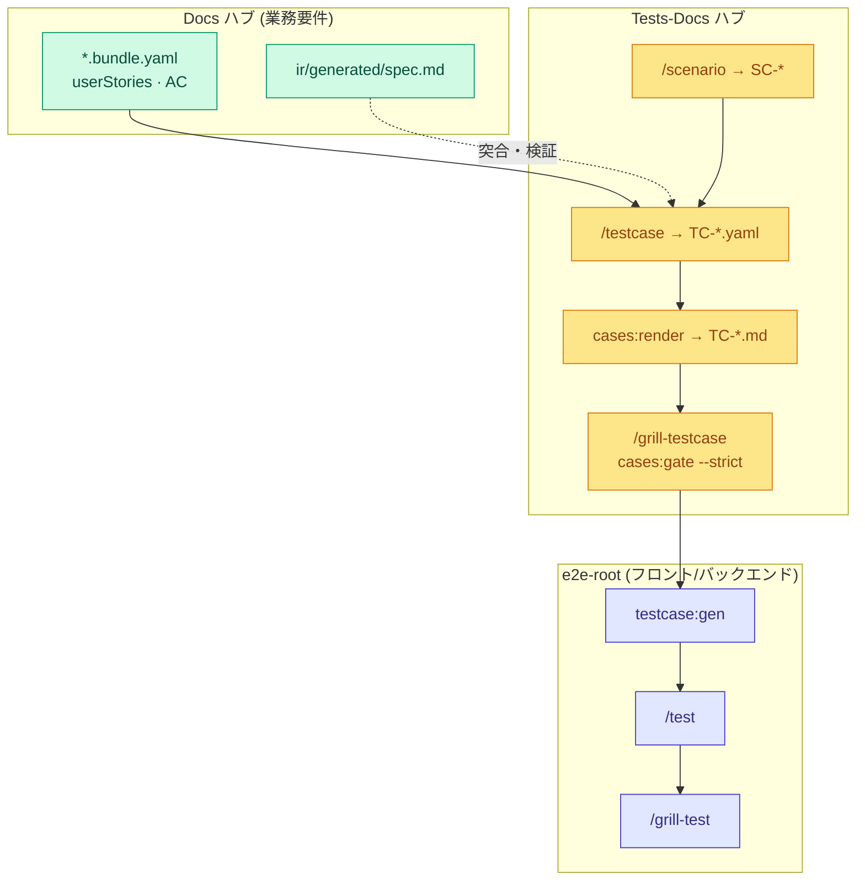
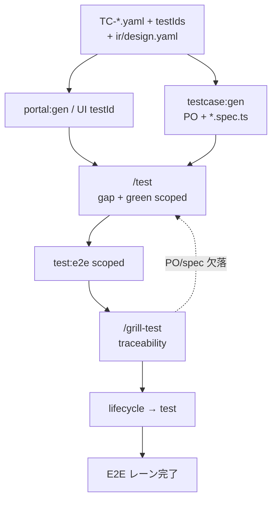
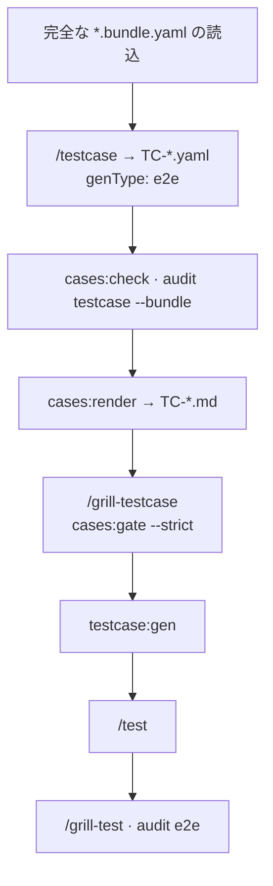
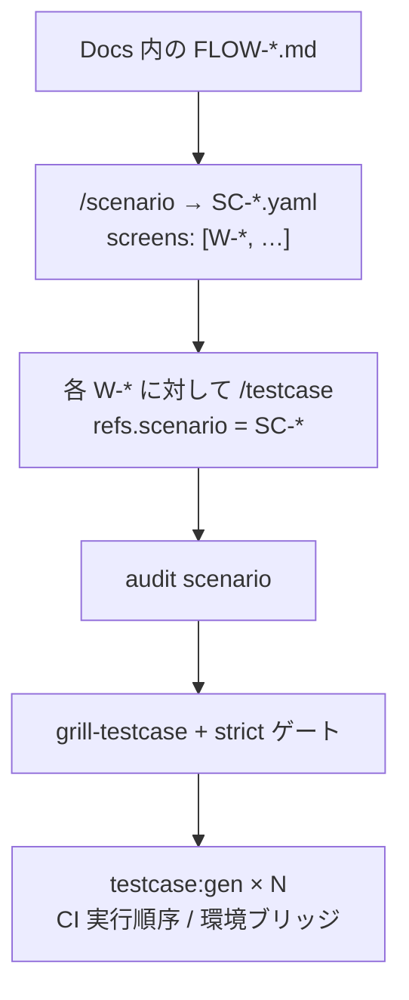
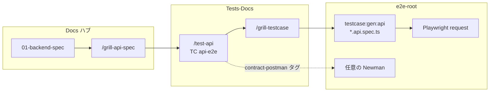

# ワークフロー — テスト (Tests-Docs と E2E)

**SSOT 対象範囲：** **コードとテスト (Code + Test)** レーン —— 具体的には **tests-docs ハブ** (`TC-*`, `SC-*`)、テスト計画の業務レビュー (Grill)、品質ゲート、QA/エンジニア向けテストケース仕様書のレンダリング、および **e2e-root** 上での自動テスト実行を対象とします。

**本ドキュメントの対象外：** 詳細な TC スキーマ、環境変数、完全な CLI コマンド引数 → [artifacts/index.md](../artifacts/index.md) · Playwright ディレクトリ構成 → [code.md](../artifacts/index.md#ワークスペースコードリポジトリの運用ルール)。

**マクロワークフローの位置づけ：** [index.md#full-cycle](./index.md#full-cycle) · Phase **2b テスト** · 品質ゲート：[gates.md](./gates.md#close-one-function) (ステップ 3–4, 7–8)。

---

## テストライフサイクル (Phase 2b) {#test-cycle}

---

## 3 層の分離構造 — 役割の明確化 {#three-layers}

| レイヤー | ルートディレクトリ | SSOT 実体 | VitePress ポータル |
|---|---|---|---|
| **Docs** | `FLOWGRID_DOCS_ROOT` | `*.bundle.yaml`, `ir/*` | ポート **5173** — `spec.md`, `data-model.md`, `api.md` |
| **Tests-docs** | `FLOWGRID_TESTS_DOC` | `cases/**/TC-*.yaml`, `scenarios/**/SC-*` | ポート **5174** — `cases:render` で出力される `TC-*.md` |
| **Automation** | `e2e-root` | `*.spec.ts`, Page Objects | 自動テストの実装・実行対象（計画用 SSOT ではない） |

**プロジェクト全体の網羅基準：** Docs のすべての機能リーフノードは `TC-*` に厳密なミラーパスを持ち、画面横断フローは `SC-*` + `audit scenario` で定義します。また `--strict` + `FLOWGRID_DOCS_ROOT` を付与した品質ゲートにより、バンドルへの 100% の**トレーサビリティ (追跡可能性)** を担保します。

---

## SSOT の読み書き責任分担 {#ssot-reading}

| ロール | 閲覧 (レビュー / ウォークスルー) | 作成・編集責務 |
|---|---|---|
| BA / PO | Docs VitePress の `spec.md` (受入基準 AC, 業務シナリオ) | `TC` を直接作成せず、仕様漏れ発見時は `/update-spec` を呼び出す |
| QA | Tests VitePress の `TC-*.md` (手順, マトリクス, 追跡) | YAML 形式で `/testcase`, `/scenario` を作成・保守 |
| フロントエンド開発 | `TC-*.md` + `ir/design.yaml` (`testIds`) | `/test` を実行。YAML 計画ファイルを直接改ざんしない |
| リリースリード | `cases:gate --strict` の JSON 結果 | トレーサビリティやマトリクス検証をスキップしてはならない |

**Grill testcase** は**完全な** `*.bundle.yaml` 全体を精査します。カバレッジを設計する際、`ir/spec` と `ir/design` を切り離して評価してはなりません。

---

## E2E 自動テストレーン {#test-e2e-lane}

Vitest/PHPUnit などの単体テストは各コードリポジトリの独立レーンで実行されるため、下記の図からは除外されています。

### 単一 E2E Spec における 3 つのアサーション層

| 層 | 目的と検証内容 |
|---|---|
| 機能アサーション (TC steps) | 業務フロー検証、Mock/本番 API 整合性、`data-testid` による操作 |
| セマンティック検証 (`#e2e:*`) | レイアウト崩れ防止、はみ出し検知、コンソールエラーゼロ検証 |
| アクセシビリティ (Axe WCAG) | 致命的なアクセシビリティ違反の自動監査 |

### `/grill-testcase` と `/grill-test` の違い

| スキル | 実行ルート | 責務 |
|---|---|---|
| **`/grill-testcase`** | **tests-docs** | YAML 計画の精査：`cases:gate --strict`、`audit testcase --bundle`、観点マトリクス検証、Docs へのギャップ差し戻し |
| **`/grill-test`** | **e2e-root** | TC ↔ PO ↔ `*.spec.ts` の整合性および `#e2e:*` の検証（`/test` がグリーン通過後に実施） |

### 統合前 (Pre-Wire) と統合後 (Post-Wire)

同一の `TC-*.yaml` を再利用します。Pre-Wire ではモックデータ上で動作し、Post-Wire (`wire`) では本番バックエンド API に接続して検証します。

---

## ディープ・グリル (3 つのモード) {#grill-modes}

3 つのワークフローはそれぞれ**独立したセッション**で実行する必要があります。1 つのチャットで `/grill-testcase` (ドキュメント) と `/grill-test` (実装コード) を混在させてはなりません。

| モード | SSOT 計画 | ハブでのレビュー (Grill) | 自動化実装のレビュー |
|---|---|---|---|
| **単一画面** `W-*` | `cases/…/TC-*.yaml` (`e2e`) | `/grill-testcase` + ゲート | `/test` 通過後に `/grill-test` |
| **画面横断シナリオフロー** `SC-*` | `scenarios/…/SC-*` + N 件の `TC` | `audit scenario` + クラスタゲート | 各 TC の個別実行 / CI での順次実行 |
| **API Hook** | `TC` `api-e2e` | `/test-api` + `/grill-testcase` | `testcase:gen:api` (および任意の Newman) |

### 1 — 単一機能画面 (`W-*`) {#grill-single-screen}

目的：UI E2E コードを自動生成する前に、**単一**の機能リーフに対して**完全なテスト観点カバレッジ**を確保し、バンドルへの追跡性を担保する。

| # | 計画検証チェック項目 | コマンド / スキル |
|---|---|---|
| 1 | バンドルにユーザーストーリーと AC が存在するか（推測によるテスト作成の禁止） | 停止 → `/update-spec` |
| 2 | `traceability` が `W-*`、シナリオ、`AC-*`、`btn_*` と完全一致するか | `audit testcase --bundle` |
| 3 | 画面全体で網羅的な `testMatrix` 観点が集約されているか（正常系のみは不可） | `cases:gate --strict` |
| 4 | QA が VitePress テストハブ上でレンダリングされた仕様を確認したか | `cases:render` |
| 5 | `testIds.required` が Split 後の Design と一致しているか | grill-dev / DOM 確認 |
| 6 | スコープ内のテストがすべてグリーン（合格）で通過するか | `/test` |
| 7 | TC ↔ PO ↔ `*.spec.ts` の整合性が保たれているか | `/grill-test`, `audit e2e` |

同一フォルダ内に複数の `TC-*.yaml`（スモーク用とフルリグレッション用など）を共存させることが可能です。ゲートは `refs.screen` 単位で観点を集約します。

### 2 — 画面横断シナリオフロー (`SC-*`) {#grill-scenario-flow}

目的：Docs 内の `FLOW-*.md` に準拠した**エンドツーエンドの業務ジャーニー**を検証する。

| # | シナリオ検証項目 | 注意点 |
|---|---|---|
| 1 | SC 作成前に Docs に `FLOW-*.md` が存在していること | 内容が不十分な場合 → Docs で `/user-flow` を実行 |
| 2 | `SC.screens[]` にジャーニーに関与するすべての `W-*` が含まれていること | FLOW の手順と完全一致させる |
| 3 | すべての `W-*` に対応する `TC-*.yaml` または明示的な `QA-*` 保留があること | `SC_SCREEN_NO_TC` チェックで検出 |
| 4 | 各 TC が**画面単位**でトレーサビリティおよびマトリクス検証に合格していること | 各リーフに対して `audit testcase --bundle` を実行 |
| 5 | ウォークスルー：VitePress テストハブで SC とレンダリング済 `TC-*.md` を確認 | ポート 5174 を開く |
| 6 | 自動化の実装方針 | 画面ごとに独立した Spec を作成（50 ステップ超の巨大 TC は禁止） |

### 3 — API フック (Playwright `request` · 任意の Newman) {#grill-api-hook}

目的：外部パートナー、Webhook、公開 API 向けのエンドポイントを検証する —— 契約 SSOT は Docs の `01` に、テスト計画は tests-docs に配置します。

| 手順 | アクション | スキル / コマンド |
|---|---|---|
| 1 | 契約 `01` の作成と API レビュー | [backend.md](./backend.md) |
| 2 | `TC` の作成 — `apiSteps[]` とステータス異常系マトリクス (401/403/404/422…) | `/test-api` · `TC.example-api.yaml` |
| 3 | テスト計画のレビュー（UI TC と同一基準） | `audit testcase`, `cases:gate --strict` |
| 4 | Playwright テストコードの生成 | `flowgrid testcase:gen:api` → `tests/api-e2e/**` |
| 5 | CI パイプラインでの実行 | `FLOWGRID_API_TEST_BASE_URL` と Secret の設定 |
| 6 | (任意) パートナー向けコレクション | `integrations/postman/` 内で Newman 実行（`contract-postman` 付与） |

---

## 着手前の前提条件 {#preconditions}

- Docs のリーフノードに完全な `userStories` / `acceptanceCriteria` を備えたバンドルが存在すること（または `QA-*` で明示的に保留）。
- 一括テスト計画レビューの前に、バンドルに対して `flowgrid check` および split が成功していること。
- `FLOWGRID_DOCS_ROOT` および `FLOWGRID_TESTS_DOC` が正しく設定されていること（`flowgrid doctor` で確認）。
- `cases/…` のディレクトリ構造が `surfaces/…` と完全に**ミラー配置**されていること。

---

## ワークフローステップ一覧 {#steps}

| 順序 | アクション | 担当 | スキル / ゲート |
|---|---|---|---|
| 0 | (任意) 画面横断フローの棚卸し | QA / BA | `FLOW-*.md` 存在時に `/scenario` を実行 |
| 1 | Testcase YAML v2 の作成 | QA | `/testcase`, `cases:check` |
| 2 | 人間可読なテストケースの生成 | QA / 全員 | `flowgrid cases:render` → VitePress テストハブを開く |
| 3 | テスト計画のレビュー (Grill) | QA + チーム | `/grill-testcase`, `audit testcase --bundle` |
| 4 | テストドキュメントの品質ゲート | QA / リリース | `cases:gate --strict` + `FLOWGRID_DOCS_ROOT` |
| 5 | Playwright テストコードの生成 | Dev / QA | `testcase:gen` (`genType: e2e`) |
| 5b | API フック計画の作成 | QA / Dev | `/test-api`, `genType: api-e2e` |
| 6 | 実装とグリーン通過の達成 | Dev | `/test`, スコープ付き `test:e2e` |
| 7 | 自動化実装のレビュー | Dev + QA | `/grill-test` |
| 8 | 計画と実装の監査 | QA | `flowgrid audit e2e` |

---

## チームテスト計画のサインオフ {#test-signoff}

一括 `testcase:gen` やリリース前検証を行う前の確認基準：

| # | 項目 | 検証基準 |
|---|---|---|
| 1 | **ゲート** | `FLOWGRID_DOCS_ROOT` を指定した `cases:gate --strict` に合格していること |
| 2 | **トレーサビリティ** | 全 TC がバンドルの画面/シナリオ/AC/アクションと一致する `traceability` を持つこと |
| 3 | **マトリクス** | 画面全体で全観点が集約網羅されていること（正常系のみは不可） |
| 4 | **可読性** | `TC-*.md` が VitePress で確認でき、生 YAML を開かずに QA が検証できること |
| 5 | **仕様一致** | `spec.md` 内の受入基準 AC と `acceptanceRefs` が一致していること |
| 6 | **保留項目** | 未カバーのギャップが `QA-*` または `coverage_deferred` に明示されていること |
