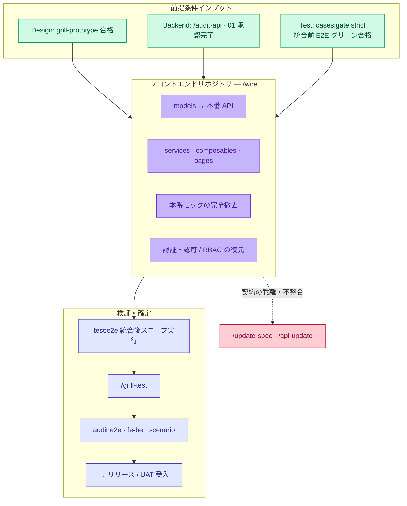

# ワークフロー — 統合連携 Wire (フロントエンド ↔ バックエンド連携)

**SSOT 対象範囲：** マクロ **統合連携 (Wire)** フェーズ（Phase **3**）—— プロダクションコード内のモックやスタブを本番バックエンド API に置き換え、認証・認可および RBAC 制御を復元し、統合後の E2E 自動テストを実行して、正式リリース (Ship) 前にデータ整合性を収束・監査します。

**本ドキュメントの対象外：** フロントエンドリポジトリにおける詳細な Portal 4 層アーキテクチャ → [artifacts/index.md](../artifacts/index.md) · `/wire` スキルの詳細リファレンス → [references/cli-and-commands.md](../references/cli-and-commands.md)。

**マクロワークフローの位置づけ：** [index.md#full-cycle](./index.md#full-cycle) · 前提レーン：[design.md](./design.md) · [backend.md](./backend.md) · [test.md](./test.md)。

---

## 統合連携サイクル (Phase 3) {#wire-cycle}



---

## 3 つの収束レイヤー {#three-convergence}

| レイヤー | 統合前 (Pre-Wire) 状態 | 統合時の責務 (Wire) | 統合後の検証 (Post-Wire) |
|---|---|---|---|
| **Portal UI フロントエンド** | プロトタイプモック、HANDOFF に `#wire-only` 記載 | `/wire` 実行 — 実サービスへの接続、モック撤去 | スコープ付き `test:e2e` · `/grill-test` |
| **API 契約** | `01` 仕様 + API レビュー、Design に `apiRef` | モデル・DTO 整合、CORS および環境変数設定 | リーフバンドルに対する `audit fe-be` |
| **画面横断フロー `SC-*`** | TC 統合前のモックデータ | 業務ジャーニーに沿って画面ごとに実 API を接続 | `audit scenario` + CI での E2E 順次実行 |

**バックエンド単体 / パートナー連携：** フロントエンドの `/wire` ステップは不要です —— `testcase:gen:api`、任意の Newman 実行、バックエンド結合テストによって検証し、SSOT ドキュメントハブに `01` 契約、tests-docs に `api-e2e` テスト計画を維持します ([test.md § API フック](./test.md#grill-api-hook))。

---

## 統合作業時の SSOT 読み書きルール {#ssot-reading}

| ロール | 参照すべき SSOT | 編集元にしてはならないファイル |
|---|---|---|
| フロントエンド開発 | `ir/design.yaml`, HANDOFF, `#wire-only` / `#update:*` | 自動生成された `ir/generated/*.md` |
| フロントエンド開発 | DTO マッピング時の `01` / OpenAPI プレビュー | フロントエンド側での `01` の直接改ざん（必ず `/api-update` を経由） |
| QA | `TC-*.md` の統合後シナリオ | 統合作業セッション中での YAML テスト計画の変更 |
| リード | [gates § マイルストーン 9](./gates.md#close-one-function) | 「手動確認で動いたから」という理由での自動監査スキップ |

**環境セットアップ：** `FLOWGRID_DOCS_ROOT`、`FLOWGRID_TESTS_DOC`、e2e-root — `flowgrid doctor` で健全性を確認。

---

## 着手前の前提条件 {#preconditions}

| マイルストーン | 最低限必要な要件 |
|---|---|
| **Design 設計** | `/grill-prototype` で SSOT のギャップ（文言、状態、モック境界）がゼロであること — [design.md](./design.md) |
| **Backend バックエンド** | API が検証環境 (Staging/Dev) にデプロイされ、`/audit-api` を通過し、`01` 契約が承認されていること |
| **テスト計画** | 対象の `W-*` に対して `cases:gate --strict` が合格していること |
| **テスト自動化** | 統合前のスコープ内 E2E テストが**グリーン通過**しているか、ギャップが記録されていること — [test.md](./test.md#test-e2e-lane) |
| **タグ整理** | HANDOFF 内で `#wire-only` / `#manual-composable` が明記されていること |

**前提条件が未達の場合：** プロトタイプ、テスト、バックエンドの各レーンに戻り仕様を修正します —— **仕様が不完全なまま見切り発車で連携を進めてはなりません**。

---

## 統合前 vs 統合後 (テストケース) {#pre-wire-post-wire}

tests-docs 上で同一の `TC-*.yaml` を再利用します —— テスト計画を書き直すことなく**ランタイム環境**のみを切り替えます：

| 観点 | 統合前 (Pre-Wire) | 統合後 (Post-Wire) |
|---|---|---|
| API 接続先 | Playwright 内部のモック / `setup.mocks` | 実 API の Base URL、認証済みセッション Cookie |
| 認証・認可 | ミドルウェアをバイパス（画面確認モード） | バンドル仕様に従いゲスト/RBAC ガードを完全復元 |
| ライフサイクル状態 | `prototype` / `test` 状態 | `wire` 状態へ昇格 |
| 監査コマンド | `audit e2e` (統合前は任意) | **`audit e2e` 必須実行** (`--screen W-*` 指定) |

---

## ワークフローステップ一覧 {#steps}

| # | アクション | 担当 | スキル / ゲート |
|---|---|---|---|
| 1 | 型・モデルの整合 ↔ `01` / OpenAPI | フロントエンド | `/model` (未実施の場合) |
| 2 | 4 層構造の実装：Service → Composable → Page | フロントエンド | `/wire` |
| 3 | 本番モックの撤去（単体テストのフォールバック用のみ保持） | フロントエンド | HANDOFF の仕様に準拠 |
| 4 | 認証・認可・RBAC・ルートメタデータの復元 | フロントエンド | ガードをバイパスした画面の納品禁止 |
| 5 | スコープ内の統合後 E2E テスト実行 | 開発 + QA | `test:e2e`、不足分に `/test` |
| 6 | 自動化コードの実装レビュー | 開発 + QA | `/grill-test` |
| 7 | 統合収束監査 | 開発 + QA | `/grill-wire` または監査コマンド：`audit e2e`, `audit fe-be`, `audit scenario` |
| 8 | UAT および関係者レビュー | PM / PO | 受入レビュー。新要件発生時はクローズ**前**に `/update-spec` を実行 |

---

## 統合レビュー (Grill) と品質ゲート {#wire-gates}

フロントエンドコード実装完了後、**フロントエンドリポジトリ**で実行します：

```bash
flowgrid audit e2e --e2e-root <path> --tests-docs "$FLOWGRID_TESTS_DOC" --screen <W-*>
flowgrid audit fe-be <path/to.bundle.yaml>    # 対象画面のバンドル
flowgrid audit scenario <SC.yaml> --tests-docs "$FLOWGRID_TESTS_DOC"   # シナリオフローの場合
```

| 監査で検出されたギャップ | 是正アクション |
|---|---|
| `missingInPlaywright` / Page Object 欠落 | `/test` を実行して補完 |
| テスト計画とバンドル仕様の乖離 | `/grill-testcase` または `/update-spec` で再同期 |
| `apiRef` ↔ `01` の契約不整合 | `/api-update` を実行して API を再レビュー |
| チーム合意の上での保留項目 | チーム規約に基づき `qa/` に起票 |

---

## 統合サインオフ基準 {#wire-signoff}

マイルストーンのマージや UAT 提出前の確認項目：

| # | 項目 | 検証基準 |
|---|---|---|
| 1 | **モック完全撤去** | 対象 `W-*` の本番コードパスにモックが一切残存していないこと |
| 2 | **タグ解消** | スコープ内の `#wire-only` / `#update:*` タグが解消または QA 保留されていること |
| 3 | **認証ガード** | ルーティングミドルウェアおよび RBAC が `screenAccess` 仕様と完全一致すること |
| 4 | **E2E 合格** | 統合後のスコープ内 E2E 自動テストが全件グリーンであること |
| 5 | **audit e2e** | 致命的なギャップがないこと（警告には担当者が割り当てられていること） |
| 6 | **FE–BE 整合** | API を利用する画面において `audit fe-be` にブロッカーがないこと |
| 7 | **ライフサイクル** | レジストリ上で対象ルートのステータスが `wire` となっていること |

---

## ギャップ解消フィードバックループ {#gap-loop}

| 発生トリガー | 是正アクション |
|---|---|
| バックエンド契約のエラー | `/api-update` → バックエンド再デプロイ → 再連携 |
| UX または仕様の不整合 | `/update-spec` → Split 分解 → 必要に応じて統合前テストを再実行 |
| E2E カバレッジの不足 | `/test` → `/grill-test` （`audit e2e` のバイパスは禁止） |
| シナリオフローの画面不足 | `TC` の追加または `QA-*` の起票 → `audit scenario` で検証 |

**1 セッション = 1 コマンド** —— `/wire` の単一セッション内で全システム回帰テストとバックエンド `/api` コード生成を同時に実行してはなりません。
