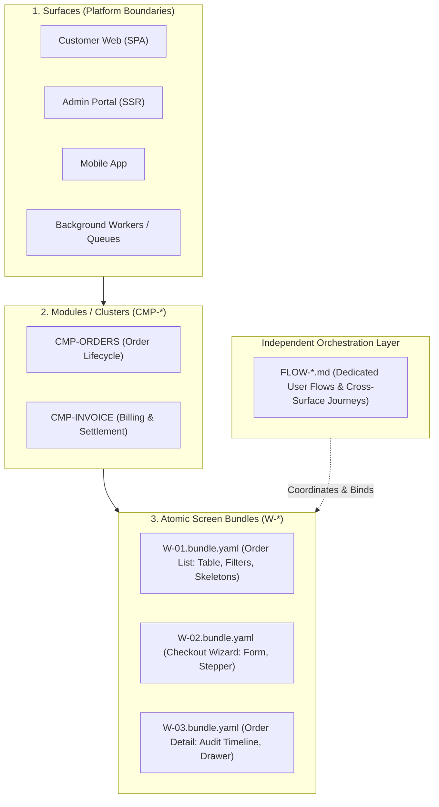
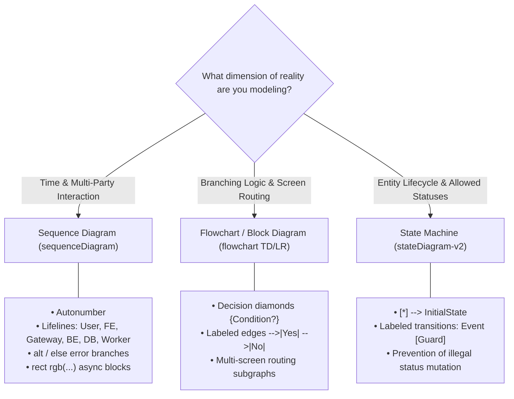

# Architectural Strengths of FlowGrid

> **Executive Summary:** FlowGrid is an enterprise-grade AI Engineering and SSOT (Single Source of Truth) platform designed for complex, production-critical software systems. Unlike traditional monolithic specification approaches, FlowGrid enforces a decoupled 3-tier hierarchy, dedicated first-class user journey orchestration, structured DSL code generation, and deterministic mechanical audit gates.

---

## 1. Decoupled 3-Tier Hierarchy vs. Monolithic Spec Approaches

### The Monolithic Spec Fallacy
In common agile and prompt-driven development, teams often rely on **Monolithic Specifications**—dumping 3 to 5 screens, multiple form dialogs, CRUD tables, API endpoints, and permission matrices into a single, massive document.

This creates several fatal architectural pitfalls:
* **Context Saturation & Pollution:** When an AI agent or engineer attempts to implement Screen A, reading a 3,000-line document containing Screens B, C, and D floods the context window with irrelevant tokens. This triggers hallucinations, missed requirements, and state leakage.
* **Diluted User Flows:** Inter-screen handoffs and business journeys are buried under hundreds of lines of UI field definitions and raw SQL schemas.
* **Invisible Boundary Failures:** What happens *between* screens (state caching, deep linking, concurrent updates, network dropped mid-step) is completely ignored.

### FlowGrid's Hierarchical Separation of Concerns
FlowGrid structures the software universe into a clean, disciplined hierarchy:

1. **Surfaces:** Explicit runtime and deployment boundaries (Customer Web, Admin Portal, Mobile Driver, Background Services).
2. **Modules (`CMP-*`):** Cohesive domain boundaries (Orders, Billing, IAM).
3. **Atomic Screen Bundles (`W-*.bundle.yaml`):** Sharp, atomic focus on **exactly one screen**. Contains wireframe structure, form fields, table column schemas, and localized UI states (L2 `interactionCases`: validation errors, dropdown toggles, loading skeletons, empty views).
4. **Dedicated User Flows (`FLOW-*.md`):** An independent orchestration layer governing the nervous system of the application without polluting screen layout definitions.

---

## 2. Dedicated User Flows (`FLOW-*.md`): Macro-Orchestration First

FlowGrid treats User Flows as **first-class architectural artifacts** rather than casual bullet points. User journeys are categorized into 3 rigorous tiers:

* **Tier A — Cross-Surface Flows (`architecture/03-user-flows/FLOW-*.md`):** Journeys transferring ownership between distinct actors and runtimes (e.g., Customer Checkout on Web ➔ Admin Approval on Portal ➔ Payment Gateway Webhook ➔ Logistics Warehouse Worker).
* **Tier B — Surface-Shared Flows (`surfaces/<surface>/user-flows/FLOW-*.md`):** Common journeys shared across modules within one surface (e.g., Safe Delete with cascade dependency checks, Bulk Async Excel Export, Session Expiry Warning).
* **Tier C — Module-Scope Flows (`surfaces/.../CMP-*/user-flows/`):** Multi-step local wizards contained within one feature cluster.

### The 6-Section Deep-Dive Standard
Every FlowGrid User Flow document must satisfy the 6-Section Enterprise Specification:
1. **Context & Business Authorization Matrix:** Trigger events, actor catalog, RBAC/ABAC permissions per screen, and Separation of Duties (SoD).
2. **Multi-tier User Story Chain:** Setup Story, Primary Story, Tracking Story, and autonomous **System Story** (background logic).
3. **Business Rules (`BR-*`) & State Lifecycle:** Exhaustive rules table paired with a strict `stateDiagram-v2`.
4. **Stage-by-Stage Journey Specification:** Detailed human actions, field-by-field Data Handoff, and async worker policies.
5. **Traceability Matrix:** 1:1 mapping: Story Step ↔ Screen `[W-*]` ↔ API `[API-*]` ↔ Diagram Lifeline ↔ Automated Test.
6. **Cross-Screen Business Sequence Diagram:** Precise Mermaid `sequenceDiagram` with `autonumber`, worker blocks (`rect rgb(...)`), and failure branches (`alt / else`).

---

## 3. The 5 Corner-Case Blindspots Hunting Protocol

Monolithic specs consistently fail at production boundary conditions. FlowGrid's architecture systematically hunts down and resolves the **5 Fatal Corner Cases**:

| Corner-Case Blindspot | Monolithic Spec Approach | FlowGrid Architectural Solution |
| :--- | :--- | :--- |
| **1. Refresh / Back State Loss** | Ignored. Page refresh at Step 3 crashes with `null pointer` or silently redirects to Step 1. | **State Persistence Contract:** Flow explicitly specifies persistence mode (`URL query params`, `sessionStorage`, or `Server Draft ID`) with deep-link recovery guards. |
| **2. Concurrent Mutation & Race Conditions** | Unaddressed. Two users editing or approving the same entity cause silent data overwrites. | **Concurrency Protocol:** Mandatory Optimistic Locking (`version` / `updated_at`), Idempotency Keys (`X-Idempotency-Key`), and `409 Conflict` auto-refetch UI handlers. |
| **3. Cross-Surface Actor & Notification Drops** | Assumes push notifications and emails are 100% reliable. Orphaned tasks if messaging fails. | **Persistent Worklist Pattern:** Every cross-surface transition maintains an inbox query fallback on the target surface, immune to notification outages. |
| **4. Partial Failure & Saga Rollback** | Only models the "Happy Path". Step 1 (Payment) succeeds but Step 2 (Inventory lock) fails, leaving data corrupted. | **Saga Compensation Rules:** Explicit `alt / else` rollback sequence in Sequence Diagrams with auto-refund, hold-release, and audit logging. |
| **5. Data Handoff Schema Drifts** | Informal descriptions ("pass user data to screen 2") lead to type and runtime mismatches. | **Field-by-Field Data Handoff Table:** Source field type, transport format, target screen prop, and fallback redirection when parameters are missing. |

---

## 4. Diagram Decision Matrix: Precision Modeling

FlowGrid eliminates ambiguity by selecting diagram notations based on the mathematical dimension of the problem:

* **Sequence Diagram (`sequenceDiagram`):** Applied when $\ge 2$ distinct lifelines exchange messages over time. Mandatory for API handshakes, webhooks, and background queues.
* **Block Diagram / Flowchart (`flowchart TD/LR`):** Applied to complex business decision trees (`IF / ELSE IF / ELSE`), discount calculation pipelines, and screen-to-screen navigation routes.
* **State Machine (`stateDiagram-v2`):** Applied to discrete entity statuses (e.g. Order: `DRAFT ➔ SUBMITTED ➔ PAID / CANCELLED ➔ COMPLETED`) to guarantee database state integrity.

---

## 5. Structured DSL & Multi-Stack Code Generation Engine

FlowGrid bridges the gap between human design and compiled code through its machine-readable DSL:

* **Intermediate Representation (`ir/design.yaml`, `ir/spec.yaml`):** Human requirements are compiled into structured ASTs, completely isolating the AI agent from guessing file structures or framework quirks.
* **4-Layer Quality Standard in Template Engine (`engines/template-builder/`):**
  1. *Contract Invariants:* Scans strict prop schemas, default values, and backend response envelopes (`{ data, error, meta }`).
  2. *The 4 Canonical UI States:* Automatically embeds `Loading` (skeleton), `Empty` (zero-data CTA), `Error` (alert + retry), and `Success / Active` states into generated code.
  3. *Inversion of Control (IoC):* Ensures common components (`shared/`) contain zero hardcoded domain endpoints; dynamic data is passed via props and slots.
  4. *Golden Test Seams:* Every scaffolded template includes a test fixture stub, enabling `testcase:gen` to run automated test suites instantly.
* **Multi-Stack Adapters:** Seamlessly generates code across Nuxt, Next.js, NestJS, Laravel, FastAPI, and .NET.

---

## 6. Deterministic Mechanical Audit Gates

While traditional tools rely entirely on LLM self-evaluation (which is prone to sycophancy and hallucinations), FlowGrid employs **deterministic Node.js audit scripts**:

* `flowgrid audit flow <path>`: Analyzes User Flow documents for missing actors, absent data handoff schemas, unhandled worker timeouts, and syntax gaps.
* `flowgrid audit spec <path>`: Audits leaf bundles for broken contract links, missing test seams, and unmapped fields.
* `flowgrid cases:gate`: Validates 100% test scenario coverage across the Test Matrix before any branch can be considered production-ready.

---

## Summary Matrix

| Capability Dimension | Monolithic Spec Paradigm | FlowGrid Platform |
| :--- | :--- | :--- |
| **Architectural Model** | Single large file per feature | 3-Tier Hierarchy (Surfaces ➔ Modules ➔ Atomic Screens) |
| **User Flow Status** | Secondary, buried in UI text | First-Class SSOT Artifact (`FLOW-*.md`) with 3 Tiers |
| **Corner-Case Handling** | Ad-hoc, high omission rate | 5 Blindspots Protocol (F5 loss, concurrency, Saga rollback) |
| **Diagramming** | Inconsistent, mostly informal | Formal Decision Matrix (`sequenceDiagram`, `flowchart`, `stateDiagram-v2`) |
| **Code Generation** | Free-form hallucinated code | Structured DSL (`ir/`) + 4-Layer Golden Sample Adapters |
| **Quality Verification** | Subjective human reading | Deterministic CLI Audit Gates (`audit flow`, `cases:gate`) |
