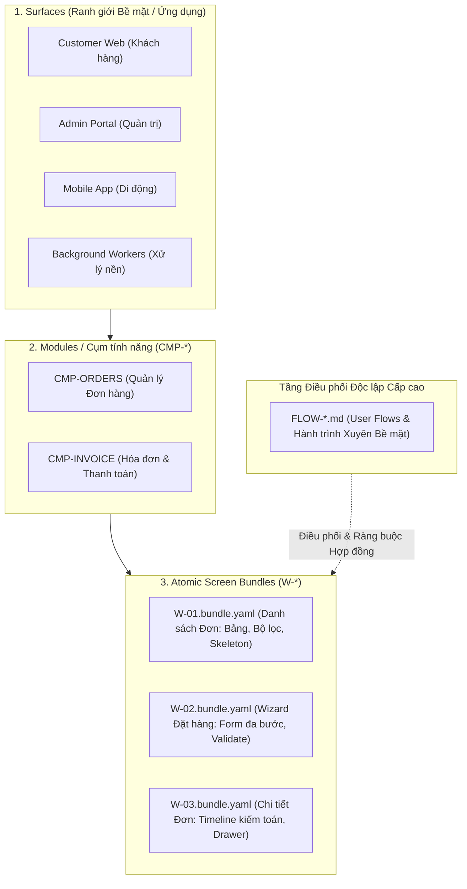
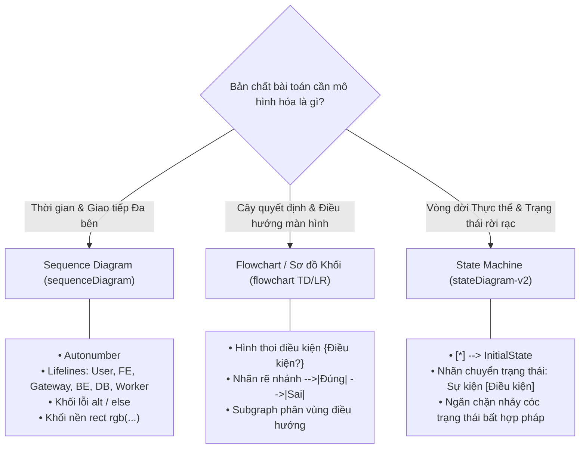

# Điểm mạnh Kiến trúc của FlowGrid

> **Tóm tắt cốt lõi:** FlowGrid là nền tảng Kỹ nghệ Phần mềm kết hợp AI (AI Engineering) và SSOT (Single Source of Truth) cấp doanh nghiệp, được thiết kế chuyên biệt cho các hệ thống phần mềm phức tạp và đòi hỏi độ tin cậy tuyệt đối. Khác với cách tiếp cận viết đặc tả nguyên khối (Monolithic Spec), FlowGrid áp dụng mô hình phân tách 3 tầng chặt chẽ, coi User Flow là trung tâm điều phối độc lập, sở hữu bộ máy DSL sinh mã tự động và các cổng kiểm toán tĩnh cơ học.

---

## 1. Mô hình Phân tách 3 Tầng vs. Sai lầm Spec Nguyên Khối (Monolithic Spec)

### Cái bẫy của Spec Nguyên Khối (Monolithic Spec Fallacy)
Trong phát triển phần mềm truyền thống hoặc các quy trình tạo prompt sơ sài, các nhóm phát triển thường gom toàn bộ tính năng gồm 3 đến 5 màn hình, form popup, bảng tra cứu, API endpoints và ma trận phân quyền vào **duy nhất 1 file tài liệu khổng lồ**.

Cách làm này tạo ra các tử huyệt kiến trúc nghiêm trọng:
* **Tràn ngập & Ô nhiễm Ngữ cảnh (Context Saturation & Pollution):** Khi AI Agent hoặc kỹ sư cần lập trình Màn hình A, việc phải đọc một tài liệu 3.000 dòng chứa cả màn hình B, C, D khiến cửa sổ ngữ cảnh bị ngập rác. AI bắt đầu sinh ra ảo giác (hallucination), bỏ sót yêu cầu và làm rò rỉ logic giữa các màn hình.
* **User Flow bị làm mờ nhạt:** Dòng chảy trải nghiệm và hành trình nghiệp vụ bị chôn vùi dưới hàng trăm dòng định nghĩa thẻ HTML/CSS và schema SQL thô.
* **Điểm mù tại ranh giới chuyển giao:** Những gì xảy ra *ở giữa* các màn hình (lưu vết trạng thái, điều hướng link sâu, cập nhật đồng thời, rớt mạng giữa chừng) hoàn toàn bị bỏ quên.

### Kiến trúc Phân tầng của FlowGrid
FlowGrid chuẩn hóa cấu trúc phần mềm thành một hệ thống phân cấp mạch lạc:

1. **Surfaces:** Ranh giới thực thi và triển khai rõ ràng (Customer Web, Admin Portal, Mobile Driver, Background Services).
2. **Modules (`CMP-*`):** Ranh giới nghiệp vụ gắn kết (Đơn hàng, Kế toán, Quản lý người dùng).
3. **Atomic Screen Bundles (`W-*.bundle.yaml`):** Tập trung sắc bén vào **duy nhất 1 màn hình**. Chứa cấu trúc layout wireframe, các cột của table, trường nhập liệu form và trạng thái nội tại cục bộ (L2 `interactionCases`: lỗi validate, bật tắt modal, trạng thái loading/empty/error của riêng màn hình đó).
4. **Dedicated User Flows (`FLOW-*.md`):** Tầng điều phối độc lập đóng vai trò hệ thần kinh trung ương, điều phối toàn bộ hành trình mà không làm ô nhiễm định nghĩa layout màn hình.

---

## 2. User Flows Độc lập (`FLOW-*.md`): Ưu tiên Điều phối Vĩ mô

FlowGrid nâng tầm User Flows thành **tài liệu kiến trúc cốt lõi hạng nhất (First-Class SSOT)** với cấu trúc 3 cấp độ:

* **Luồng Xuyên Bề mặt (`architecture/03-user-flows/FLOW-*.md`):** Hành trình chuyển giao trách nhiệm giữa $\ge 2$ bề mặt hoặc tác nhân độc lập (Khách đặt hàng trên Web ➔ Admin duyệt trên Portal ➔ Webhook Cổng thanh toán ➔ Worker kho xuất hàng).
* **Luồng Người dùng Thuộc Module (`surfaces/<surface>/<module>/user-flows/FLOW-*.md`):** Hành trình thao tác UI do module sở hữu theo Quy tắc Step 1 Ownership (Bước 1 bắt đầu ở module nào thì toàn bộ flow nằm tại `user-flows/` của module đó).

### Tiêu chuẩn 6 Phần Đặc tả Chuyên sâu
Mọi tài liệu User Flow của FlowGrid bắt buộc phải thỏa mãn 6 phần theo chuẩn Enterprise:
1. **Bối cảnh & Ma trận Phân quyền Nghiệp vụ:** Sự kiện kích hoạt, danh mục tác nhân (Actors), phân quyền RBAC/ABAC trên từng màn hình và nguyên tắc Tách biệt Trách nhiệm (Separation of Duties - SoD).
2. **Chuỗi User Story Đa tầng:** Setup Story, Primary Story, Tracking Story và **System Story** (mô tả hệ thống tự chạy ngầm).
3. **Luật Nghiệp vụ (`BR-*`) & Vòng đời Trạng thái:** Bảng luật nghiệp vụ đối chiếu 1:1 với sơ đồ `stateDiagram-v2`.
4. **Đặc tả Hành trình Từng bước:** Thao tác người dùng, hợp đồng chuyển giao dữ liệu (Data Handoff) từng trường và quy tắc xử lý tiến trình nền.
5. **Ma trận Truy vết (Traceability Matrix):** Ánh xạ 1:1: Bước User Story ↔ Màn hình `[W-*]` ↔ API `[API-*]` ↔ Đường sống biểu đồ ↔ Ca kiểm thử tự động.
6. **Sơ đồ Tuần tự Nghiệp vụ Xuyên Màn hình:** Biểu đồ Mermaid `sequenceDiagram` chuẩn mực với `autonumber`, khối worker `rect rgb(...)` và các nhánh xử lý lỗi `alt / else`.

---

## 3. Giao thức Săn lùng 5 Điểm mù Ngóc ngách (Corner-Case Hunting)

Các tài liệu spec nguyên khối luôn thất bại khi đưa vào môi trường production thực tế vì bỏ qua các ca góc cạnh. Kiến trúc FlowGrid thiết lập quy trình giải quyết triệt để **5 Điểm mù Chí mạng**:

| Điểm mù Ngóc ngách | Cách tiếp cận Spec Nguyên khối | Giải pháp Kiến trúc của FlowGrid |
| :--- | :--- | :--- |
| **1. Mất trạng thái khi F5 / Back** | Bỏ qua. Tải lại trang tại Bước 3 bị lỗi `null pointer` hoặc tự nhảy về Bước 1 làm mất trắng dữ liệu. | **Hợp đồng Lưu vết Trạng thái:** Quy định rõ cơ chế lưu tạm (`URL query params`, `sessionStorage`, hoặc `Server Draft ID`) kèm guard phục hồi link sâu. |
| **2. Tranh chấp Ghi & Sửa đè (Concurrency)** | Không đề cập. Hai nhân viên cùng sửa/duyệt 1 bản ghi dẫn tới việc dữ liệu bị ghi đè im lặng. | **Giao thức Chống Xung đột:** Bắt buộc dùng Optimistic Locking (`version` / `updated_at`), Idempotency Key (`X-Idempotency-Key`), và màn hình thông báo `409 Conflict` tự tải lại dữ liệu mới. |
| **3. Đứt gãy Thông báo Đa vai trò** | Giả định email/push luôn chạy tốt. Nếu dịch vụ rớt, công việc bị rơi vào trạng thái "mồ côi". | **Mô hình Hàng đợi Công việc (Worklist):** Mọi điểm giao tiếp xuyên bề mặt đều có tab danh sách chờ xử lý trên Portal, đảm bảo không phụ thuộc vào email/push. |
| **4. Lỗi nửa chừng & Hoàn tác Saga** | Chỉ vẽ luồng màu hồng (Happy Path). Trừ tiền thành công nhưng khóa kho bị lỗi, gây sai lệch hệ thống. | **Cơ chế Bồi hoàn Saga (Rollback):** Vẽ rõ nhánh `alt / else` trên Sequence Diagram với quy trình hoàn tiền tự động, mở khóa kho và ghi log kiểm toán. |
| **5. Lệch chuẩn Kiểu dữ liệu khi Chuyển trang** | Mô tả sơ sài ("truyền dữ liệu sang màn hình 2") dẫn đến lệch kiểu dữ liệu khi tích hợp. | **Bảng Data Handoff 1:1 Từng trường:** Quy định rõ kiểu dữ liệu đầu ra, giao thức truyền, prop nhận của màn hình đích và hành vi fallback khi thiếu param. |

---

## 4. Ma trận Quyết định Biểu đồ Chuẩn xác

FlowGrid xóa bỏ hoàn toàn sự cảm tính khi vẽ sơ đồ bằng cách dựa trên chiều không gian/thời gian của bài toán:

* **Sequence Diagram (`sequenceDiagram`):** Bắt buộc khi có $\ge 2$ Lifelines trao đổi bản tin theo thời gian. Áp dụng cho gọi API, Webhook, Queue nền.
* **Block Diagram / Flowchart (`flowchart TD/LR`):** Áp dụng cho các cây quyết định nghiệp vụ phức tạp (`IF / ELSE IF / ELSE`), chính sách giảm giá, hoặc bản đồ điều hướng chuyển trang.
* **State Machine (`stateDiagram-v2`):** Áp dụng cho trạng thái vòng đời của thực thể (Ví dụ Đơn hàng: `DRAFT ➔ SUBMITTED ➔ PAID / CANCELLED ➔ COMPLETED`) nhằm bảo vệ tính toàn vẹn trạng thái trong cơ sở dữ liệu.

---

## 5. Hệ thống DSL Có Cấu trúc & Bộ máy Sinh mã Tự động

FlowGrid kết nối bản thiết kế của con người với mã nguồn ứng dụng thông qua bộ máy DSL máy đọc được:

* **Intermediate Representation (`ir/design.yaml`, `ir/spec.yaml`):** Yêu cầu được phân tích cú pháp thành cây AST có cấu trúc, giúp AI agent không cần đoán mò cấu trúc thư mục hay đặc trưng framework.
* **Tiêu chuẩn 4 Lớp Chất Lượng trong Engine (`engines/template-builder/`):**
  1. *Contract Invariants:* Quét kiểu props nghiêm ngặt, giá trị mặc định và Response Envelope chuẩn backend (`{ data, error, meta }`).
  2. *4 Trạng thái Giao diện Chuẩn:* Tự động gắn sẵn 4 trạng thái `Loading` (skeleton), `Empty` (màn hình rỗng có nút bấm), `Error` (alert + nút thử lại) và `Success / Active` vào code sinh ra.
  3. *Inversion of Control (IoC):* Đảm bảo component dùng chung (`shared/`) tách rời 100% khỏi API nghiệp vụ, truyền dữ liệu qua props và slots.
  4. *Golden Test Seams:* Mọi template đều đi kèm test fixture stub, giúp `testcase:gen` chạy kiểm thử tự động ngay lập tức.
* **Hỗ trợ Đa nền tảng (Multi-Stack Adapters):** Sinh mã tương thích cao cho Nuxt, Next.js, NestJS, Laravel, FastAPI và .NET.

---

## 6. Cổng Kiểm toán Tĩnh Cơ học (Deterministic Mechanical Audits)

Khác với các công cụ chỉ dựa vào khả năng "tự chấm điểm" của LLM (vốn hay ảo giác và dễ dãi), FlowGrid sử dụng **các script kiểm toán thuần Node.js với tính tất định 100%**:

* `flowgrid audit flow <path>`: Kiểm tra tài liệu User Flow xem có thiếu tác nhân, thiếu bảng handoff dữ liệu, thiếu timeout worker hay sai cú pháp không.
* `flowgrid audit spec <path>`: Kiểm toán các bundle màn hình xem có đứt liên kết hợp đồng, thiếu test seam hay trường dữ liệu chưa map không.
* `flowgrid cases:gate`: Xác nhận độ phủ kiểm thử 100% trên Test Matrix trước khi một nhánh code được phép coi là hoàn thành.

---

## Bảng So sánh Tổng quan

| Tiêu chí | Mô hình Spec Nguyên khối (Monolithic) | Nền tảng FlowGrid |
| :--- | :--- | :--- |
| **Mô hình Kiến trúc** | 1 file tài liệu lớn cho cả feature | Phân tầng 3 cấp (Surfaces ➔ Modules ➔ Atomic Screens) |
| **Vị thế của User Flow** | Thứ yếu, chìm trong mô tả UI | Tài liệu SSOT độc lập (`FLOW-*.md`) với 3 cấp độ |
| **Xử lý Ca góc cạnh** | Tùy hứng, bỏ sót nhiều | Giao thức 5 Điểm mù (F5 mất state, concurrency, Saga rollback) |
| **Quy chuẩn Vẽ Biểu đồ** | Tùy tiện, thiếu nhánh lỗi | Ma trận Quyết định chuẩn (`sequenceDiagram`, `flowchart`, `stateDiagram-v2`) |
| **Sinh mã (Code Gen)** | Đoán mò, prompt tự do | DSL có cấu trúc (`ir/`) + Adapters huấn luyện 4 Lớp |
| **Kiểm tra Chất lượng** | Con người đọc rà soát thủ công | Cổng kiểm toán cơ học bằng CLI (`audit flow`, `cases:gate`) |
