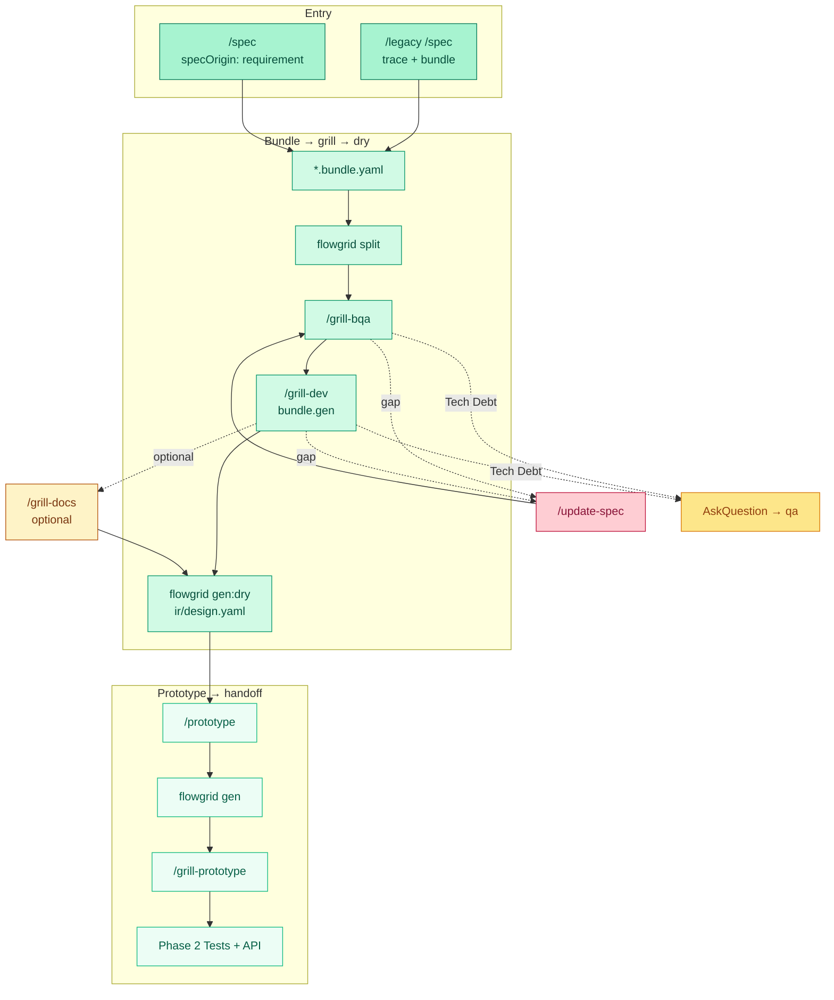
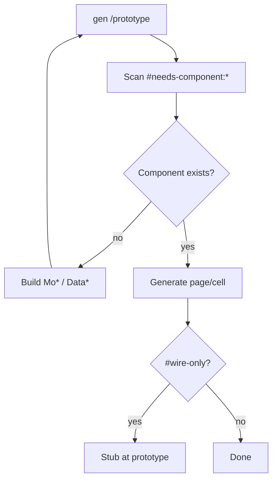

# Workflow — Design

**Scope (SSOT):** The **Design** lane (macro) — from analysis/spec to grilled prototype, ready for codegen dry-run.

**Not covered here:** Bundle/IR structure → [artifacts/docs.md](../artifacts/docs.md) · DNA/tags → [artifacts/dsl.md](../artifacts/dsl.md).

**Part of Macro Workflows:** [index.md](./index.md) · Phase 0 Setup: [phase-0-setup.md](./phase-0-setup.md) · Grill & Review: [grill-and-human-review.md](./grill-and-human-review.md).

---

## Design Cycle (Phase 1) {#design-cycle}

Emerald color scheme matches the [Workflow Overview](./index.md). Optional `/grill-docs` = amber in the diagram (non-default).

Project setup & surface mapping: [phase-0-setup.md](./phase-0-setup.md) — **before** writing detailed specs.

### `#needs-component` (inside `/prototype`)

`gen` does **not** automatically implement Mo* — it leaves placeholders + HANDOFF markers; iterate with `/prototype` until all `#needs-component` items are resolved.

### Promote Design Registry (end of `/prototype`)

Reusable or standard shell/widget components (non-domain-only) must be **promoted** into `.flowgrid/registries/design.registry.json` (`planned` → `implemented`, update `aliasIndex`, `registry` check passes), then re-grill the spec using `#widget:` / `#shell:` instead of `#needs-*`. Domain-only / `#wire-only` components remain within the feature without being promoted.

Promote criteria, hashtag mappings, and PR reviews: [artifacts/dsl.md — Registry & promote](../artifacts/dsl.md#registry--promote).

---

## Prerequisites (FE Code Repository)

- **Standard base:** FE codebase has run `flowgrid registry:sync` (initialization or post-UI/composable change) — `/spec` maps `#ui:`, `#shell:`, `#composable:` from `.flowgrid/registries/design.registry.json` in the Workspace SSOT ([dsl.md](../artifacts/dsl.md#registry--script-sau-init-repo-code)).
- **Prior to `gen:dry`:** `grillStatus.dev: done` + `flowgrid split` / `check` passes with zero errors on the leaf bundle.

## Workflow Steps

| Sequence | Task | Role | Skill / Gate (example) |
|----------|------|------|------------------------|
| 0b | ERD / Ownership (when new entities or tables exist) | Lead / Data Engineer | `/db-erd` → `common/db-erd.md` — see [architecture-data.md](./architecture-data.md) |
| 1 | Scope, module, flow analysis & **Module API** | Lead / BA | `/overview`, `/module` (finalize `W-*`), `/user-flow` |
| 2 | Spec bundle + IR (including **bind/db** & **link apiBindings**) | BA / Dev | `/spec`, `/legacy /spec`, read LCA ERD, reuse `#reuse-api`, `split` + `render` |
| 3 | Business & technical grill / arbitration | BA + Dev | `/grill-bqa`, `/grill-dev`, `/grill-docs` (optional) — re-run `split` after every bundle patch |
| 4 | Finalize codegen readiness (docs hub) | Dev | `flowgrid gen:dry` against `ir/design.yaml` (FE repo, `FLOWGRID_DOCS_ROOT`) |
| 5 | UI Prototype (mock API) + promote reusable Mo* registry | FE Dev | `flowgrid gen` → `/prototype` → `flowgrid registry` validation |
| 6 | Grill prototype (UI checklist) | FE Dev / BA | `/grill-prototype` **after** Step 5 — layout, copy, mock boundary, testIds (no Playwright) |

### Module API Catalog Pre-Allocation & Centralized Reference Binding

To eliminate Git merge conflicts between team members developing screens in parallel (e.g., Detail and Edit screens sharing the same detail API):

1. **PM / Leader Pre-Allocation**:
   - When running `/module` for `CMP-*`, the Lead pre-allocates shared API catalogs under `common/yaml/`.
2. **BE Lead Contract-First Pre-Design**:
   - Decouple all shared APIs from feature folders (`CMP-*/api/`). Store them centrally in module LCA `common/yaml/<slug>/` or `surfaces/common/yaml/`.
3. **FE Member Reference Binding**:
   - In Leaf Spec (`W-*.bundle.yaml`), FE engineers **only reference** shared APIs using `#reuse-api` + `reuseFrom`. The feature directory `CMP-*` only holds UI Specs and private APIs (if any). This guarantees that PRs developed in parallel remain **100% conflict-free**.

Parallel execution (non-blocking for emerald flow): After round 1 of grilling, team members can start `/testcase` on the test hub ([gates.md](./gates.md)).

### Data Model — Two Layers {#data-model-two-stages}

| Layer | Artifact | Owner |
|-------|----------|-------|
| Global ERD (Phase 0) | `<LCA>/common/db-erd.md` | `/db-erd` before authoring new leaf |
| Screen Detail (Phase 1) | `spec.entities`, `design.sections[].db`, `spec.ui.list` columns | `/spec` — [bundle-authoring § Data](../../templates/shared/bundle-authoring.md#data-model--phase-0-erd-vs-screen-detail) |
| BE Contract | `api/.../01-backend-spec.yaml` | `/api-spec`, `/grill-dev` |

`/spec` does **not** create `db-erd.md`; it **must read** the existing ERD when declaring `db.schema` / `db.field`. For list/detail/form columns: define `key` + `meaning` + (if persisted) `db` or `#derived-data`.

### Technical Deliverables of `/spec`

- Raw inputs (bullet points, screenshots, legacy code) + LCA ERD → `*.bundle.yaml` (user stories, screen access, **entities + db binding**, dictionary, validation, action flows, state matrix).
- `flowgrid split` + `flowgrid render` → `ir/generated/spec.md` (table of contents, overview, metrics, non-goals) for BA review — do not handcraft `.md`.
- Open questions: `qa/*.yaml` → `/qa-resolve`.
- **Sign-off (voluntary per team):** 6-point rubric in [design-leaf-signoff.md](./design-leaf-signoff.md) — optional, not an engine-enforced gate.

### Grilling in Design

- **Business logic:** 5-layer validation, optimistic locking, HTTP matrix (409, 422, 403 IDOR), `#reuse-api`.
- **Prototype:** Mock complete states (Empty/Loading/Error), long text, pagination, early `data-testid`.
- **Grill-prototype:** Dedicated session **after** `/prototype` — UI checklist (see Step 6); does not replace `gen:dry` (Step 4). Inside `/prototype` sessions, execute `gen:dry` first following [team-flow-prototype](../../harness/fe/rules/team-flow-prototype.mdc).

For detailed audit, zones, AskQuestion, **load policy**, and `grillStatus`, see [grill-and-human-review.md](./grill-and-human-review.md#design-grill-chain).

### Single Session = Single Command

Switching phases (spec → prototype → test) → **start a new conversation/session**. Avoid combining implementation lanes into the same Design session.

---

## Handoff to Downstream Lanes

- **Backend** → [backend.md](./backend.md) once `api/<seq>/01` and actions in `ir/design.yaml` are clarified.
- **Test** → [test.md](./test.md) when authoring `TC-*.yaml` (can run in parallel after prototype round 1).
- **Wire** — only after API grilling + testcase scope are locked; see [wire.md](./wire.md).
