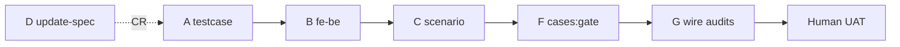
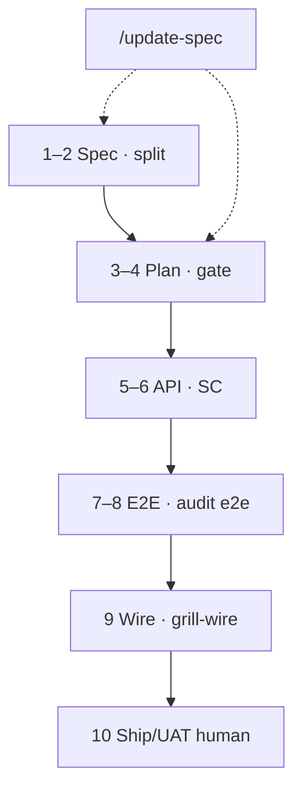

# Quality Gates & Verification Milestones

**SSOT Scope:** **When** to execute `flowgrid audit *` and `cases:gate`; safe phase transitions; and the artifact completeness chain (bundle ↔ TC ↔ FE-BE ↔ scenario).

**Out of Scope:** Detailed command options → [references/cli-and-commands.md](../references/cli-and-commands.md#audit--harness-pr-workflow).

**Context:** [index.md](./index.md#full-cycle) · Human adversarial review: [grill-and-human-review.md](./grill-and-human-review.md) · Design leaf sign-off: [design-leaf-signoff.md](./design-leaf-signoff.md) · Wire & Ship: [wire.md](./wire.md).

---

## When to Run (By Lane) {#when-to-run}

| Milestone | Recommended Command / Skill | Who Reviews Results |
|---|---|---|
| Post `/spec`, `/update-spec` | `flowgrid audit spec` (`--type`) | BA / Dev grill reviewer |
| Contract grilling (docs) | `/grill-api-spec` · `audit api` | Backend Dev + BA |
| Backend prior to wiring | `/audit-api` · `audit api` | Backend Dev |
| Prior to closing testcases | `cases:check`, `audit testcase` (+ `--bundle`) | Quality Engineer (QA) |
| Test hub release gate | `cases:gate` (`--strict`, `--docs-root`) | QA + `/grill-testcase` |
| Pre-wire E2E verification | Scoped `test:e2e` · `audit e2e` | Frontend Dev + QA |
| **Post `/wire`** | **`/grill-wire`** or `audit e2e` + `audit fe-be` + `audit scenario` | Frontend Dev + QA |
| Detailed TC matrix vs PO | `/grill-test` following green `/test` run | QA / Frontend Dev |
| Legacy adoption audit | `audit legacy` | Technical Lead |
| **Prior to leaf merge/UAT** | Steps 1–10 [§ Closing a Function](#close-one-function) · human sign-off [grill § sign-off](./grill-and-human-review.md#human-signoff) | Lead / PM / QA |

Tooling **does not** execute automatically — team members invoke the CLI/skills at appropriate gates. Skipping steps introduces process risks (see [grill-and-human-review.md](./grill-and-human-review.md)).

---

## Reference Flows (Standard Delivery Cycles)

### Authoring a New Feature / Screen

```text
/spec → audit spec → grill-bqa / grill-dev → split (repeated after each bundle patch / grill cycle)
→ /testcase (bundle SSOT, schema v2, traceability) — can run in parallel after grill round 1 (design.md)
→ cases:gate [--strict] + FLOWGRID_DOCS_ROOT
→ testcase:gen → Playwright (e2e-root)
→ (policy) Manual exploratory E2E review before release
```

### Change Requests (CR)

```text
/update-spec → audit spec (mandatory in skill) → split
→ re-grill-bqa / grill-dev if UX affordances or bundle.gen change
→ patch TC alongside affected W-* / bundle impact
→ cases:gate --strict
→ /grill-testcase (reads gate output)
→ gen + IT + manual E2E (team policy)
→ if already wired: re-run `/grill-wire` following TC/spec patch
```

### Post-Wire Behavior Drift

```text
UAT / Staging identifies acceptance criteria deviation
→ docs /update-spec (or /api-update) — NEVER patch silently in FE code alone
→ split/render → tests /grill-testcase if scenario matrix changes
→ FE /wire or /test → /grill-wire
→ Human leaf sign-off (Step 10)
```

Detailed loop: [wire.md § gap](./wire.md#gap-loop) · [grill-and-human-review § post-wire](./grill-and-human-review.md#post-wire-loop).

---

## Completeness Chain (SSOT Chain) {#ssot-chain}

Testcase policy: `/testcase` reads **`*.bundle.yaml`** directly. If the bundle is missing or `flowgrid check` detects drift → STOP and split from docs hub first.

| Phase | Implemented Engine / Skill | Objective |
|---|---|---|
| **A** | `audit testcase --bundle` | Trace scenario/AC/actions ↔ TC |
| **B** | `audit fe-be` + grill-dev | Validate `apiRef` ↔ `01-backend-spec` |
| **C** | `audit scenario` + `/scenario` | Validate `FLOW` / SC `screens[]` ↔ `cases/**` |
| **D** | `/update-spec` rules | Verify delta design ↔ `userStories` / AC |
| **F** | `cases:gate`, TC schema v2 | Tests-docs release gate |
| **G** | `/wire` + `/grill-wire` | Post-wire `audit e2e` + `fe-be` + `scenario`; plan ↔ live API |
| **E** | *(DevOps, optional)* | CI automation: `check`, `cases:gate`, `doctor`, scoped `audit e2e` |



---

## 10-Step Leaf Closure Overview {#close-leaf-overview}



---

## Closing a Function (`W-*`) {#close-one-function}

Recommended checklist before considering a single **leaf** (screen / API sequence) artifact-complete — distinct from a macro whole-product release checklist:

**Prerequisite (Once per workspace):** [phase-0-setup.md](./phase-0-setup.md) — Initialize workspace, `registry:sync`, or archaeological code inspection prior to batch `/spec` authoring.

| # | Milestone | Command / Skill | Verification / Review |
| --- | --- | --- | --- |
| 1 | Spec & Grill | `flowgrid audit spec` (`--type`) · `/grill-bqa` · `/grill-dev` | Review `gaps[]` / confirms; stakeholder agreement |
| 2 | IR Synchronization | `flowgrid split` · `flowgrid check` | Bundle ↔ `ir/*` aligned before testcases or codegen |
| 3 | Tests-Docs Plan | `/testcase` · `/grill-testcase` | `cases:check` · `audit testcase --bundle` |
| 4 | Plan Quality Gate | `cases:gate --strict` + `FLOWGRID_DOCS_ROOT` | Schema v2 compliance, traceability, facet matrix |
| 5 | Backend Contract | `audit api` · `audit fe-be` | `apiRef` ↔ `01-backend-spec.yaml` parity |
| 6 | Cross-Flow (if SC) | `audit scenario` | `screens[]` covered by `TC-*.yaml` or deferred with `QA-*` |
| 7 | E2E (e2e-root) | `testcase:gen` · `/test` · `/grill-test` | TC matrix ↔ PO acceptance ↔ `*.spec.ts` |
| 8 | Plan ↔ Execution | `flowgrid audit e2e` (`--e2e-root`, `--tests-docs`) | Plan hub matches scoped Playwright test spec |
| 9 | Wire (Live API) | `/wire` · post-wire scoped E2E — [wire.md](./wire.md#wire-gates) | `/grill-wire` or `audit e2e` · `audit fe-be` · `audit scenario` |
| 10 | Ship / UAT (Leaf) | Manual acceptance per bundle AC (team policy) · product merge checklist | **Human** confirms scope sufficiency; new behavior → `/update-spec` **before** step 10 |

> **Audit Pass ≠ Ship:** Clean JSON with 0 critical gaps does not replace formal PM/QA UAT sign-off — [grill-and-human-review § sign-off](./grill-and-human-review.md#human-signoff).

---

## Audit Command ↔ Artifact Matrix

| Command | Primary Verification Focus |
|---|---|
| `audit spec` | Bundle integrity + UX affordance (`UX_*`, `confirms`) |
| `audit api` | Backend API YAML contracts |
| `audit testcase` | TC v2 schema; `--bundle` cross-reference |
| `audit fe-be` | Bundle `apiRef` vs backend specifications |
| `audit scenario` | SC screen coverage vs testcases |
| `audit flow` | `FLOW-*.md` journey consistency |
| `audit e2e` | `TC-*.yaml` (tests-docs) ↔ Playwright specs (`--e2e-root`, `--tests-docs`) |
| `audit legacy` | Legacy adoption index |
| `cases:gate` | Schema + TC audit + bundle trace + matrix facets |

---

## Human-in-the-Loop Risk Analysis

| Command | Warning Indicators | Deciding Authority |
|---|---|---|
| `audit spec` | `gaps[]`; **`confirms[]`** wizard (`CONFIRM_UX_*`, **`CONFIRM_DB_*`** vs ERD/`01`); `warnings[]` metrics | `/spec` author, BA, Dev grill |
| `cases:gate` | Schema errors, matrix facet voids, bundle trace gaps | QA / grill-testcase |
| `audit testcase --bundle` | Unmapped scenario / AC / actions | Testcase author |
| `audit scenario` | `screens[]` lacking matching TC | Cross-flow owner |
| `audit e2e` | `missingInPlaywright`, `matrixRowsUncovered` | `/test` · `/grill-test` · `/grill-wire` |
| `audit fe-be` | `FEBE_*` alignment mismatches | `/api-update` (docs) · re-wire |

JSON output is intended for **review and informed decision-making**, never replacing human judgment regarding release readiness.
