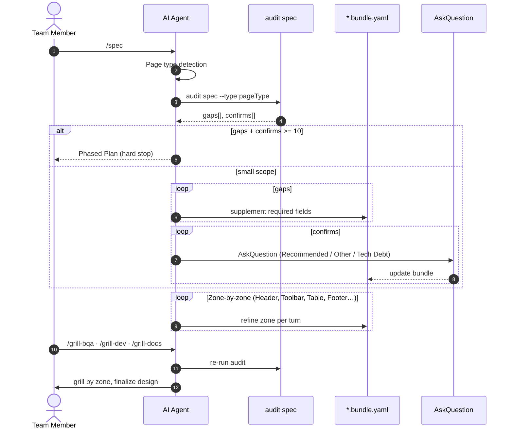
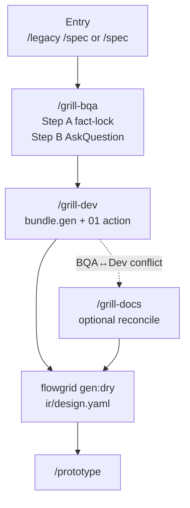
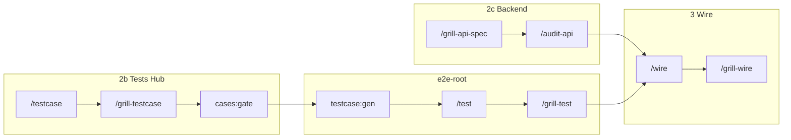

# Grilling, Reviews & Human Accountability

**Scope (SSOT):** Team members **reviewing, grilling, and finalizing decisions**; AI does not replace the Product Owner; **qualitative reasoning** (grilling / deep logic) vs **quantitative validation** (deterministic audit scripts reporting `gaps[]` / `confirms[]`).

**Not covered here:** Audit CLI flags → [references/cli-and-commands.md](../references/cli-and-commands.md#audit--harness-pr-workflow) · QA tag taxonomies → [artifacts/dsl.md](../artifacts/dsl.md).

**Lane Context:** [design.md](./design.md) · [backend.md](./backend.md) · [test.md](./test.md) · [wire.md](./wire.md) · Gate milestones: [gates.md](./gates.md#close-one-function).

---

## One-Sentence Philosophy

**The toolchain provides the SSOT, skills, and deterministic audits with standardized error codes — the human team chooses to execute workflows faithfully, interpret gaps, and make conclusive decisions.**

AI **standardizes** YAML/IR; human members **review** Markdown and visual prototypes. The toolchain **never** promises zero defects if members bypass grilling/auditing or merge passing gates superficially.

| Toolchain (Product) | Team Responsibility (Human Process) |
|----------------------|-----------------------------------|
| Skills `/spec`, `/update-spec`, `/testcase`, `flowgrid audit *`, `cases:gate`, `testcase:gen` | Running skills when appropriate; reading gap JSON outputs; grilling domain business rules |
| AskQuestion + `qa` | Selecting Recommended / Other / **Log as Tech Debt** · Team workflows: [qa-team.md](./qa-team.md) |
| `/update-spec` + re-auditing within skills | Synchronizing `TC-*.yaml` following change requests; executing manual E2E (team policy) |

**Out of scope for product:** CI/CD deployments, sprint management, tracking who skipped grilling, forcing full BQA on rapid exploratory sketches.

| Scenario | Primary Accountability |
|----------|------------------------|
| Skipping grilling/audits when skill directs them | Engineer + Tech Lead |
| `/update-spec` executed without syncing TCs / traceability | Author of change request + QA |
| Superficial Playwright test matrices | Test author + reviewer in `/grill-test` |
| Skipping `/grill-wire` after real API integration | FE Dev + QA — leaks `FEBE_*` / plan gaps |
| UAT fails but merged because "audit passed" | PM / Lead — automated audits never replace human acceptance |
| Defects escaping to production due to bypassed steps | Engineering process — toolchain does not guarantee zero bugs |

---

## Scripts (Quantitative) vs Agent (Qualitative)

```text
       SPEC / TC / API REQUIREMENTS
                    │
        ┌───────────┴───────────┐
        ▼                       ▼
  DETERMINISTIC AUDIT      AI AGENT (GRILLING)
  gaps[] · confirms[]      domain logic, zones,
  UX_* · FEBE_*            UI ↔ API ↔ TC parity
```

| Audit Output | Action & Ownership |
|--------------|--------------------|
| `gaps[]` (mandatory omissions) | Agent supplements bundle/YAML (or engineer provides direction) |
| `confirms[]` (optional clarifications) | **AskQuestion** modal per question — ≥3 choices, including **Log as Tech Debt** |
| `gaps[]` + `confirms[]` **≥ 10** | **Hard Stop** — formulate phased Implementation Plan (3–5 items/phase); avoid chat spam |

**Page type detection** before `flowgrid audit spec`: read `gen.codegen.profile` or infer from prompt — always pass `--type`.

| Prompt Hints | `pageType` |
|--------------|------------|
| list, table, index, grid | `list` |
| create, new, form, input | `create` |
| detail, view, inspect | `detail` |
| login, auth, signin | `auth` |
| CRUD, entity management | `admin-crud` |

**UX affordance checks** (`UX_*`, `CONFIRM_UX_*`, `uxAffordanceGaps` in JSON): delete confirmation, `disabledReason`, filter+pagination, detail breadcrumbs — matches global UX rules in harness.

---

## `/spec` Workflow + Audits + Zones (Sequence)



### Zone-Based Analysis (Anti-Lost-in-the-Middle)

Large screens: **never** attempt all-in-one in a single prompt — dissect by **zone** (e.g. for a list: Header → Search/Filter → Table → Pagination/Empty) · one turn per zone.

Grilling: challenge assumptions **zone by zone** (e.g., timezone filters, table currency formatting).

---

## Design Grilling Chain (BQA → Dev → Dry → Prototype) {#design-grill-chain}

Following `/spec` or `/legacy /spec` — matches [design cycle](./design.md#design-cycle); diagram below shows the **grilling branch** preceding prototype implementation:



Following `PROTO` in [design.md](./design.md#design-cycle): execute `flowgrid gen` + resolve `#needs-component` within `/prototype` session, followed by **`/grill-prototype`** (UI checklist) prior to handing off to testing.

**Pending questions:** **Never** store unresolved questions in `openQuestions` on bundle/YAML. Prompt via AskQuestion → record finalized field, or log to `qa/<SHORT>_NNNN.yaml` and resolve with `/qa-resolve` (tagged `#tech-debt:QA-*` — [artifacts/dsl.md](../artifacts/dsl.md)).

### Agent Context Loading Policy

| Phase | Files to Load | What Not to Load / Forbidden Actions |
|-------|---------------|-------------------------------------|
| `/grill-bqa` | Entire `ir/design.yaml` (layout/copy) + `ir/spec.yaml` prose | Hand-editing `ir/*`; inventing fields |
| `/grill-dev` | `ir/design.yaml` + sibling `api/<seq>/01` | `bundle.spec.api`; using `ir/spec.yaml` for codegen |
| `/grill-docs` | Bundle + IR reconciliation (BQA ↔ Dev) | Re-running legacy archaeology from scratch |

Skill references: [references/skills/grill-bqa](../references/skills/grill-bqa.md), [grill-dev](../references/skills/grill-dev.md), [grill-docs](../references/skills/grill-docs.md), [qa-resolve](../references/skills/qa-resolve.md).

### `grillStatus` Tracking (on Bundle)

| Field | Set By |
|-------|--------|
| `bqaFacts` / `bqaOpen` | `/grill-bqa` |
| `dev` | `/grill-dev` once `codegen.profile` + entity/module + `01` `action` are defined — `flowgrid split` **fails** if incomplete |

Deltas following pilot runs: `/update-spec` → re-audit spec → re-grill if necessary — [gates.md](./gates.md).

---

## Role-Based Grilling Summary

| Skill | Focus |
|-------|-------|
| `/grill-bqa` | Domain logic, validations, user stories, UX affordances |
| `/grill-dev` | `bundle.gen`, actions, `#gen:*`, `#needs-component`, `ir/design` split |
| `/grill-docs` | Reconciles BQA ↔ Dev conflicts — **never** replaces individual grills |
| `/grill-prototype` | UI fidelity vs spec, mock boundaries, testIds |
| `/grill-api-spec` | Contract YAML on docs hub |
| `/audit-api` | BE code vs `01` contract before `/wire` |
| `/grill-test` | Matrix alignment across spec ↔ TC ↔ Playwright — audit without blind regeneration |
| `/grill-wire` | Post-wire audit chain: `audit e2e` + `fe-be` + `scenario`; routes gaps |
| `/grill-testcase` | YAML plans in tests-docs — spec gaps route to `/docs-hub /update-spec` |
| `/grill-api-spec` | Contract YAML — prior to BE codegen / wiring |
| `/audit-api` | BE implementation vs `01` — human sign-off prior to FE wiring |

`/qa-resolve` closes `qa/*` tickets — avoids hallucinating open questions on the bundle.

---

## Post-Design Grilling (Test · API · Wire) {#post-design-grill}

Following [design grill chain](#design-grill-chain) and code implementation — **qualitative grilling** continues to interleave with **quantitative audits**:



| Phase | Qualitative Grill | Quantitative Audit | Human Decision Gate |
|-------|-------------------|--------------------|---------------------|
| Plan | `/grill-testcase` — AC/matrix facet coverage | `cases:gate`, `audit testcase --bundle` | QA: Plan covers full domain logic, not just happy path |
| Automation | `/grill-test` — PO/testIds fidelity | `audit e2e` | Dev + QA: Spec matches TC; no raw brittle locators |
| Contract | `/grill-api-spec` | `audit api`, `audit fe-be` | BE + Dev: Real fields and HTTP status codes |
| Wire | HANDOFF `#wire-only` validation | `/grill-wire` full chain | Never ship bypassed auth or mock data |

Lane specifications: [test.md](./test.md) · [backend.md](./backend.md) · [wire.md](./wire.md).

---

## Post-Wire Gap Remediation (Human + Agent) {#post-wire-loop}

When staging, UAT, or `/grill-wire` reveals that **specs, plans, or contracts** are inaccurate — **return to docs/tests lanes**; do not patch single FE lines and close tickets prematurely:

| Discovery | Source Grill / Audit | Team Action |
|-----------|----------------------|-------------|
| UX / AC / Copy discrepancies | UAT, grill-test | `/update-spec` → re-audit spec → `/grill-testcase` if matrix changed |
| `01` Contract / DTO errors | `audit fe-be`, `/audit-api` | `/api-update` → BE redeploy → `/wire` |
| Missing post-wire test facets | `audit e2e` | Patch tests hub YAML → `cases:gate` → `testcase:gen` → `/test` → `/grill-wire` |
| Deliberate deferral | AskQuestion **Tech Debt** | Record in `qa` with `QA-*` / `coverage_deferred` on scenario |

Agent extracts: FE `wire-audit-loop.md` · Tests `wire-test-handoff.md` · Docs `wire-spec-feedback.md`.

---

## Human Sign-off vs Automated Audit Pass {#human-signoff}

| Dimension | Automated Audit / Gate (Tool) | Human Sign-off (Team) |
|-----------|-------------------------------|-----------------------|
| **Primary Question** | Does artifact match SSOT schema? | Does customer/PO accept real behavior? |
| **Output** | `gaps[]`, zero exit code | UAT sign-off document, merge approval, release notes |
| **Owner** | Agent + Dev/QA parsing JSON | PM, BQA, Engineering Lead |
| **Timing** | Following every skill requiring audit | **Milestone 10** in [gates § Close Leaf](./gates.md#close-one-function) |

Suggested checklist prior to declaring a leaf **Ship-Ready**:

| # | Item | Evidence Source |
|---|------|-----------------|
| 1 | Spec & grilling finalized for scope | `audit spec` has no blockers; grilling rounds completed |
| 2 | Plan & gates passed on tests-docs | `cases:gate --strict` exits 0 |
| 3 | E2E & wire audits verified | `/grill-wire` or equivalent — [wire sign-off](./wire.md#wire-signoff) |
| 4 | Manual / UAT sign-off (if enabled) | AC bundle / grilled TCs — signed by **human stakeholder** |
| 5 | Zero unspecified behaviors | All deltas routed through `/update-spec` prior to Milestone 10 |

**Scripts pass + human has not accepted UAT** → Remain **STOPPED** at Milestone 10; never treat tool passes as a complete release guarantee.

---

## Pre-Codegen Grilling Conventions

Detailed constraints reside in skills (`harness/docs/skills/…`, `harness/tests/skills/…`) and `flowgrid audit *` output. The table below summarizes expected behaviors from Design through codegen.

| Area | Rule |
|------|------|
| Page Type | `/spec` and grilling invoke `flowgrid audit spec --type <pageType>` — emits `gaps[]` / `confirms[]` |
| Confirmation Volume | Total `gaps` + `confirms` ≥ 10 → skill pauses, drafts phased plan (no unorganized Q&A) |
| Large Screens | Decompose by **zone** — one turn per zone (prevents lost-in-the-middle degradation) |
| Design Chain | BQA → Dev → (`/grill-docs` on conflict) → `gen:dry` — [§ Design Grilling Chain](#design-grill-chain) |
| Unresolved Gaps | Log to `qa/*` or resolve directly on bundle — never invent data |
| Post `/update-spec` | Skill requires **re-auditing spec** prior to safe split/merge |
| Post-Wire Gaps | `/grill-testcase` or `/update-spec` → repeat automation + `/grill-wire` |
| Leaf Closure | 10-step sequence with human sign-off at Milestone 10 — [gates.md](./gates.md#close-one-function) |

Audit and gate milestones by lane: [gates.md § When to Run](./gates.md#when-to-run) · [SSOT Chain](./gates.md#ssot-chain) · [10 Milestones Overview](./gates.md#close-leaf-overview).
