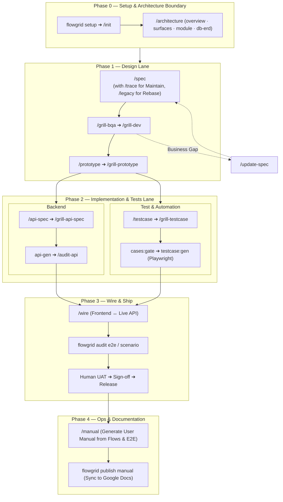

# Development Workflows Overview

This document presents the complete lifecycle workflow spanning from [Phase 0 Setup](./phase-0-setup.md) to [Wire](./wire.md) and final release sign-off:

- **Project Initialization & Configuration (Phase 0):** See detailed instructions in [Phase 0 — Setup & Project Scaffolding](./phase-0-setup.md) across three project scenarios: Greenfield, Maintain, Rebase.
- **Leaf Closure Checklist (`W-*`):** [gates § Closing a Function](./gates.md#close-one-function) (**10 Milestones**, Step 10 = Human UAT/Ship) — the authoritative SSOT during adversarial grill and audit.
- **Grill vs Audit, Zone Analysis, and AskQuestion Wizard:** [grill-and-human-review.md](./grill-and-human-review.md).
- **Specialized Phase Details:** Explore dedicated lanes: [Design](./design.md) ➔ [Backend](./backend.md) ➔ [Test](./test.md) ➔ [Wire](./wire.md).

---

## 1. End-to-End Feature Lifecycle

Every feature specification or screen (`W-*` / leaf) progresses through a standardized 4-phase lifecycle:

| Phase | Primary Focus | Core Responsibility | Lane Details |
| :--- | :--- | :--- | :--- |
| **Phase 0: Setup & Boundary** | Repository scaffolding, surfaces mapping, system architecture, module boundaries | Lead / Architect | [Phase 0 Setup](./phase-0-setup.md) · [Architecture](./architecture-data.md) |
| **Phase 1: Design** | Leaf bundle specification, adversarial business grilling, interactive prototype | BA / Frontend Dev | [Design](./design.md) |
| **Phase 2: Code & Test** | Backend API contract agreement, test scenario matrix authoring, automated E2E codegen | Backend Dev / QA | [Backend](./backend.md) · [Test](./test.md) |
| **Phase 3: Wire & Ship** | Wiring frontend ↔ real backend API, regression E2E runs, UAT & Sign-off | Frontend Dev + QA + PO | [Wire](./wire.md) · [Gates](./gates.md) |
| **Phase 4: Ops & Docs** | User manual generation, Google Docs / Help Center sync | BA / CS | [User Manual](./build-user-manual.md) |

---

## 2. Phase Execution Details

### Phase 0: Setup & Boundary
- **Scaffolding:** Run `flowgrid setup [name]` to scaffold the SSOT skeleton (`source-code/`, `source-legacy/`, `registries/`, Arc42 docs).
- **Discovery:** Run skill `/init` to map surfaces and configure `platform-repos.local.json`.
- **Architecture:** Use `/architecture`, `/overview`, `/surfaces`, `/module`, and `/db-erd` to establish system boundaries prior to screen authoring.
- *Details:* [phase-0-setup.md](./phase-0-setup.md) and [architecture-data.md](./architecture-data.md).

### Phase 1: Design Lane
- **Spec Authoring:**
  - *Greenfield:* Run `/spec` to author complete bundle specifications (`<slug>.bundle.yaml`, `ir/design.yaml`, `ir/spec.yaml`).
  - *Maintain Projects:* Complement with `/trace` to inspect existing code in `source-code/`.
  - *Rebase Projects:* Complement with `/legacy` to extract archaeological logic from `source-legacy/`.
- **Adversarial Review (*Grill*):** Run `/grill-bqa` (business depth) and `/grill-dev` (technical viability) to refine specifications.
- **Early Feedback Prototype:** Run `/prototype` to generate interactive prototypes (HTML/Vue/React) for stakeholders to test usability prior to writing production code.
- *Details:* [design.md](./design.md).

### Phase 2: Implementation & Tests Lane
- **Backend API:**
  - Define REST/DTO contracts at `api/<seq>/01-backend-spec.yaml` using `/api-spec`.
  - Review contracts with `/grill-api-spec`, scaffold controllers/services via `api-gen`, and verify with `/audit-api`.
- **Tests-Docs & E2E Automation:**
  - QAs author test scenario matrices on the tests-docs hub via `/testcase`, `/scenario`, and `/grill-testcase`.
  - Run `cases:gate` to validate test coverage, followed by `testcase:gen` to automatically generate production-ready Playwright E2E suites (`*.spec.ts`) in the frontend codebase.
- *Details:* [backend.md](./backend.md) and [test.md](./test.md).

### Phase 3: Wire & Ship
- **Integration (*Wire*):** Frontend engineers execute `/wire` to connect UI components with live backend APIs, eliminating mock fixtures.
- **Regression Auditing:** Execute automated Playwright E2E suites and verify spec ↔ code parity via `flowgrid audit e2e`.
- **Human UAT & Release:** Stakeholders perform final User Acceptance Testing (UAT) against acceptance criteria to sign off and close the screen ([gates § Step 10](./gates.md#close-one-function)).
- *Details:* [wire.md](./wire.md) and [gates.md](./gates.md).

---

## 3. Responsibility Matrix (T-Shaped Team)

Roles are structured around **deliverable artifacts** rather than rigid job titles:

| Role | Primary Scope | Core Deliverables (Artifacts) | Recommended Skills & Commands |
| :--- | :--- | :--- | :--- |
| **Solution Architect / Lead** | System architecture, module boundaries, deployment topologies | `overview/`, `architecture/`, `FLOW-*` | `/architecture`, `/overview`, `/surfaces`, `/module`, `/db-erd` |
| **Business Analyst (BA)** | Business requirements, acceptance criteria, clarifying questions | Leaf bundle specs, interactive prototypes | `/spec`, `/grill-bqa`, `/prototype` |
| **Software Engineer (Dev)** | Screen technical design, API contracts, production implementation | `ir/design.yaml`, `01-backend-spec.yaml`, production code | `/spec`, `/grill-dev`, `/api-spec`, `/api`, `/wire` |
| **Quality Engineer (QA)** | Test matrices, test scenarios, E2E automation | `TC-*.yaml`, Playwright E2E (`*.spec.ts`) | `/testcase`, `/scenario`, `testcase:gen`, `/test` |

---

## 4. Primary Slash Commands Cheat Sheet

| Command / Skill | Phase | Primary Purpose |
| :--- | :--- | :--- |
| `flowgrid setup [name]` | Phase 0 | Scaffolds workspace skeleton and configures agent harnesses. |
| `/init` | Phase 0 | Discovers repositories, maps surfaces, and initializes repo maps. |
| `/architecture` | Phase 0 | Declares Arc42 architecture, overview, surfaces, modules, and ERD. |
| `/spec` | Phase 1 | Authors leaf bundle specifications (`.bundle.yaml`, `ir/`, data models). |
| `/trace` | Phase 1 | *(Maintain)* Archaeological inspection directly on active code in `source-code/`. |
| `/legacy` | Phase 1 | *(Rebase)* Strictly Read-Only extraction from `source-legacy/` into new codebase. |
| `/grill-bqa`, `/grill-dev` | Phase 1 | Adversarial business grilling and technical viability verification. |
| `/prototype`, `/grill-prototype` | Phase 1 | Generates and reviews living interactive prototypes. |
| `/api-spec`, `/grill-api-spec` | Phase 2 | Authors and grills backend API contracts. |
| `/testcase`, `/grill-testcase` | Phase 2 | Constructs test scenario matrices on the tests-docs hub. |
| `testcase:gen` | Phase 2 | Generates Playwright E2E automation from testcase YAML. |
| `/wire`, `/grill-wire` | Phase 3 | Wires frontend UI to live backend APIs, auditing spec ↔ code alignment. |
| `/manual` | Phase 4 | Generates User Manuals from user journey flows and E2E test evidence. |
| `flowgrid publish manual` | Phase 4 | Synchronizes User Manuals to Google Docs with Anti-Quotas API handling. |
| `/update-spec`, `/qa-resolve` | Any Phase | Patches deltas upon requirement changes or closes open QA items. |

*See comprehensive CLI commands and options in:* [CLI & Commands](../references/cli-and-commands.md).
