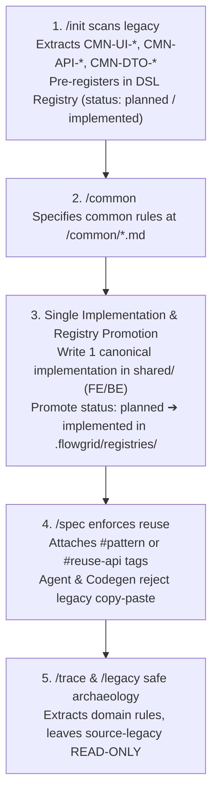
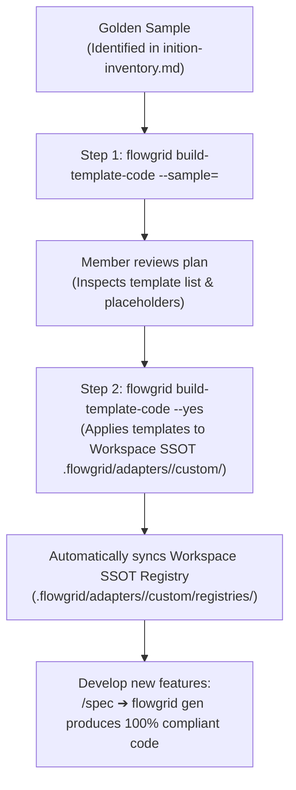

# Phase 0 — Setup & Project Initialization

This guide details the first setup step (Phase 0) using the `flowgrid setup` command and workflow execution across **3 real-world project contexts**:
1. **Greenfield:** Building a completely new product from scratch.
2. **Maintain:** Continuing development and maintenance on an existing codebase.
3. **Rebase / Modernization:** Rebuilding from an older legacy system.

---

## Phase 0 Flowchart

```mermaid
flowchart TD
  START(["Start: flowgrid setup [workspace]"]) --> CHOICE{"Project Context?"}

  %% Branch 1: Greenfield
  CHOICE -->|1. Greenfield<br/>(Brand new product)| GF_DOCS["Author overview, architecture<br/>Define surfaces"]
  GF_DOCS --> GF_REPO["Create code repos<br/>under source-code/"]
  GF_REPO --> GF_INIT["Run /init<br/>(Map repos & surfaces)"]
  GF_INIT --> NEXT_PHASE

  %% Branch 2: Maintain
  CHOICE -->|2. Maintain<br/>(Existing codebase)| MT_REPO["Place existing repos<br/>under source-code/"]
  MT_REPO --> MT_INIT["Run /init<br/>(Scan & identify config)"]
  MT_INIT --> MT_NEXT["Enter Design Phase:<br/>Use /trace for codebase archaeology"]
  MT_NEXT --> NEXT_PHASE

  %% Branch 3: Rebase
  CHOICE -->|3. Rebase<br/>(System modernization)| RB_LEGACY["Place legacy code in source-legacy/<br/>(STRICTLY READ-ONLY)"]
  RB_LEGACY --> RB_EXTRACT["Run /extract-legacy<br/>(Extract legacy modules & surfaces)"]
  RB_EXTRACT --> RB_NEW["Initialize new target code repos<br/>under source-code/"]
  RB_NEW --> RB_INIT["Run /init<br/>(Configure new project)"]
  RB_INIT --> RB_NEXT["Enter Design Phase:<br/>Use /legacy for feature recovery"]
  RB_NEXT --> NEXT_PHASE

  NEXT_PHASE(["Transition to feature lifecycle:<br/>Design ➔ Codegen ➔ Test ➔ Wire"])
```

---

## Detailed Scenarios

### 1. Greenfield Scenario (Brand New Project)

Applies when building a product entirely from scratch.

- **Step 1: Initialize Workspace Skeleton**
  ```bash
  flowgrid setup my-project [--mode=base|custom]
  ```
  The CLI supports two scaffolding modes:
  - **`base` (default):** Populates the full skeleton framework + standard sample common patterns/components (`surfaces/common`, `03-user-flows/FLOW-login.md`, global templates) as initial reference documentation.
  - **`custom`:** Scaffolds only core docs structure and VitePress dev hub (`.vitepress/`, `architecture/`, `overview/`, `registries/`, `source-code/`), **without** injecting skeleton sample common files and templates — keeping the workspace clean tailored to custom project needs.
- **Step 2: Formulate High-Level Directives**
  - Author documentation in `overview/index.md` (Vision, Personas, Release Goals).
  - Declare architecture under `architecture/` (Arc42, Technical Constraints, Database ERD).
  - Define application surface catalog under `surfaces/` (List surfaces: Web Admin, Mobile App, Portal, etc.).
- **Step 3: Initialize Code Repositories**
  - Create or clone new source code repositories under `source-code/` (recommended as Git Submodules).
- **Step 4: Identify Configurations**
  - Open AI Agent and run the **`/init`** skill to inspect workspace, generate link config `platform-repos.local.json`, and map all surfaces.
- **Next:** Proceed with downstream lifecycle phases: [Design](./design.md) ➔ [Backend](./backend.md) ➔ [Test](./test.md) ➔ [Wire](./wire.md).

---

### 2. Maintain Scenario (Maintenance & Extension of Existing Project)

Applies when onboarding an active codebase into FlowGrid standards to add features or upgrade without rewriting from scratch.

- **Step 1: Initialize Workspace Skeleton**
  ```bash
  flowgrid setup my-project
  ```
- **Step 2: Mount Existing Source Code**
  - Clone or move all current source repositories into `source-code/`.
- **Step 3: Configuration & Archaeology**
  - Run the **`/init`** skill in the AI Agent to scan codebase, detect technology stacks, generate repo maps, and associate surfaces matching the actual code structure.
- **Step 4: Enter Design Phase with Archaeology**
  - When initiating or modifying features in the [Design](./design.md) phase, **consistently use the `/trace` skill**:
    - The Agent scans active code in `source-code/` to verify logic, reverse-engineering Data Models, API contracts, and business flows into standardized spec files.
    - Guarantees accurate specifications without breaking implicit system behaviors.

---

### 3. Rebase / Modernization Scenario (Modernizing Legacy Systems)

Applies when performing an architectural overhaul (e.g., migrating from Monolith to Microservices, or PHP/WebForms to Nuxt/Next/NestJS), preserving domain business rules while adopting modern tech stacks.

- **Step 1: Initialize Workspace Skeleton**
  ```bash
  flowgrid setup my-project
  ```
- **Step 2: Isolate Legacy Codebase**
  - Place old source repositories into `source-legacy/`.
  - **Inviolable Rule:** `source-legacy/` is **STRICTLY READ-ONLY**. Never modify or copy-paste raw code from this directory into new codebases.
- **Step 3: Global Legacy Extraction with `/extract-legacy`**
  - Run the **`/extract-legacy`** skill in the AI Agent:
    - Deep scans legacy source trees to extract module maps, screen catalogs, API rosters, and common rules (`CMN-*`).
    - Emits functional catalogs into `surfaces/` and `architecture/`.
- **Step 4: Initialize New Codebase**
  - Create repositories for the new tech stack and place them under `source-code/`.
  - Run the **`/init`** skill to bind the new code repositories to the extracted SSOT documents.
- **Step 5: Enter Design Phase with Feature Recovery**
  - When authoring screens/features in the [Design](./design.md) phase, **use the `/legacy` skill**:
    - The Agent reads corresponding legacy code from `source-legacy/`, extracting 100% of core domain rules, DTOs, validation constraints, and UI states into the new spec.
    - Ensures clean-slate new code inheriting domain behavior without legacy technical debt.

---

## 4. Skills & Anti-Copy-Paste Guard

A critical problem during maintenance or modernization is **widespread duplicate copy-paste code** across modules (e.g., the same Confirm Modal, pagination table, or Excel export logic re-implemented across 4–5 controllers/views).

FlowGrid enforces a closed-loop skill set to eliminate code duplication starting at Phase 0:



### Anti-Duplication Skill Breakdown:

1. **Skill `/init` (Scan, Common Classification, Placement Discovery & DSL Registry Pre-Registration)**:
   - In Common Discovery mode, the Agent scans controllers, services, routers, and views for duplicate logic appearing across 2+ locations, grouping findings into **two distinct categories**:
     - **Category 1 — Existing Commons (Already implemented in base/shared):** Components/services already present in shared libraries (e.g., `ConfirmModal.vue`, `BaseServiceImpl.php`). **DO NOT plan code generation** for these; generate Markdown User Stories (`<LCA>/common/<CMN-ID>.md`) to complete the SSOT documentation, and register into DSL Registry (`design.registry.json` or `be-capabilities.registry.json`) with `status: "implemented"`.
     - **Category 2 — Duplicate Candidates (Duplicated in multiple places):** Logic/UI duplicated across 2+ locations lacking a shared component. These **require an Action Plan (`common-plan.md`)** with full Target Placement Checks (Target Repo, Target Code Path, Target Docs Path) to generate a single canonical implementation into `shared/` for **NEW features and future updates to use**. **STRICTLY NEVER modify or refactor existing code where duplicates were found** — prevent duplication from this point forward without risking regressions on running code.
   - **DSL Registry Pre-Registration (`status: "planned"`):** `/init` pre-registers duplicate candidates directly into Workspace SSOT registries (`design.registry.json` / `be-capabilities.registry.json`) with `status: "planned"` and standard tags (`#pattern: <CMN-ID>`, `#reuse-api: <CMN-ID>`). This empowers `/spec` to immediately reference shared components for upcoming screens without generating redundant ad-hoc components (`#needs-component`).
   - **Sequential Post-Init Onboarding Chain via GUI Modals (`AskQuestion`):** Immediately upon completing `common-plan.md` and architecture docs, `/init` proactively launches GUI Modal 1 asking if the member wishes to run `build-env` to set up the containerized dev stack. Upon completion (or skip) of `build-env`, `/init` launches GUI Modal 2 asking if the member wishes to execute `common-plan.md`. If "Yes", the Agent auto-generates Markdown Specs for Existing Commons and provisions shared code in `shared/` for Duplicate Candidates without requiring manual `/common` triggers.
   - **Target Placement Check:** In large or multi-repo projects, the Agent cross-references `projects` in `.flowgrid/config.json` to assign coordinates in `inition-inventory.md`:
     1. *Owning Surface & Target Repo:* Destination repository (e.g., `admin-fe`, `booking-portal`, or `core-api`).
     2. *Target Code Path:* Explicit source code file path (e.g., `source-code/admin-fe/src/components/Common/ConfirmModal.vue`).
     3. *Target Docs Path (LCA):* Markdown User Stories file path in Docs Hub (`surfaces/admin/common/CMN-UI-001.md`).
   - **Whole Page Duplication Warnings:** If 2 screen files are 90–95% identical (e.g., `CreateUser.vue` and `EditUser.vue`), the Agent recommends a single polymorphic Form Spec (`mode: create | edit`) rather than creating a `CMN-*`.

2. **Skill `/common <CMN-ID>` (User Stories Spec, Shared Code Generation & Registry Promotion)**:
   - **Markdown `.md` Only for Stories & Rules:** Common components reside in base/shared (`shared/`). **NEVER CREATE YAML FILES OR IR ARTIFACTS FOR COMMONS**. Creating YAML for commons is redundant.
   - **Execution Branches:**
     - *Existing Common:* Agent reads existing code and generates only the Markdown User Stories `.md` file; **never regenerates code**.
     - *Duplicate Candidate:* Member approves Action Plan ➔ Agent generates User Stories `.md` + **generates single canonical implementation into `shared/`** + promotes DSL registry entry from `status: "planned"` ➔ `status: "implemented"`.
   - **Plan ➔ Fast-track Execution on Approve / Proceed:**
     - Agent drafts a concise Action Plan (target User Stories and code paths).
     - Member reviews and clicks **Approve** or **Proceed**.
     - Agent executes steps without circular confirmations:
       1. Generates User Stories & Behavior at `<LCA>/common/<CMN-ID>.md`.
       2. Generates code implementation into `shared/` (`shared/components/` for FE or `shared/services/` for BE).
       3. Updates Workspace SSOT registry (`.flowgrid/registries/design.registry.json` or `.flowgrid/registries/be-capabilities.registry.json`), promoting entry status to `"implemented"`. Never creates `registries/` directories inside code repositories.

3. **Absolute Safety Rule: Create For The Future — NEVER Mutate Existing Or Legacy Code**:
   - The purpose of Common creation: The code was detected as duplicated across old modules. We establish a single canonical implementation in `shared/` for **future features and updates to consume**, preventing future duplication.
   - **STRICTLY NEVER modify or refactor existing code where duplicates were found or in `source-legacy/`**: All existing running code remains **READ-ONLY / UNTOUCHED**. Do not replace existing working code to avoid regression risks. "Ngăn chặn duplicate từ đây chứ không sửa duplicate code cũ."

4. **Skill `/spec` & Codegen (Anti-Copy-Paste Guard Enforcement)**:
   - When authoring screens or APIs via `/spec`, bundles must attach `#pattern: <CMN-ID>` or `#reuse-api: <CMN-ID>`.
   - The AI Agent and Codegen engine **strictly reject raw copy-paste from legacy code**, enforcing `import` and reuse of registered components in `shared/`.

5. **Archaeology Pair: `/trace` & `/legacy`**:
   - `/trace` (Maintain projects): Scans active code to cross-reference data models and implicit logic without breaking flows.
   - `/legacy` (Rebase projects): Read-only extraction from `source-legacy/`, porting 100% of domain logic into clean new specs.

---

## 5. Template Training from Golden Sample (`build-template-code`)

After standardizing common components, the next challenge is ensuring that the **AI Agent and Codegen engine generate code matching 100% of project conventions, UI libraries, and architectural patterns** without drifting into generic defaults.

FlowGrid accomplishes this with `build-template-code` (paired with `/build-templates`), learning automatically from a **Golden Sample** (canonical module).

### 5.1. What is a Golden Sample?
At the end of `inition-inventory.md`, the AI Agent analyzes the codebase and identifies a **Golden Sample** — the module or surface exhibiting the cleanest architecture, clearest separation of concerns (e.g., Controller ➔ Service ➔ Repository ➔ DTO or View ➔ Component), and complete CRUD/validation examples.

### 5.2. Template Training Workflow (Tri-Sync)



### 5.3. Step-by-Step Execution:

#### Step 1: Analyze Sample Module & Output Plan (`--sample`)
Specify the path to the sample module (relative or absolute):

```bash
flowgrid build-template-code --sample=./source-code/src/modules/orders
```

*Safety Guarantee:* This step **does not overwrite any existing templates**. The CLI only scans and generates `.flowgrid/template-plan.json` containing:
- List of projected template files.
- Identified placeholder positions (`{{entity}}`, `{{fields}}`, `{{actions}}`).
- Extracted UI components and API endpoints.

#### Step 2: Build Templates on User Approval (`--yes`)
- **Fast-track Build on User Approval:**
  - Once the user/member reviews the Golden Sample proposal and clicks **Approve** or **Proceed**:
  - The Agent immediately executes `flowgrid build-template-code --yes` to **BUILD TEMPLATES IMMEDIATELY**.
  - **Do not engage in lengthy discussions.** Technical leads and engineers understand the code; approval signals readiness to proceed. Furthermore, generating templates into `.flowgrid/` does not alter legacy code, ensuring safety.

```bash
flowgrid build-template-code --yes
```

The CLI writes template files into Workspace SSOT `.flowgrid/adapters/<target>/custom/` (never into code repositories):

| Technology | Template Extension | Registry File in Workspace SSOT (`.flowgrid/adapters/<target>/custom/registries/`) |
| :--- | :--- | :--- |
| **Nuxt, Next, NestJS** | `.hbs` (Handlebars) | `design.registry.json` (FE) · `codegen.registry.json` (BE) |
| **Laravel / PHP** | `.stub` | `codegen.registry.json` |
| **FastAPI / Python** | `.j2` (Jinja2) | `codegen.registry.json` |
| **.NET / C#** | `.scriban` | `codegen.registry.json` |

*Overwriting when necessary:* To refresh all existing templates, supply `--force`:
```bash
flowgrid build-template-code --yes --force
```

#### Step 3: Feature Development with Custom Templates
From this point onward, new feature development runs smoothly:
1. Author specifications with `/spec` (inheriting `CMN-*`).
2. Critique domain and UI flows with `/grill-bqa`, `/prototype`.
3. Running `flowgrid gen` generates code strictly following project custom templates without manual refactoring.

---

## 6. Local SSOT Documentation Server (`pnpm docs:dev`)

Phase 0 setup is now complete! You can run the documentation server to browse the interactive web portal of the Workspace SSOT:

```bash
pnpm docs:dev
# or: flowgrid dev
```

This launches the VitePress dev server at `http://localhost:5173`:
- Explore Arc42 architecture, surface topologies, data models, ERDs, and API contracts as an interactive portal.
- Realtime Hot Reload on Markdown/YAML updates made on disk by the team or AI Agents.
- The single visual source of truth bridging BAs, Developers, and QA engineers across the project lifecycle.
