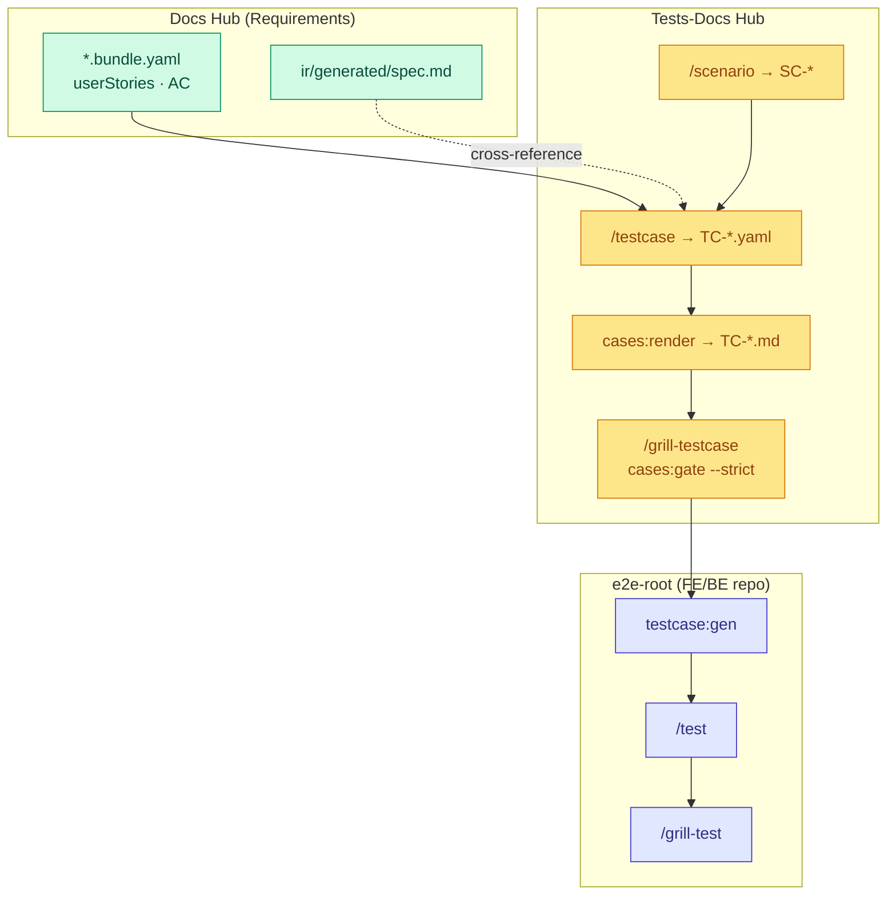
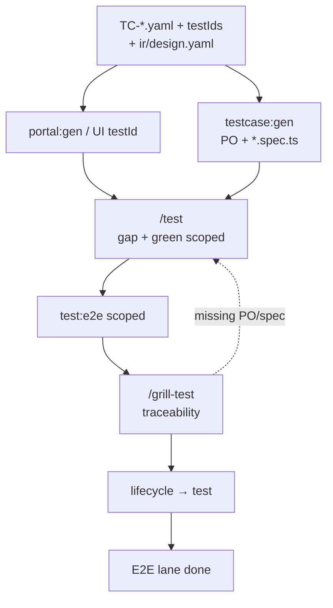
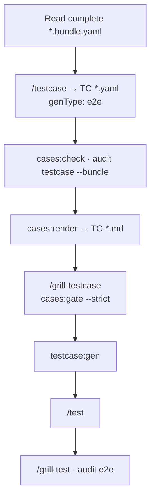
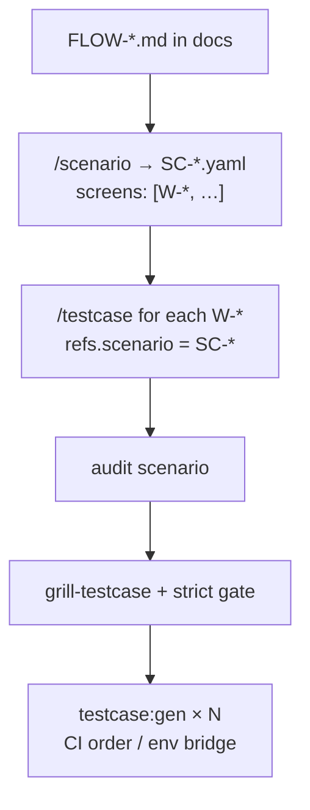
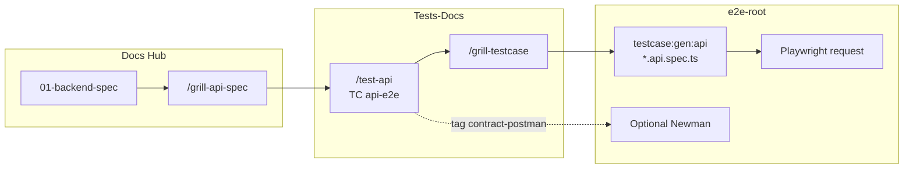

# Workflow — Test (Tests-Docs & E2E)

**Scope (SSOT):** The **Code + Test** lane — specifically the **tests-docs hub** (`TC-*`, `SC-*`), test plan grilling, quality gates, rendering human-readable test cases for QA/Devs, and automation on **e2e-root**.

**Not covered here:** Detailed TC schema, environment variables, full commands → [artifacts/tests-docs.md](../artifacts/tests-docs.md) · Playwright file layouts → [artifacts/code.md](../artifacts/code.md#e2e-root).

**Part of Macro Workflows:** [index.md#full-cycle](./index.md#full-cycle) · Phase **2b Tests** · Quality Gates: [gates.md](./gates.md#close-one-function) (steps 3–4, 7–8).

---

## Test Cycle (Phase 2b) {#test-cycle}



---

## Three Distinct Layers {#three-layers}

| Layer | Root | SSOT | VitePress Portal |
|-------|------|------|------------------|
| **Docs** | `FLOWGRID_DOCS_ROOT` | `*.bundle.yaml`, `ir/*` | Port **5173** — `spec.md`, `data-model.md`, `api.md` |
| **Tests-docs** | `FLOWGRID_TESTS_DOC` | `cases/**/TC-*.yaml`, `scenarios/**/SC-*` | Port **5174** — `TC-*.md` generated via `cases:render` |
| **Automation** | `e2e-root` | `*.spec.ts`, Page Objects | Implementation target, not planning SSOT |

**Project-Wide Coverage:** Every functional leaf in docs has a mirroring path in `TC-*`; cross-functional flows have `SC-*` + `audit scenario`; quality gates with `--strict` + `FLOWGRID_DOCS_ROOT` enforce strict **traceability** back to the bundle.

Authoring guide: [harness/tests/templates/tpl-testcase-plan.md](../../harness/tests/templates/tpl-testcase-plan.md) (from initialization to tests hub).

---

## SSOT Read / Write Responsibilities {#ssot-reading}

| Role | Reads (Review / Walkthrough) | Writes |
|------|------------------------------|--------|
| BA / PO | Docs VitePress `spec.md` (AC, scenarios) | Does not author `TC` — routes gaps to `/update-spec` |
| QA | Tests VitePress `TC-*.md` (steps, matrices, traces) | `/testcase`, `/scenario` in YAML |
| FE Dev | `TC-*.md` + `ir/design.yaml` (`testIds`) | `/test`, avoids modifying YAML plan files directly |
| Release Lead | `cases:gate --strict` JSON | Never bypasses trace/matrix criteria |

**Grill testcase** reviews the **entire** `*.bundle.yaml` — never decouple `ir/spec` and `ir/design` when designing coverage.

**UAT Excel Exports:** Deliverables exported **after** YAML/MD are locked — [tests-docs § Excel](../artifacts/tests-docs.md#team-operations-vs-excel-deliverables).

---

## E2E Lane (Automation) {#test-e2e-lane}

Vitest/PHPUnit units run on separate lanes within FE/BE repos; excluded from diagram below.



### Three Assertion Tiers (Single E2E Spec)

| Tier | Purpose |
|------|---------|
| Functional (TC steps) | Flow assertions, mock/real API verification, `data-testid` |
| Semantic (`#e2e:*`) | Layout integrity, overflow detection, clean browser console |
| Axe (WCAG) | Critical accessibility violation audits |

Details: [code.md § E2E](../artifacts/code.md#e2e-root).

### `/grill-testcase` vs `/grill-test`

| Skill | Root | Responsibility |
| --- | --- | --- |
| **`/grill-testcase`** | **tests-docs** | YAML Plan: `cases:gate --strict`, `audit testcase --bundle`, facet matrix, spec gap → docs |
| **`/grill-test`** | **e2e-root** | TC ↔ PO ↔ `*.spec.ts`, semantic `#e2e:*` — executed after `/test` is green |

### Pre-Wire vs Post-Wire

Using the same `TC-*.yaml`: `lifecycle` ≠ wire runs on mocks; `wire` targets real backend APIs. Handoff details: [wire.md § Pre/Post](./wire.md#pre-wire-post-wire).

**API Hooks:** See [§ Grill API Hook](#grill-api-hook) · Details: [tests-docs § API Hook](../artifacts/tests-docs.md#api-hook-tc).

---

## Deep Grill — Three Modes {#grill-modes}

Three distinct workflows requiring **separate sessions** — never combine `/grill-testcase` (hub) with `/grill-test` (e2e-root) in one chat prompt.

| Mode | SSOT Plan | Hub Grilling | Automation Grilling |
|------|-----------|--------------|---------------------|
| **Single Screen** `W-*` | `cases/…/TC-*.yaml` (`e2e`) | `/grill-testcase` + gate | `/grill-test` after `/test` |
| **Multi-Screen Flow** `SC-*` | `scenarios/…/SC-*` + N× `TC` | `audit scenario` + cluster gate | E2E per TC / CI sequence |
| **API Hook** | `TC` `api-e2e` | `/test-api` + `/grill-testcase` | `testcase:gen:api` (+ optional Newman) |

Agent extracts: `harness/tests/extracts/grill-screen-tc.md`, `grill-scenario-flow.md`, `grill-api-hook.md`.

### 1 — Single Functional Screen (`W-*`) {#grill-single-screen}

Objective: Achieve **full facet coverage** for **one** functional leaf, traced back to the bundle, before generating UI E2E code.



| # | Grill Plan Verification | Command / Skill |
|---|-------------------------|-----------------|
| 1 | Bundle contains user stories/AC — no fabricated test steps | STOP → `/update-spec` |
| 2 | `traceability` matches `W-*`, scenarios, `AC-*`, `btn_*` | `audit testcase --bundle` |
| 3 | Screen-level union of `testMatrix` facets (not just happy path) | `cases:gate --strict` |
| 4 | QA reads rendered test cases on VitePress tests hub | `cases:render` |
| 5 | `testIds.required` matches design post-split | grill-dev / spot DOM |
| 6 | Scoped spec passes cleanly (green) | `/test` |
| 7 | Alignment across TC ↔ PO ↔ `*.spec.ts` | `/grill-test`, `audit e2e` |

Multiple `TC-*.yaml` files may coexist in one folder (smoke + regression) — gates aggregate facets grouped by `refs.screen`.

### 2 — Multi-Screen Scenario Flows (`SC-*`) {#grill-scenario-flow}

Objective: Validate **end-to-end user journeys** adhering to `FLOW-*.md` in docs — do not flatten `scenarios/auth/…`.



| # | Grill Verification | Notes |
|---|--------------------|-------|
| 1 | `FLOW-*.md` exists prior to authoring SC | Thin FLOW → docs `/user-flow` |
| 2 | `SC.screens[]` includes all `W-*` touched in journey | Matches prose in FLOW |
| 3 | Every `W-*` has a corresponding `TC-*.yaml` **or** explicit `QA-*` deferral | `SC_SCREEN_NO_TC` check |
| 4 | Each TC individually passes trace/matrix **per screen** | `audit testcase --bundle` per leaf |
| 5 | Walkthrough: SC + rendered `TC-*.md` files | VitePress port 5174 |
| 6 | Automation | Dedicated spec per screen; avoid monolithic 50-step TC files |

**UI + API within same journey:** Two plans — `genType: e2e` (data generation) + `genType: api-e2e` (hook) — sharing `refs.scenario`; CI bridges `orderId` / tokens via env across jobs (see API hooks).

### 3 — API Hooks (Playwright `request` · Optional Newman) {#grill-api-hook}

Objective: Validate HTTP endpoints for **partners / webhooks / public APIs** — SSOT contract in docs `01`, test plan in tests-docs.



| Step | Action | Skill / Command |
|------|--------|-----------------|
| 1 | Contract `01` + API grill | [backend.md](./backend.md) |
| 2 | Author `TC` — `apiSteps[]`, `testMatrix` (401/403/404/422…) | `/test-api` · `TC.example-api.yaml` |
| 3 | Grill test plan identically to UI TCs | `audit testcase`, `cases:gate --strict` |
| 4 | Generate Playwright test suite | `flowgrid testcase:gen:api` → `tests/api-e2e/**` |
| 5 | Execute in CI pipeline | `FLOWGRID_API_TEST_BASE_URL`; secrets via env |
| 6 | (Optional) Partner Collections | Newman in `integrations/postman/`; tag `contract-postman` — **never** replaces YAML SSOT |

| Tool | Role |
|------|------|
| **Playwright `request`** (FlowGrid gen) | Standard pipeline — traces `TC` ↔ spec, `audit e2e` |
| **Newman** | Partner collection replays / complex HMAC workflows — isolated CI job linked via tag |
| **BE Unit** (Supertest/pytest) | Webhook signatures, idempotency, DLQ verifications — complementary, not replacing hub plans |

Portal order creation + partner export call: SC couples **UI TC** + **api-e2e TC** — `audit scenario` grilling must identify both.

---

## Preconditions Before Entering Lane {#preconditions}

- Docs leaf has a bundle with complete `userStories` / `acceptanceCriteria` (or accepted deferral with `QA-*`).
- `flowgrid check` / split succeeds on the bundle prior to batch testcase grilling.
- `FLOWGRID_DOCS_ROOT` + `FLOWGRID_TESTS_DOC` configured (`flowgrid doctor`).
- Path `cases/…` strictly **mirrors** `surfaces/…` — avoid ad-hoc flat paths.

---

## Workflow Steps {#steps}

| Order | Action | Role | Skill / Gate |
|-------|--------|------|--------------|
| 0 | (Optional) Cross-flow inventory | QA / BA | `/scenario` when `FLOW-*.md` exists |
| 1 | Testcase YAML v2 authoring | QA | `/testcase`, `cases:check` |
| 2 | Render human-readable user cases | QA / Any | `flowgrid cases:render` → open VitePress tests hub |
| 3 | Grill test plan | QA + Member | `/grill-testcase`, `audit testcase --bundle` |
| 4 | Tests-docs quality gate | QA / Release | `cases:gate --strict` + `FLOWGRID_DOCS_ROOT` |
| 5 | Generate Playwright test suite | Dev / QA | `testcase:gen` (`genType: e2e`) |
| 5b | Author API hook plan | QA / Dev | `/test-api`, `genType: api-e2e` |
| 6 | Implement & reach green state | Dev | `/test`, scoped `test:e2e` |
| 7 | Grill automation implementation | Dev + QA | `/grill-test` |
| 8 | Audit plan vs execution | QA | `flowgrid audit e2e` (policy) |

Leaf closure milestones: [gates.md § Close One Function](./gates.md#close-one-function) steps 3–4, 7–8.

### Summary of `TC-*.yaml` Content

- `schemaVersion: 2`, comprehensive `testMatrix` facets, `steps`, `traceability`, `testIds.required`.
- Business-rich `story` / `description` — concise `title`; leverage `meaning`/`purpose` from bundle when drafting steps.
- Template: `harness/tests/templates/TC.example.yaml`.

### Grill Cycles (Who Does What)

| Step | Who | Responsibility |
|------|-----|----------------|
| Spec / testIds | BA / Dev | `ui.testIds`, `#e2e:*` when necessary |
| `portal:gen` | Script | Injects `data-testid` onto UI |
| `testcase:gen` | Script | Page Objects + `.spec.ts` |
| `/test` | Dev + AI | Resolves fixture gaps, achieves scoped green pass |
| `/grill-test` | Dev + AI | Validates TC ↔ PO ↔ spec matrix alignment |

---

## Test Plan Sign-off (Voluntary per Team) {#test-signoff}

Prior to batch `testcase:gen` or IT release sign-off:

| # | Item | Verification |
|---|------|--------------|
| 1 | **Gate** | `cases:gate --strict` passes with `FLOWGRID_DOCS_ROOT` |
| 2 | **Trace** | Every TC has `traceability` matching bundle screen/scenario/AC/actions |
| 3 | **Matrix** | Comprehensive union of facets across the screen (audit / gate) — not just happy path |
| 4 | **Readability** | `TC-*.md` rendered in VitePress — QA walkthroughs without opening raw YAML |
| 5 | **Docs Parity** | Spot-check AC in `spec.md` ↔ `acceptanceRefs` |
| 6 | **Deferrals** | Uncovered gaps explicitly mapped to `QA-*` / `coverage_deferred` |

```text
Test plan sign-off: <screen W-*> | reviewer | date | cases:gate strict OK
```

---

## Handoff {#handoff}

- **Upstream Design updates:** Domain gaps discovered → docs `/update-spec` (paste prompt from `/grill-testcase`).
- **Wire:** Post-wire scoped E2E — [wire.md](./wire.md).
- **Backend:** API-only flows — [backend.md](./backend.md) + `api-e2e` TCs.

---

## Quick Links

| Topic | Page |
|-------|------|
| Schema, directory mirroring, API hooks | [artifacts/tests-docs.md](../artifacts/tests-docs.md) |
| Skill `/testcase` | [references/skills/testcase.md](../references/skills/testcase.md) |
| CLI commands `testcase:gen` / `cases:*` | [references/skills/testcase-gen.md](../references/skills/testcase-gen.md) |
| CLI agent extract | [testcase-gen-cli.md](../../harness/tests/extracts/testcase-gen-cli.md) |
| Design sign-off (test entry) | [design-leaf-signoff.md](./design-leaf-signoff.md) |
| Grilling modes (single screen / SC / API hook) | [§ Deep Grill](./test.md#grill-modes) |
| `/test-api` | [references/skills/test-api.md](../references/skills/test-api.md) |
