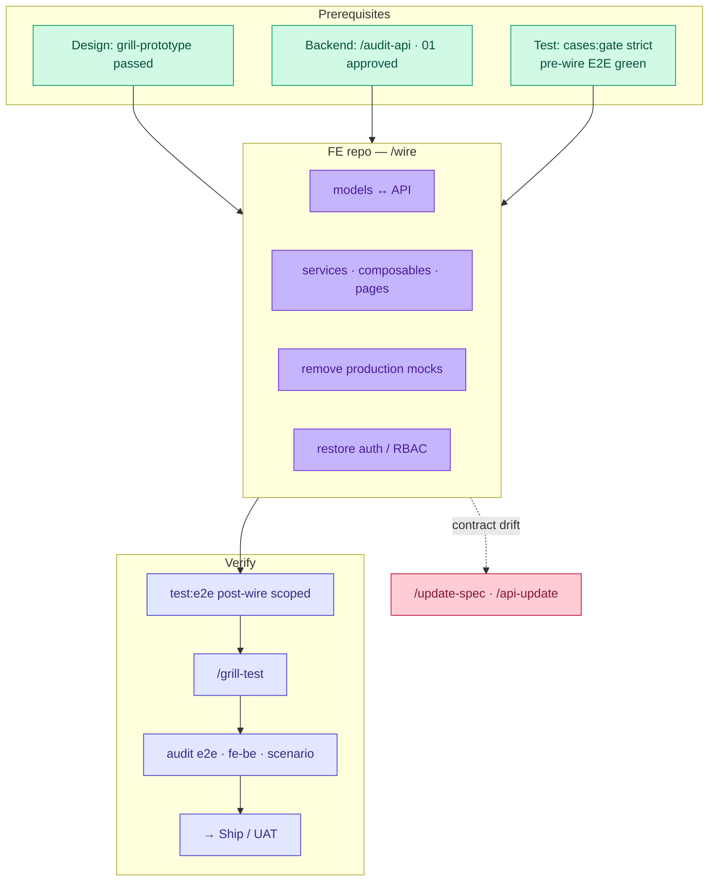
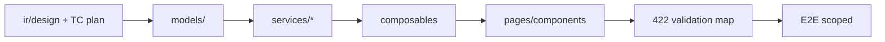

# Workflow — Wire (FE ↔ BE Integration)

**Scope (SSOT):** Macro **Wire** (Phase **3**) — replacing production mocks/stubs with real backend APIs, restoring authentication/RBAC, executing post-wire E2E test runs, and running convergence audits prior to Shipping.

**Not covered here:** Detailed 4-layer Portal architecture in FE repos → [artifacts/code.md](../artifacts/code.md) · Slash skill reference → [references/skills/wire.md](../references/skills/wire.md).

**Part of Macro Workflows:** [index.md#full-cycle](./index.md#full-cycle) · Prerequisite Lanes: [design.md](./design.md) · [backend.md](./backend.md) · [test.md](./test.md).

---

## Wire Cycle (Phase 3) {#wire-cycle}



---

## Three Convergence Layers {#three-convergence}

| Layer | Pre-Wire State | Wire Responsibilities | Post-Wire Verification |
|-------|----------------|-----------------------|------------------------|
| **Portal UI** | Prototype mocks, `#wire-only` on design/HANDOFF | `/wire` — wire real services, dismantle mocks | `test:e2e` scoped · `/grill-test` |
| **Contract** | `01` + API grill; FE `apiRef` on design | Align models/DTOs; configure CORS/env | `audit fe-be` on leaf bundle |
| **Cross-Flow `SC-*`** | TC pre-wire mocks | Wire individual screens across user journey | `audit scenario` + E2E ordered/CI env |

**BE-only / Partner integrations:** No FE `/wire` step — verified via `testcase:gen:api`, optional Newman runs, and BE integration tests; SSOT docs maintain `01` + `api-e2e` TCs in tests-docs ([test.md § API Hook](./test.md#grill-api-hook)).

---

## SSOT Sources During Wiring {#ssot-reading}

| Role | Reads | Never Uses as Source of Edits |
|------|-------|-------------------------------|
| FE Dev | `ir/design.yaml`, HANDOFF, `#wire-only` / `#update:*` | Generated files `ir/generated/*.md` |
| FE Dev | `01` / OpenAPI preview when mapping DTOs | Editing `01` directly from FE repo — route via `/api-update` |
| QA | `TC-*.md` post-wire scenarios | Mutating YAML plans during wire session |
| Lead | [gates § Milestone 9](./gates.md#close-one-function) | Skipping audits claiming "manual checks passed" |

**Environment setup:** `FLOWGRID_DOCS_ROOT`, `FLOWGRID_TESTS_DOC`, e2e-root — verified via `flowgrid doctor`.

Agent extracts (FE harness): [wire-phase.md](../../harness/fe/extracts/wire-phase.md) · [wire-audit-loop.md](../../harness/fe/extracts/wire-audit-loop.md) · Skill `/grill-wire` ([grill-wire.md](../references/skills/grill-wire.md)).

Tests hub feedback when wiring uncovers plan gaps: [wire-test-handoff.md](../../harness/tests/extracts/wire-test-handoff.md). Docs hub feedback: [wire-spec-feedback.md](../../harness/docs/extracts/wire-spec-feedback.md).

---

## Preconditions Before Entering Lane {#preconditions}

| Milestone | Minimum Requirement |
|-----------|---------------------|
| Design | `/grill-prototype` leaves zero SSOT gaps (copy, state, mock boundaries) — [design.md](./design.md) |
| Backend | API deployed to staging/dev; `/audit-api` or open issues assigned; `approval` on `01` per team policy |
| Test Plan | `cases:gate --strict` passes for scoped `W-*` (when gate is enabled) |
| Test Automation | Pre-wire scoped E2E tests are **green** or gaps documented — [test.md](./test.md#test-e2e-lane) |
| Tags | `#wire-only` / `#manual-composable` explicitly enumerated in HANDOFF — [dsl.md § Wire Defer](../artifacts/dsl.md#vòng-đời-wire-defer) |

**If prerequisites are incomplete:** Return to prototype/test/backend lanes — **never** wire halfway while postponing spec repairs.

---

## Pre-Wire vs Post-Wire (Test Cases) {#pre-wire-post-wire}

Reusing the same `TC-*.yaml` on tests-docs — shifts the **runtime environment** without forcing plan rewrites:

| Dimension | Pre-Wire | Post-Wire |
|-----------|----------|-----------|
| API | Mocks / `setup.mocks` inside Playwright | Real Base URL, authenticated session cookies |
| Authentication | Bypass middlewares (grill-prototype mode) | Restore guest/RBAC gates per bundle spec |
| Lifecycle Route | `prototype` / `test` | Promote to `wire` — [code.md § Page Lifecycle](../artifacts/code.md#page-lifecycle) |
| Audit | `audit e2e` (optional pre-wire) | **`audit e2e` mandatory** scoped with `--screen W-*` |

Test grilling deep dive: [test.md § Deep Grill](./test.md#grill-modes).

---

## Workflow Steps {#steps}

| # | Action | Role | Skill / Gate |
|---|--------|------|--------------|
| 1 | Align types/models ↔ `01` / OpenAPI | FE Dev | `/model` (if pending) |
| 2 | Service → Composable → Page (4-tier hierarchy) | FE Dev | `/wire` |
| 3 | Remove production mocks; reserve mocks for test fallbacks | FE Dev | HANDOFF grill-prototype |
| 4 | Restore auth / RBAC / route metadata | FE Dev | Prohibit shipping bypassed routes |
| 5 | Execute scoped post-wire E2E | Dev + QA | `test:e2e`, `/test` on gaps |
| 6 | Grill automation implementation | Dev + QA | `/grill-test` |
| 7 | Convergence audit | Dev + QA | `/grill-wire` or audit commands: `audit e2e`, `audit fe-be`, `audit scenario` (if SC) |
| 8 | UAT & stakeholder review | PM | Acceptance grilled; new requirements → `/update-spec` **prior** to closure |

### Portal Architecture Order (Recommended)



---

## Wire Grilling & Gates {#wire-gates}

Execute from **FE repo** (e2e-root) following wiring code implementation:

```bash
flowgrid audit e2e --e2e-root <path> --tests-docs "$FLOWGRID_TESTS_DOC" --screen <W-*>
flowgrid audit fe-be <path/to.bundle.yaml>    # portal leaf
flowgrid audit scenario <SC.yaml> --tests-docs "$FLOWGRID_TESTS_DOC"   # if scenario flow
```

| Audit Gap | Corrective Action |
|-----------|-------------------|
| `missingInPlaywright` / Page Object | Run `/test` |
| Plan vs bundle drift | Run `/grill-testcase` or `/update-spec` |
| `apiRef` ↔ `01` mismatch | Run `/api-update` + re-grill API |
| Deliberate deferral | Route to `qa` per team tagging policy |

---

## Wire Sign-off (Voluntary per Team) {#wire-signoff}

Prior to merging release scopes or UAT sign-off:

| # | Item | Verification |
|---|------|--------------|
| 1 | **No Production Mock** | No mocks remaining in production code paths for scoped `W-*` |
| 2 | **Tags Cleared** | `#wire-only` / `#update:*` tags in wire scope resolved or deferred to QA |
| 3 | **Authentication** | Middlewares and RBAC match bundle `screenAccess` |
| 4 | **E2E** | Post-wire scoped test run is green |
| 5 | **audit e2e** | No critical gaps (warnings have assigned owners) |
| 6 | **FE–BE** | Portal screens consuming APIs: `audit fe-be` has no blockers |
| 7 | **Lifecycle** | Route stage marked `wire` in registry (if tracked) |

```text
Wire sign-off: <W-*> | reviewer | date | audit e2e OK
```

---

## Gap Remediation Loops {#gap-loop}

| Trigger | Action |
|---------|--------|
| Backend contract error | `/api-update` → BE redeploy → re-wire |
| UX or spec discrepancy | `/update-spec` → split → re-test pre-wire if needed |
| Incomplete E2E coverage | `/test` → `/grill-test` — never bypass `audit e2e` |
| Scenario flow missing screens | Add `TC` or `QA-*` — verify with `audit scenario` |

**Single session = Single command** — do not combine full product regression runs with backend `/api` codegen in `/wire`.

---

## Downstream Handoff {#handoff}

- **Ship / Macro Release:** Human UAT Milestone 10 — [gates.md § Close Leaf](./gates.md#close-one-function) · [Human Sign-off](./grill-and-human-review.md#human-signoff) · [index.md](./index.md#full-cycle)
- **Remaining test gaps:** [test.md](./test.md)
- **Pending API grilling:** [backend.md](./backend.md) — never wire FE to unapproved backend contracts

---

## Quick Links

| Topic | Page |
|-------|------|
| Leaf closure Milestone 9 | [gates.md § Close One Function](./gates.md#close-one-function) |
| `#wire-only` DSL rules | [artifacts/dsl.md](../artifacts/dsl.md) |
| Skill `/wire` | [references/skills/wire.md](../references/skills/wire.md) |
| Page Lifecycle | [artifacts/code.md#page-lifecycle](../artifacts/code.md#page-lifecycle) |
