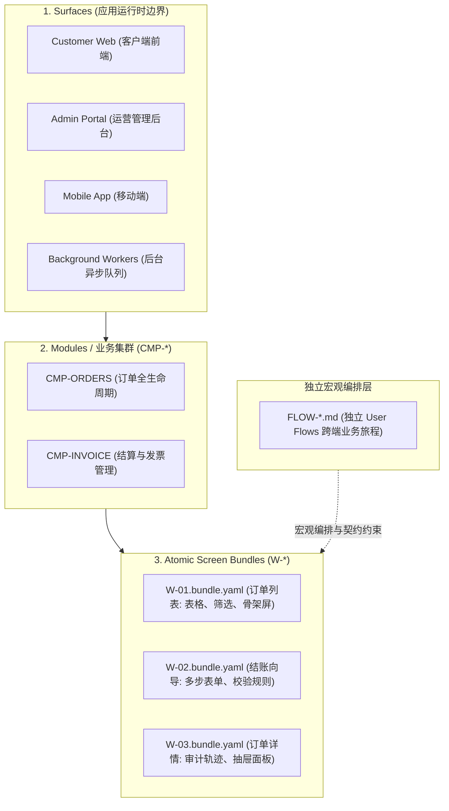
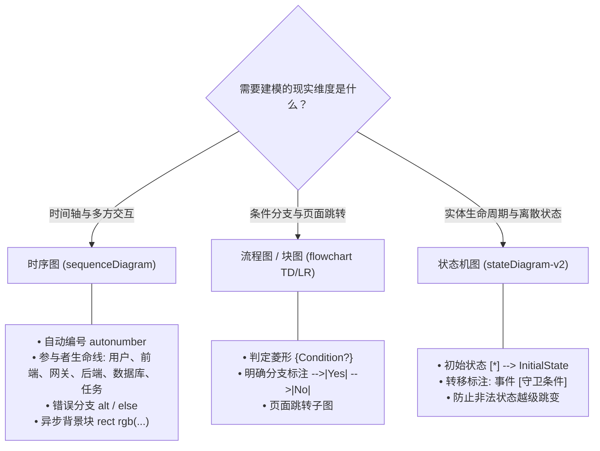

# FlowGrid 架构优势解析

> **核心摘要：** FlowGrid 是一个面向企业级软件工程的 AI 辅助工程与 SSOT（单一事实源）平台，专为生产级高可靠复杂系统打造。与传统的单体规范（Monolithic Spec）开发模式不同，FlowGrid 强制实施分层解耦的 3 级架构体系，将用户业务旅程（User Flow）提升为独立的宏观编排中枢，并依托结构化 DSL 引擎与确定性机械审计关卡保障交付质量。

---

## 1. 3 级解耦架构体系 vs. 单体规范（Monolithic Spec）陷阱

### 单体规范（Monolithic Spec）的致命缺陷
在敏捷开发或简单的 Prompt 提示词工程中，团队往往习惯采用**单体规范模式**——将 3 到 5 个页面、弹窗表单、数据表格、接口定义及权限矩阵全部揉塞在一个庞大的 Markdown 文档中。

这种模式带来了严重的架构隐患：
* **上下文饱和与污染（Context Saturation & Pollution）：** 当 AI Agent 或工程师尝试实现 A 页面时，不得不读取包含 B、C、D 页面的数千行冗余上下文。这会严重稀释注意力，诱发 AI 幻觉，导致关键需求被遗漏以及跨页面状态混乱。
* **业务流（User Flow）被严重稀释：** 跨页面的交互旅程与数据流转，被淹没在海量的 HTML/CSS 标签与底层 SQL 字段细节中。
* **边界状态盲区：** 页面与页面*交接之间*的关键场景（如页面刷新、深度链接直达、并发冲突、步骤中断网络重连）完全缺失。

### FlowGrid 的分层架构解耦
FlowGrid 将软件全生命周期拆解为清晰的 3 级体系：

1. **Surfaces（端/表面）：** 明确的运行时与部署边界（Web、管理后台、移动端、后台服务）。
2. **Modules（业务模块 `CMP-*`）：** 高内聚的业务领域边界（订单、支付、权限）。
3. **Atomic Screen Bundles（单页面特征包 `W-*.bundle.yaml`）：** 高度聚焦于**单个原子页面**。涵盖骨架布局、数据表格列规范、表单项校验及页面局部状态（L2 `interactionCases`：校验报错、弹窗开关、加载/空/错误状态）。
4. **Dedicated User Flows（独立用户旅程 `FLOW-*.md`）：** 作为宏观编排神经中枢独立存在，绝不与具体的页面排版细节混杂。

---

## 2. 独立业务流（`FLOW-*.md`）：宏观编排优先

FlowGrid 将业务流提升为**第一等核心 SSOT 架构资产**，并严格划分为 3 个层级：

* **跨端全局流（`architecture/03-user-flows/FLOW-*.md`）：** 跨越 $\ge 2$ 个不同端或角色的全局旅程（例如：客户端用户下单 ➔ 管理后台审批 ➔ 支付网关 Webhook ➔ 仓库后台出库 Worker）。
* **模块用户业务流（`surfaces/<surface>/<module>/user-flows/FLOW-*.md`）：** 由步骤 1 发生所在模块拥有的 UI 旅程（Step 1 归属原则：Step 1 决定模块所有权，无论是单屏还是跨屏交互）。

### 6 大核心板块深度规范
每一个 FlowGrid User Flow 文件必须满足企业级 6 大规范板块：
1. **上下文与业务授权矩阵：** 触发机制、参与者清单、页面级 RBAC/ABAC 权限以及职责分离原则（Separation of Duties - SoD）。
2. **多层级 User Story 链路：** 初始化故事、主线故事、跟踪故事以及独立的**系统自治故事（System Story）**。
3. **业务规则（`BR-*`）与状态机生命周期：** 详尽的规则表并严格匹配 Mermaid `stateDiagram-v2`。
4. **分阶段旅程全要素规范：** 用户交互动作、逐字段数据传递契约（Data Handoff）及后台重试/容灾策略。
5. **端到端可追溯性矩阵：** 1:1 映射表：用户故事步骤 ↔ 页面 `[W-*]` ↔ 接口 `[API-*]` ↔ 时序图生命线 ↔ 自动化测试用例。
6. **跨页面业务时序图：** 标准 Mermaid `sequenceDiagram`，包含 `autonumber`、异步任务块 `rect rgb(...)` 及异常分支 `alt / else`。

---

## 3. 五大角标边界盲区（Corner-Case）猎杀协议

单体规范在生产环境中频繁出故障，根源在于对边界条件的漠视。FlowGrid 体系化地解决以下**五大致命角标盲区**：

| 致命边界盲区 | 单体规范（Monolithic Spec）现状 | FlowGrid 架构解决方案 |
| :--- | :--- | :--- |
| **1. 刷新 / 后退状态丢失** | 忽视。在向导第 3 步按 F5 页面报空指针崩溃，或静默重定向回第 1 步导致录入丢失。 | **状态持久化契约：** 明确声明持久化策略（`URL Query 参数`、`sessionStorage` 或 `服务端草稿 ID`），并配置深层链接恢复守卫。 |
| **2. 并发修改与竞争覆写** | 完全不提。两名管理员同时审批同一条记录，导致后提交者静默覆盖前者的改动。 | **并发控制协议：** 强制采用乐观锁（`version` / `updated_at`）、幂等键（`X-Idempotency-Key`）以及 `409 Conflict` 冲突提示自动重新拉取机制。 |
| **3. 跨端协作与通知中断** | 默认消息推送或邮件 100% 成功。若三方通知服务异常，下游任务成为死锁“孤儿”。 | **持久化工作待办模式（Worklist）：** 跨端流必须在目标端提供查询兜底的工作待办列表，完全免除对通知通道的单点依赖。 |
| **4. 局部失败与 Saga 事务回滚** | 只画“美好路径”（Happy Path）。步骤 1 扣款成功，步骤 2 锁库存失败，造成账实不符。 | **Saga 补偿事务流程：** 在时序图中强制标注 `alt / else` 异常分支，定义自动退款、释放锁定及审计告警流程。 |
| **5. 页面间数据传递类型漂移** | 仅用口头描述（“传递用户数据给页面 2”），导致前后端类型对接时报类型不匹配。 | **逐字段 Data Handoff 契约表：** 详细定义源输出字段、传递介质、目标输入 Prop，并提供参数缺失时的 Fallback 回退逻辑。 |

---

## 4. 严谨的模型图谱决策矩阵

FlowGrid 依据建模对象的本质维度选择对应的图表符号，杜绝画图的随意性：

* **时序图（`sequenceDiagram`）：** 当 $\ge 2$ 个独立生命线沿时间轴交互时必须使用。适用于 API 请求、Webhook 回调、异步队列。
* **流程图（`flowchart TD/LR`）：** 适用于复杂的业务决策树（`IF / ELSE IF / ELSE`）、价格计算规则，或跨页面的路由导航。
* **状态机图（`stateDiagram-v2`）：** 适用于实体状态生命周期（如订单：`DRAFT ➔ SUBMITTED ➔ PAID / CANCELLED ➔ COMPLETED`），保障数据库状态完整性。

---

## 5. 结构化 DSL 与多语言代码生成引擎

FlowGrid 通过机器可读的 DSL 抹平业务设计与可执行代码之间的鸿沟：

* **中间表示层（Intermediate Representation `ir/`）：** 人类需求被编译为结构化的 AST 树，使 AI Agent 无需猜测文件组织或框架语法。
* **模板引擎的 4 层质量标准（`engines/template-builder/`）：**
  1. *契约不变量（Contract Invariants）：* 提取严格的 Prop 类型、默认值，以及标准后端响应封装结构（`{ data, error, meta }`）。
  2. *四大规范 UI 状态（4 Canonical States）：* 自动在模板中集成 `Loading`（骨架屏）、`Empty`（带行动号召的空状态）、`Error`（错误重试横幅）以及 `Success / Active`。
  3. *控制反转与插槽隔离（IoC & Slots）：* 保证公共组件（`shared/`）零硬编码业务接口，全部通过插槽或参数注入。
  4. *标准测试接缝（Golden Test Seams）：* 随模板提供测试脚手架，便于 `testcase:gen` 立即执行自动化测试。
* **多技术栈适配器：** 深度适配 Nuxt、Next.js、NestJS、Laravel、FastAPI 及 .NET。

---

## 6. 确定性机械静态审计关卡

与依赖 LLM 主观“自我评估”（极易产生盲目迎合与幻觉）的传统方案不同，FlowGrid 依托**确定性的 Node.js 脚本关卡**：

* `flowgrid audit flow <path>`：校验 User Flow 是否缺少参与者、缺失数据契约表、未处理异步超时等。
* `flowgrid audit spec <path>`：审计单页面特征包是否存在断链、未绑定的测试桩或未映射的字段。
* `flowgrid cases:gate`：在分支合并前，机械校验测试矩阵中 100% 的场景覆盖率。

---

## 综合对比矩阵

| 评估维度 | 单体规范模式（Monolithic Spec） | FlowGrid 平台 |
| :--- | :--- | :--- |
| **架构组织** | 每个功能一份臃肿大文档 | 3 级解耦体系（Surfaces ➔ Modules ➔ Atomic Screens） |
| **业务流地位** | 次要，埋没在 UI 字段描述中 | 第一等独立 SSOT 架构文件（`FLOW-*.md`）及 3 级分流 |
| **边界角标处理** | 凭运气，遗漏率极高 | 5 大盲区猎杀协议（F5 丢失、并发锁、Saga 回滚等） |
| **图表表达** | 格式混乱，缺失异常路径 | 严格依据数学维度的决策矩阵（`sequenceDiagram` 等） |
| **代码生成** | 自由 Prompt，极易幻觉 | 结构化 DSL（`ir/`）+ 4 层训练 Adapter 模板 |
| **质量把控** | 人工肉眼核对 | 命令行确定性机械审计关卡（`audit flow`、`cases:gate`） |
