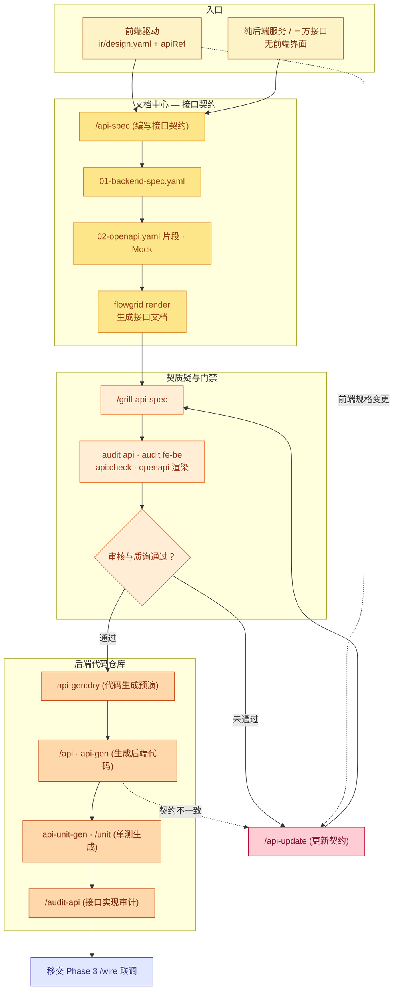

# 研发工作流 — Backend 后端开发泳道

**SSOT 范围：** **后端研发泳道 (Backend Lane)** ——涵盖接口契约文件（`01-backend-spec.yaml`）、OpenAPI 片段生成、接口契约质询 (`/grill-api-spec`)、后端代码生成、单元测试以及前后端对齐审计。

**宏观工作流从属：** [index.md](./index.md) · Phase 2 实现阶段 · 前后端联调：[wire.md](./wire.md)。

---

## 1. 后端研发核心循环 (Phase 2c)

---

## 2. 后端开发标准化步骤

1. **确立接口契约 (`/api-spec`):**
   - 在 `api/<seq>/01-backend-spec.yaml` 中定义端点路径、HTTP 请求方法、入参 DTO 校验规则与标准响应体结构。
2. **接口规范质询 (`/grill-api-spec`):**
   - 审查是否存在未捕获的 400/409/422 异常状态、越权漏洞 (IDOR)、数据库索引支持情况及高并发幂等性。
3. **接口完整性校验与文档渲染:**
   - 执行 `flowgrid api:check` 验证 Schema 合法性。
   - 执行 `flowgrid openapi_gen` 与 `flowgrid openapi_render` 输出 Swagger / OpenAPI 接口规范。
4. **后端代码自动生成 (`flowgrid api-gen`):**
   - 依据目标语言技术栈（NestJS, Laravel, FastAPI, .NET）在后端工程中生成 Controller、Service、DTO 与 ORM 实体。
5. **单元测试生成 (`flowgrid api-unit-gen`):**
   - 自动生成配套的单元测试框架代码（Pytest, PHPUnit, Vitest）。
6. **对齐审计 (`/audit-api` 与 `flowgrid audit fe-be`):**
   - 机械校验真实代码与 `01-backend-spec.yaml` 是否 100% 对齐，保障联调前零契约违约。
