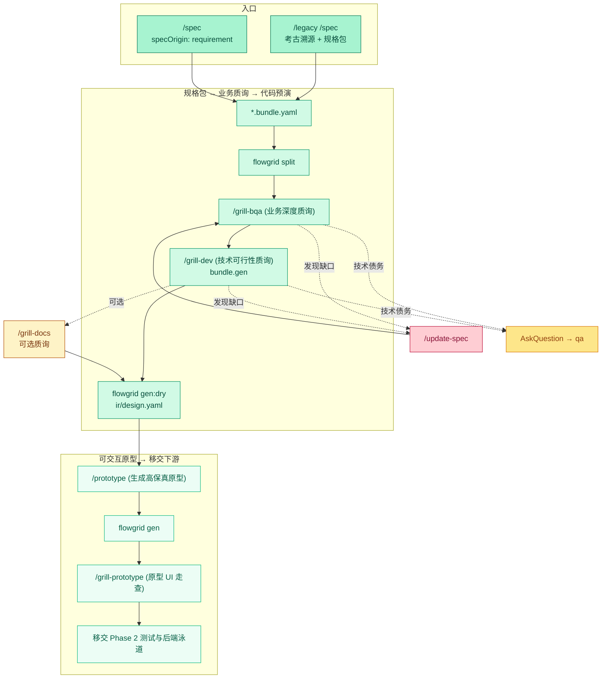

# 研发工作流 — Design 设计泳道

**SSOT 范围：** **设计泳道 (Design Lane)** 宏观全貌——从业务分析、规格包编写到经过质询的可交互原型，直至代码生成预演（Codegen Dry-Run）。

**宏观工作流从属：** [index.md](./index.md) · Phase 0 设置：[phase-0-setup.md](./phase-0-setup.md) · 业务质询与评审：[grill-and-human-review.md](./grill-and-human-review.md)。

---

## 1. 设计阶段核心循环 (Phase 1)

---

## 2. 步骤指引

| 序号 | 任务内容 | 主责角色 | 技能 / 质量门禁示例 |
| :--- | :--- | :--- | :--- |
| **0b** | ERD 数据模型设计（有新实体/数据表时） | 架构师 / 数据工程师 | `/db-erd` → `common/db-erd.md` |
| **1** | 范围、模块、业务流分析与模块级 API 预分配 | 架构师 / BA | `/overview`, `/module`（确立 `W-*`）, `/user-flow` |
| **2** | 页面规格包编写与 IR 编译（绑定实体与 DB 映射） | BA / 研发工程师 | `/spec`, `/legacy /spec`, 绑定 ERD, `split` + `render` |
| **3** | 业务与技术对抗性质询 (Grill) | BA + 研发工程师 | `/grill-bqa`, `/grill-dev`（每次更新规格包重新运行 `split`） |
| **4** | 完成代码生成准备（Dry-run） | 研发工程师 | 对照 `ir/design.yaml` 运行 `flowgrid gen:dry` |
| **5** | UI 原型生成（Mock API）与组件注册晋升 | 前端工程师 | `flowgrid gen` ➔ `/prototype` ➔ 注册表校验 |
| **6** | 原型 UI 检查清单走查 | 前端工程师 / BA | `/prototype` 之后执行 `/grill-prototype`（布局、Mock 边界、testId） |

---

## 3. 设计泳道中的对抗性质询重点

- **业务逻辑深度：** 5 层数据校验、乐观锁版本号、HTTP 状态码矩阵（409 冲突, 422 格式错误, 403 越权防护）、API 复用策略。
- **可交互原型验证：** 完整模拟 4 大 UI 状态（Loading 骨架屏、Empty 空状态、Error 错误重试、Success 数据展示）、长文本溢出、分页、提前植入 `data-testid`。
- **跨模块 API 零冲突隔离：** 共享接口统一存放在 LCA `common/yaml/` 下，叶子规格中仅通过 `#reuse-api` 引用，保障多人在不同分支并行开发零冲突。
