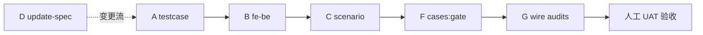
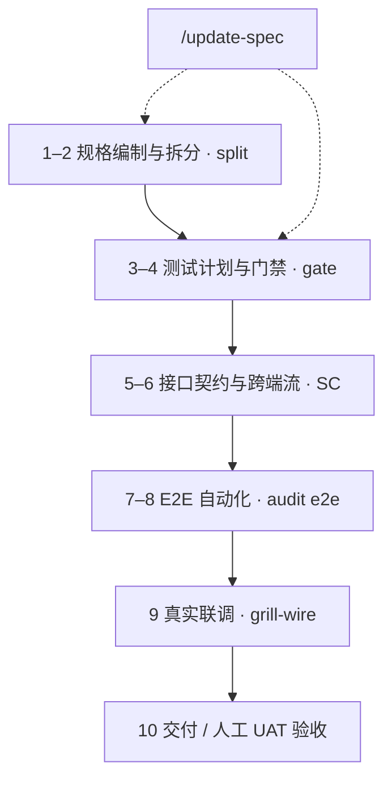

# 质量门禁与验证里程碑 (Quality Gates)

**SSOT 职责范围：** 规范**何时**调用 `flowgrid audit *` 和 `cases:gate`；把控安全的阶段流转（Phase Transitions）；以及维护核心资产的完整性链条（Bundle ↔ TC ↔ 前后端契约 ↔ 场景流）。

**本文档不包含：** 详细的 CLI 参数与选项说明 → [references/cli-and-commands.md](../references/cli-and-commands.md#审计与-harness-pr-自动化工作流)。

**上下文脉络：** [index.md](./index.md#full-cycle) · 人工对抗性评审：[grill-and-human-review.md](./grill-and-human-review.md) · 页面叶子节点签字验收：[design-leaf-signoff.md](./design-leaf-signoff.md) · 联调与交付：[wire.md](./wire.md)。

---

## 质量门禁调用时机 (按泳道) {#when-to-run}

| 里程碑节点 | 推荐命令 / 技能 | 结果审核负责人 |
|---|---|---|
| 完成 `/spec`, `/update-spec` 后 | `flowgrid audit spec` (`--type`) | BA / 开发质询评审员 |
| 接口契约质询阶段 (Docs) | `/grill-api-spec` · `audit api` | 后端开发 + BA |
| 联调前端前验证后端 API | `/audit-api` · `audit api` | 后端开发 |
| 关闭测试用例设计前 | `cases:check`, `audit testcase` (+ `--bundle`) | 测试工程师 (QA) |
| 测试中心发版门禁 | `cases:gate` (`--strict`, `--docs-root`) | QA + `/grill-testcase` |
| 联调前 E2E 自动化验证 | 局部运行 `test:e2e` · `audit e2e` | 前端开发 + QA |
| **完成 `/wire` 联调后** | **`/grill-wire`** 或 `audit e2e` + `audit fe-be` + `audit scenario` | 前端开发 + QA |
| 详细 TC 矩阵对齐 PO | 在 `/test` 绿灯后执行 `/grill-test` | QA / 前端开发 |
| 遗留系统资产采纳审计 | `audit legacy` | 技术主管 (Tech Lead) |
| **页面叶子节点合并 / UAT 验收前** | 执行 [§ 单功能节点关闭](#close-one-function) 步骤 1–10 · 人工签字确认 | 主管 / PM / QA |

工具链**绝不自动隐式**执行全部门禁 —— 团队成员必须在适宜的关键节点主动调用对应命令。跳过步骤会累积过程风险（详见 [grill-and-human-review.md](./grill-and-human-review.md)）。

---

## 标准交付周期参考流

### 新建功能 / 新屏幕页面

```text
/spec → audit spec → grill-bqa / grill-dev → split (每次修改 Bundle / 质询后重复执行)
→ /testcase (基于 Bundle SSOT, Schema v2, 溯源对齐) — 在第 1 轮质询后可并行启动
→ cases:gate [--strict] + FLOWGRID_DOCS_ROOT
→ testcase:gen → Playwright (e2e-root)
→ (团队规范) 发布前进行人工探索性 E2E 验收走查
```

### 需求变更流程 (Change Request - CR)

```text
/update-spec → audit spec (技能内强制执行) → split
→ 若交互或 Bundle 代码生成配置发生变动，重新运行 grill-bqa / grill-dev
→ 同步更新受影响 W-* 的 TC 用例 / 评估 Bundle 影响
→ cases:gate --strict
→ /grill-testcase (读取门禁报告)
→ 生成代码 + 修复用例 + 人工走查
→ 若已完成联调：在修复用例与规格后重新执行 `/grill-wire`
```

### 联调后业务行为漂移

```text
UAT 验收或预发布测试发现验收标准 (AC) 出现偏差
→ Docs 运行 /update-spec (或 /api-update) —— 严禁仅在前端私自修改代码修补
→ split/render 重新生成 → 若场景矩阵改变，运行 /grill-testcase
→ 前端运行 /wire 或 /test → 执行 /grill-wire 重新收敛闭环
→ 人工叶子节点签字验收 (步骤 10)
```

---

## SSOT 资产完整性闭环链条 {#ssot-chain}

测试用例策略：`/testcase` 直接读取 **`*.bundle.yaml`**。如果 Bundle 缺失或 `flowgrid check` 检测到漂移 → 必须立刻停止，先从文档中心执行 Split 同步。

| 阶段 | 引擎 / 技能实现 | 核心目标 |
|---|---|---|
| **A** | `audit testcase --bundle` | 验证场景 / AC / 用户操作 ↔ TC 测试用例的完全溯源 |
| **B** | `audit fe-be` + grill-dev | 校验 `apiRef` ↔ `01-backend-spec` 接口契约一致性 |
| **C** | `audit scenario` + `/scenario` | 校验 `FLOW` / SC 场景中 `screens[]` ↔ `cases/**` 目录的覆盖率 |
| **D** | `/update-spec` 规则 | 审查交互设计增量 ↔ `userStories` / AC 的同步 |
| **F** | `cases:gate`, TC schema v2 | 测试中心发布的严格门禁拦截 |
| **G** | `/wire` + `/grill-wire` | 联调后执行 `audit e2e` + `fe-be` + `scenario`；验证测试规划 ↔ 在线真实 API |
| **E** | *(DevOps 自动化，可选)* | CI 流水线校验：`check`, `cases:gate`, `doctor`, 局部 `audit e2e` |



---

## 10 步功能节点关闭流程全览 {#close-leaf-overview}



---

## 关闭单个功能节点 (`W-*`) 检查清单 {#close-one-function}

在认定单个**叶子节点**（页面或 API 序列）资产完备前推荐执行的完整检查项：

| # | 里程碑 | 对应命令 / 技能 | 验证与评审要求 |
|---|---|---|---|
| 1 | 规格与质询 | `flowgrid audit spec` (`--type`) · `/grill-bqa` · `/grill-dev` | 走查 `gaps[]` / confirms；各方达成业务一致 |
| 2 | 中间表 (IR) 同步 | `flowgrid split` · `flowgrid check` | 生成测试用例或代码前，确保 Bundle ↔ `ir/*` 完全一致 |
| 3 | 测试用例规划 | `/testcase` · `/grill-testcase` | `cases:check` · `audit testcase --bundle` 零报错 |
| 4 | 测试质量门禁 | `cases:gate --strict` + `FLOWGRID_DOCS_ROOT` | 符合 Schema v2，具备 100% 溯源性与测试维度矩阵 |
| 5 | 后端契约对齐 | `audit api` · `audit fe-be` | `apiRef` ↔ `01-backend-spec.yaml` 严格吻合 |
| 6 | 跨端场景流 (若涉 SC) | `audit scenario` | `screens[]` 内各页面均有 `TC-*.yaml` 或显式 `QA-*` 挂起 |
| 7 | E2E 自动化落地 | `testcase:gen` · `/test` · `/grill-test` | TC 矩阵 ↔ PO 验收 ↔ `*.spec.ts` 三者对齐 |
| 8 | 规划与实现对齐 | `flowgrid audit e2e` (`--e2e-root`, `--tests-docs`) | 测试规划与局部运行的 Playwright 测试套件一致 |
| 9 | 真实接口联调 | `/wire` · 联调后局部 E2E 回归 | 运行 `/grill-wire` 或 `audit e2e` · `audit fe-be` · `audit scenario` |
| 10 | 交付与 UAT 签署 | 按照 Bundle AC 进行人工验收与发布合并检查 | **人工**确认业务完备；发现新行为必须在步骤 10 **之前**运行 `/update-spec` |

> **审计通过 ≠ 可以直接发版：** 0 阻断性缺口的 JSON 报告永远无法取代 PM/QA 的正式 UAT 签字确认。

---

## 审计命令与资产对照矩阵

| 命令 | 核心审计关注点 |
|---|---|
| `audit spec` | Bundle 完整性与 UX 交互可用性 (`UX_*`, `confirms`) |
| `audit api` | 后端 API YAML 接口契约合规性 |
| `audit testcase` | TC v2 Schema 标准性；`--bundle` 交叉对照 |
| `audit fe-be` | Bundle 的 `apiRef` 与后端服务接口一致性 |
| `audit scenario` | SC 跨端场景中涉及的屏幕与测试用例覆盖 |
| `audit flow` | `FLOW-*.md` 业务旅程连贯性 |
| `audit e2e` | tests-docs 中的 `TC-*.yaml` ↔ Playwright 测试规范 |
| `audit legacy` | 遗留代码资产采纳与迁移健康度 |
| `cases:gate` | Schema + TC 审计 + Bundle 溯源 + 维度矩阵全量拦截 |
