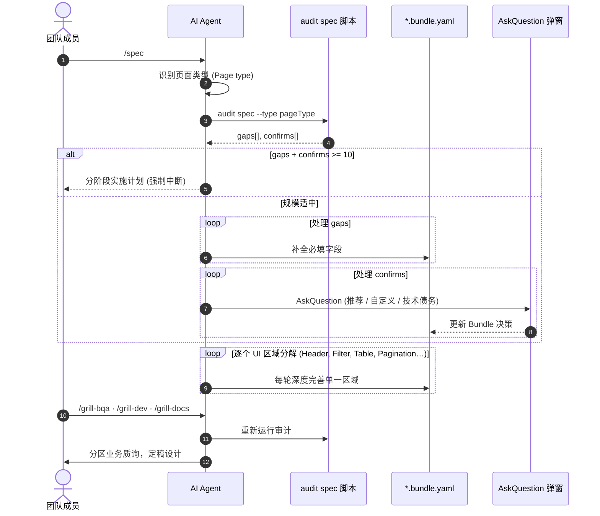
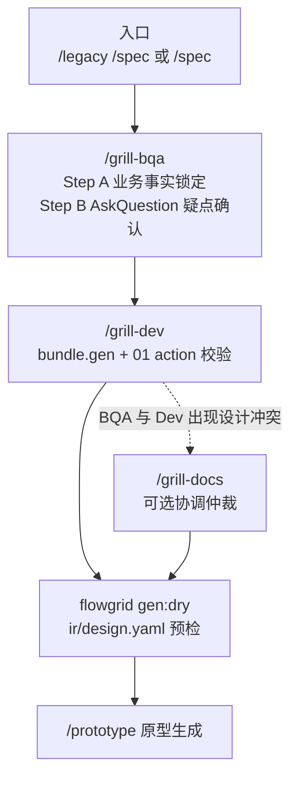
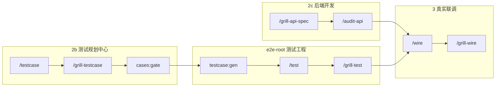

# 业务质询 (Grill)、人工评审与问责机制

**SSOT 职责范围：** 团队成员**评审、质询、研讨并敲定最终业务决策**；AI 绝不替代产品负责人 (PO)；区分**定性质询研判** (Grilling / 业务纵深逻辑探查) 与**定量自动化审计** (确定性审计脚本输出 `gaps[]` / `confirms[]`)。

**本文档不包含：** 审计 CLI 命令行参数 → [references/cli-and-commands.md](../references/cli-and-commands.md#审计与-harness-pr-自动化工作流) · QA 标签分类规则 → [artifacts/index.md](../artifacts/index.md)。

**关联泳道：** [design.md](./design.md) · [backend.md](./backend.md) · [test.md](./test.md) · [wire.md](./wire.md) · 门禁里程碑：[gates.md](./gates.md#close-one-function)。

---

## 一句话核心哲学

**工具链负责提供 SSOT、规范技能、确定性审计与标准化错误码 —— 人类团队负责严格执行工作流、深度解读缺口并做出最终决策。**

AI 负责**标准化** YAML 与 IR 结构；人类成员负责**评审** Markdown 文档与可视化交互原型。如果团队成员跳过质询/审计流程，或流于表面地敷衍通过门禁，工具链**绝不承诺**产出零缺陷系统。

| 工具链 (产品能力) | 团队职责 (人类流程) |
|---|---|
| 提供技能 `/spec`, `/update-spec`, `/testcase`, `flowgrid audit *`, `cases:gate`, `testcase:gen` | 在适当节点运行技能；审阅生成的 JSON 缺口报告；深入质询核心业务规则 |
| 提供 AskQuestion 弹窗交互与 `qa` 待办 | 做出“推荐选择 / 其他决策 / **记录为技术债务**”的裁决 · 团队协作：[qa-team.md](./qa-team.md) |
| `/update-spec` 及技能内嵌的自动重审 | 在需求变更后同步维护 `TC-*.yaml`；执行人工探索性 E2E 走查 |

| 典型风险场景 | 首要问责角色 |
|---|---|
| 在技能明确提示审计时跳过审计或质询 | 责任工程师 + 技术主管 |
| 执行 `/update-spec` 变更后未同步更新测试用例与溯源关系 | 变更发起人 + QA |
| Playwright 测试用例矩阵流于形式、缺乏异常分支覆盖 | 用例编写者 + `/grill-test` 评审人 |
| 真实 API 联调完成后跳过 `/grill-wire` | 前端开发 + QA（极易遗漏 `FEBE_*` 契约冲突） |
| UAT 验收未通过，但因“自动化审计全绿”强行合并上线 | PM / 技术负责人 —— 自动化工具绝不能替代人工业务验收 |
| 由于跳过规定步骤导致线上缺陷逃逸 | 工程交付流程缺陷 —— 工具链不承诺无脑零 Bug |

---

## 脚本定量审计 vs Agent 定性质询

```text
       SPEC / TC / API 核心业务需求
                    │
        ┌───────────┴───────────┐
        ▼                       ▼
   确定性自动化审计          AI AGENT 业务深度质询
   gaps[] · confirms[]      领域纵深逻辑、区域细化、
   UX_* · FEBE_* 契约校验    UI ↔ API ↔ TC 跨端一致性
```

| 审计输出项 | 应对机制与权属 |
|---|---|
| `gaps[]` (强制缺失项) | Agent 自动补全 Bundle/YAML（或由工程师提供决策方向） |
| `confirms[]` (需确认业务项) | 每个问题通过 **AskQuestion** 弹窗交互 —— 至少提供 3 个选项（含 **记录为技术债务**） |
| `gaps[]` + `confirms[]` **≥ 10** | **强制阻断 (Hard Stop)** —— 输出分阶段实施计划（每阶段 3–5 项），避免刷屏 |

在运行 `flowgrid audit spec` 之前，会自动识别页面类型：读取 `gen.codegen.profile` 或从 Prompt 推断 —— 务必显式传入 `--type`。

| 提示词特征 | 推断的 `pageType` |
|---|---|
| list, table, index, grid, 列表, 检索 | `list` |
| create, new, form, input, 新建, 表单 | `create` |
| detail, view, inspect, 详情, 查看 | `detail` |
| login, auth, signin, 登录, 认证 | `auth` |
| CRUD, entity management, 管理配置 | `admin-crud` |

---

## `/spec` 质询时序交互 (按区域分解)



### 基于区域分析 (Anti-Lost-in-the-Middle)

对于大型复杂页面：**严禁在单个 Prompt 中试图一次性完成所有设计** —— 必须按**区域 (Zone)** 拆解（例如列表页拆为：Header 顶栏 → 搜索/过滤工具栏 → 数据表格 → 分页与空状态）· 每轮交互精耕一个区域。

---

## 设计阶段质询链 (BQA → Dev → Dry → Prototype) {#design-grill-chain}



**未决疑问规范：** **严禁**将未解决的业务疑问存放在 Bundle/YAML 的 `openQuestions` 中。必须通过 AskQuestion 当场确认 → 直接更新字段；若确实无法立即决策，则登记至 `qa/<SHORT>_NNNN.yaml` 并使用 `/qa-resolve` 闭环。

---

## 角色化质询分工一览

| 技能 | 核心质询聚焦点 |
|---|---|
| `/grill-bqa` | 领域业务逻辑、表单校验、User Stories、UX 交互完整性 |
| `/grill-dev` | `bundle.gen` 配置、事件操作、`#gen:*`、`#needs-component`、IR Split 一致性 |
| `/grill-docs` | 仲裁 BQA 业务要求与 Dev 开发诉求的冲突 |
| `/grill-prototype` | UI 视觉与交互还原度、Mock 边界、`data-testid` 埋点 |
| `/grill-api-spec` | 文档中心中的 API YAML 接口契约合规性 |
| `/audit-api` | 联调前验证后端实际代码与 `01` 契约的一致性 |
| `/grill-test` | 审查 Spec ↔ TC ↔ Playwright 矩阵对齐，避免盲目重写用例 |
| `/grill-wire` | 联调后审计链路：`audit e2e` + `fe-be` + `scenario`；发现缺口快速分流 |
| `/grill-testcase` | 审查 tests-docs 中的 YAML 测试计划 —— 规格遗漏回传 Docs |

---

## 设计后质询链路 (测试 · API · 联调) {#post-design-grill}



| 阶段 | 定性质询 (Grill) | 定量审计 (Audit) | 人工决策门禁 (Human Gate) |
|---|---|---|---|
| **测试计划** | `/grill-testcase` — 审查 AC 与矩阵覆盖 | `cases:gate`, `audit testcase --bundle` | QA：确认覆盖全量业务异常，非仅正常流 |
| **自动化** | `/grill-test` — 检查 PO 结构与 testId 稳定性 | `audit e2e` | Dev + QA：测试代码符合规范，无脆弱选择器 |
| **契约** | `/grill-api-spec` | `audit api`, `audit fe-be` | BE + Dev：字段类型准确，HTTP 状态码完备 |
| **联调** | HANDOFF 中 `#wire-only` 逐项验证 | `/grill-wire` 全链路审计 | 严禁带病上线绕过鉴权的代码或 Mock 残留 |

---

## 人工签字确认 vs 自动化审计通过 {#human-signoff}

| 维度 | 自动化审计 / 门禁 (工具层) | 人工签字确认 (团队层) |
|---|---|---|
| **核心问题** | 成果物是否符合 SSOT Schema 规范？ | 真实业务行为是否达到 PO 与客户预期？ |
| **产出结果** | `gaps[]`，退出码为 0 | UAT 验收报告、PR 合并批准、发版记录 |
| **权属人** | Agent + 解析 JSON 的 Dev/QA | PM、BQA、技术负责人 |
| **介入时机** | 每个需要审计的技能执行后 | **里程碑 10**（功能节点关闭前） |

**脚本全绿 + 人工未签署 UAT** → 必须在里程碑 10 **保持阻断停止状态**；切勿将自动化工具通过误当做终审合格。
