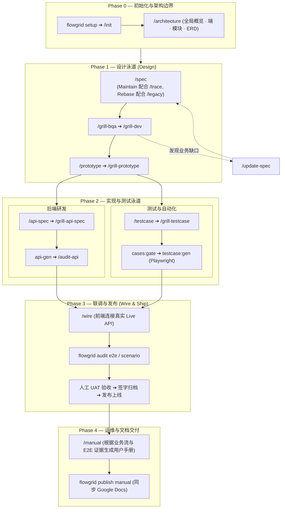

# 软件研发工作流全局概览 (Workflows)

本文档系统介绍了从 [Phase 0 项目初始化](./phase-0-setup.md) 到 [Wire 联调](./wire.md) 及最终交付验收的软件研发完整生命周期：

- **项目初始化与配置 (Phase 0):** 详见 [Phase 0 — 初始化与项目脚手架](./phase-0-setup.md)，涵盖 Greenfield（新项目）、Maintain（既有维护）、Rebase（遗留重构）三大场景。
- **功能关闭核对清单 (`W-*`):** [gates § 关闭单项功能](./gates.md#close-one-function)（包含 **10 个里程碑**，第 10 步为人工 UAT 验收与发布）——在业务质询与质量审计过程中的权威基准。
- **业务质询 (Grill) vs 审计 (Audit)、分区分析与质询向导：** [grill-and-human-review.md](./grill-and-human-review.md)。
- **各阶段专用泳道文档：** [Design 设计](./design.md) ➔ [Backend 后端](./backend.md) ➔ [Test 测试](./test.md) ➔ [Wire 联调集成](./wire.md)。

---

## 1. 端到端功能研发全生命周期

每一个功能规格或页面（`W-*` 叶子节点）均经历标准化的 4 阶段生命周期：

| 研发阶段 | 核心关注点 | 主责角色 | 详细指引文档 |
| :--- | :--- | :--- | :--- |
| **Phase 0: 基础设施与边界** | 代码仓库脚手架、Surfaces 拓扑映射、系统架构标准、模块边界划定 | 架构师 / Tech Lead | [Phase 0 设置](./phase-0-setup.md) · [架构设计](./architecture-data.md) |
| **Phase 1: 规格设计 (Design)** | 单页面规格包定义、业务质询 (Grill)、可交互原型验证 | 产品 / BA / 前端开发 | [Design 设计阶段](./design.md) |
| **Phase 2: 编码与测试 (Code & Test)**| 后端 API 接口契约敲定、测试矩阵设计、自动化 E2E 代码生成 | 后端开发 / QA | [Backend 后端](./backend.md) · [Test 测试](./test.md) |
| **Phase 3: 联调与发布 (Wire & Ship)** | 前端对接真实后端 API、回归测试验证、UAT 验收签字关闭 | 前端 / QA / PO | [Wire 联调集成](./wire.md) · [Gates 门禁](./gates.md) |
| **Phase 4: 运维与文档 (Ops & Docs)** | 用户操作手册生成、同步至知识库与帮助中心 | BA / 客服支持 | [用户手册生成](./build-user-manual.md) |

---

## 2. 阶段执行要点详解

### Phase 0: 基础设施与边界
- **脚手架生成：** 运行 `flowgrid setup [name]` 生成 SSOT 骨架（`source-code/`, `source-legacy/`, `registries/`, Arc42 架构文档）。
- **资产探测：** 运行技能 `/init` 扫描代码库、映射 Surfaces 端结构并初始化 `platform-repos.local.json`。
- **架构设立：** 使用 `/architecture`, `/overview`, `/surfaces`, `/module`, `/db-erd` 在编写具体页面前确立系统边界。

### Phase 1: 规格设计泳道 (Design)
- **规格编写：**
  - *新项目 (Greenfield):* 运行 `/spec` 编写完整页面规格包（`<slug>.bundle.yaml`, `ir/design.yaml`, `ir/spec.yaml`）。
  - *既有维护 (Maintain):* 结合 `/trace` 检索 `source-code/` 中的既有代码与暗含逻辑。
  - *重构升级 (Rebase):* 结合 `/legacy` 从 `source-legacy/` 提取业务规则并保持只读。
- **业务与技术质询 (Grill):** 执行 `/grill-bqa`（深挖业务死角）与 `/grill-dev`（技术可行性审查）打磨规格。
- **早期可交互原型：** 执行 `/prototype` 快速生成交互式前端原型，供业务方在正式编码前验证体验。

### Phase 2: 实现与测试泳道 (Backend & Test)
- **后端 API 契约：**
  - 使用 `/api-spec` 在 `api/<seq>/01-backend-spec.yaml` 定义接口契约。
  - 使用 `/grill-api-spec` 审查契约，`api-gen` 生成控制器/服务骨架，并用 `/audit-api` 审计。
- **测试中心与自动化：**
  - QA 使用 `/testcase`, `/scenario`, `/grill-testcase` 在测试中心设计场景矩阵。
  - 运行 `cases:gate` 校验测试覆盖率，再通过 `testcase:gen` 自动生成生产级 Playwright E2E 自动化测试用例代码。

### Phase 3: 联调与发布 (Wire & Ship)
- **接口联调 (Wire):** 前端工程师执行 `/wire` 将 UI 组件与真实后端 API 贯通，彻底剔除 Mock 数据。
- **回归审计：** 运行 Playwright E2E 测试套件，并通过 `flowgrid audit e2e` 验证规格与代码的一致性。
- **UAT 验收与发布：** 业务方根据验收准则进行最终用户验收测试，签字确认并关闭该页面。

---

## 3. T 型人才职责分工矩阵 (Responsibility Matrix)

团队角色依据**可交付的核心资产 (Artifacts)** 进行协同分工：

| 团队角色 | 主要负责范畴 | 核心交付物 (Artifacts) | 常用技能与指令 |
| :--- | :--- | :--- | :--- |
| **架构师 / 技术主管** | 系统技术架构、模块边界、部署拓扑 | `overview/`, `architecture/`, `FLOW-*` | `/architecture`, `/overview`, `/surfaces`, `/module`, `/db-erd` |
| **业务分析师 (BA) / PM** | 业务需求梳理、验收准则、业务答疑 | 单页面规格包、可交互原型 | `/spec`, `/grill-bqa`, `/prototype` |
| **软件工程师 (Dev)** | 页面技术设计、API 接口契约、生产代码 | `ir/design.yaml`, `01-backend-spec.yaml`, 业务代码 | `/spec`, `/grill-dev`, `/api-spec`, `/api`, `/wire` |
| **测试工程师 (QA)** | 测试矩阵设计、边界场景、E2E 自动化 | `TC-*.yaml`, Playwright E2E (`*.spec.ts`) | `/testcase`, `/scenario`, `testcase:gen`, `/test` |
