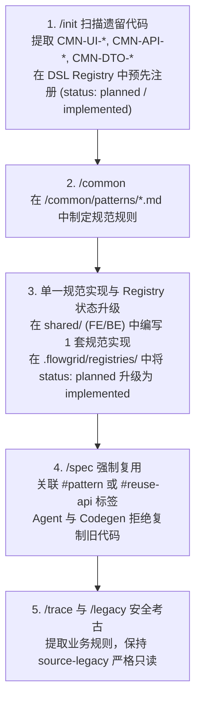
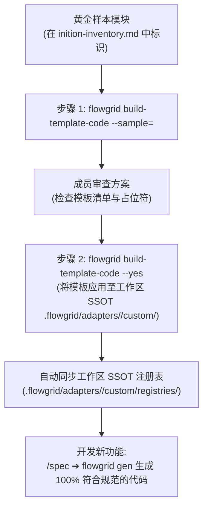

# Phase 0 — 项目初始化与架构基座设置

本文档详细介绍了通过 `flowgrid setup` 命令执行项目初始化（Phase 0）的具体步骤，并深入拆解在 **3 种典型企业研发场景** 下的标准操作流程：
1. **Greenfield（全新开发）：** 从零开始构建全新产品。
2. **Maintain（既有维护）：** 在既有代码库上进行持续功能迭代与重构维护。
3. **Rebase / Modernization（系统重构升级）：** 基于老旧遗留系统进行彻底的技术栈升级与架构现代化。

---

## Phase 0 决策流程图

```mermaid
flowchart TD
  START(["开始: flowgrid setup [workspace]"]) --> CHOICE{"项目类型？"}

  %% 分支 1: Greenfield
  CHOICE -->|1. Greenfield<br/>(全新产品)| GF_DOCS["编写全局概览、架构约束<br/>定义 Surfaces 端结构"]
  GF_DOCS --> GF_REPO["在 source-code/ 下<br/>创建或关联目标代码仓"]
  GF_REPO --> GF_INIT["运行 /init<br/>(映射代码仓与 Surfaces)"]
  GF_INIT --> NEXT_PHASE

  %% 分支 2: Maintain
  CHOICE -->|2. Maintain<br/>(既有代码维护)| MT_REPO["将既有工程放入<br/>source-code/ 目录下"]
  MT_REPO --> MT_INIT["运行 /init<br/>(扫描并识别配置)"]
  MT_INIT --> MT_NEXT["进入设计阶段:<br/>结合 /trace 进行代码考古"]
  MT_NEXT --> NEXT_PHASE

  %% 分支 3: Rebase
  CHOICE -->|3. Rebase<br/>(遗留系统重构)| RB_LEGACY["将旧代码置于 source-legacy/<br/>(严格只读 READ-ONLY)"]
  RB_LEGACY --> RB_EXTRACT["运行 /extract-legacy<br/>(提取遗留模块与业务流)"]
  RB_EXTRACT --> RB_NEW["在 source-code/ 下<br/>建立全新技术栈工程"]
  RB_NEW --> RB_INIT["运行 /init<br/>(配置新工程环境)"]
  RB_INIT --> RB_NEXT["进入设计阶段:<br/>结合 /legacy 进行规则还原"]
  RB_NEXT --> NEXT_PHASE

  NEXT_PHASE(["进入功能生命周期:<br/>Design ➔ Codegen ➔ Test ➔ Wire"])
```

---

## 三大场景实战指南

### 1. Greenfield 场景（全新项目）
- **步骤 1：初始化工作区骨架**
  ```bash
  flowgrid setup my-project [--mode=base|custom]
  ```
  CLI 提供两种脚手架模式：
  - `base`（默认）：包含完整骨架及通用模式示例（`surfaces/common`, `03-user-flows/FLOW-login.md`）。
  - `custom`：仅搭建纯净的 SSOT 目录结构（`.vitepress/`, `architecture/`, `overview/`, `registries/`, `source-code/`），不塞入示例文件。
- **步骤 2：明确宏观指导方针**
  - 在 `overview/index.md` 中编写产品愿景、用户角色与发布目标。
  - 在 `architecture/` 中定义系统架构（Arc42 标准、技术约束、数据库 ERD）。
  - 在 `surfaces/` 中规划端列表（Admin 后台、移动端、Portal 门户等）。
- **步骤 3：创建代码仓库**
  - 在 `source-code/` 下创建或 Clone 源代码仓库（推荐使用 Git Submodules 管理）。
- **步骤 4：运行技能 `/init`**
  - 执行 `/init` 自动探测技术栈，配置 `platform-repos.local.json` 并注册生成模板。

### 2. Maintain 场景（既有项目维护）
- 将既有工程克隆或移动到 `source-code/` 下。
- 运行 `/init`，FlowGrid 会自动扫描目录架构与技术栈并生成映射。
- 在后续功能迭代阶段，执行 `/spec` 时结合 `/trace` 技能对 `source-code/` 中的实现进行对比验证，确保新功能与既有系统无缝兼容。

### 3. Rebase 场景（遗留重构与系统升级）
- **防复制隔离：** 将老旧系统完整代码放置在 `source-legacy/` 目录下（**严格只读**，绝不可直接在老代码上修改，也严禁直接大段复制老代码垃圾）。
- 运行 `/extract-legacy` 逆向挖掘老系统中的核心业务规则与实体流转逻辑。
- 在 `source-code/` 下建立采用现代框架的全新代码工程。
- 在 Phase 1 设计阶段，结合 `/legacy` 技能进行合规的业务逻辑提取与重新建模。
---

## 4. 技能协同体系与防复制防护机制（Anti-Copy-Paste Guard）

在项目维护或系统升级过程中，最严重的问题之一是**不同模块之间大量复制粘贴重复代码**（例如相同的确认弹窗、分页表格或 Excel 导出逻辑在 4–5 个控制器/视图中被重复实现）。

FlowGrid 在 Phase 0 即建立了闭环技能体系，从源头消灭代码重复：



### 防重复技能职责细分：

1. **技能 `/init`（扫描、通用分类、放置发现与 DSL Registry 预先注册）**：
   - 在 Common Discovery 模式下，Agent 深度扫描控制器、服务、路由与视图中出现在 2 处以上的重复逻辑，自动归为**两大类别**：
     - **类别 1 — 既有 Common（已在 base/shared 中实现）：** 共享库中已存在的组件/服务（如 `ConfirmModal.vue`、`BaseServiceImpl.php`）。**绝不规划重新生成代码**；仅生成 Markdown User Stories（`<LCA>/common/patterns/<CMN-ID>.md`）以完善 SSOT 文档，并以 `status: "implemented"` 注册至 DSL Registry（`design.registry.json` 或 `be-capabilities.registry.json`）。
     - **类别 2 — 重复候选（在多处重复复制）：** 缺少共享组件而在 2 处以上重复的逻辑/UI。这类组件**必须制定行动计划（`common-plan.md`）**，具备完整放置检查（目标 Repo、目标代码路径、目标文档路径），在 `shared/` 中生成 1 套规范实现，供**新功能与后续更新使用**。**严格禁止修改或重构存在重复的既有旧代码** — 从此处开始防止重复，避免运行中代码出现回归故障。
   - **DSL Registry 预先注册 (`status: "planned"`)：** `/init` 将重复候选直接以 `status: "planned"` 及标准标签（`#pattern: <CMN-ID>`, `#reuse-api: <CMN-ID>`）预先注册至工作区 SSOT 注册表（`design.registry.json` / `be-capabilities.registry.json`）。这使得 `/spec` 在后续开发新功能时能够立即引用共享组件，避免重复创建临时组件（`#needs-component`）。
   - **放置定位检查（Target Placement Check）：** 在大型或多仓库项目中，Agent 对照 `.flowgrid/config.json` 中的 `projects` 为每个候选指定 3 维坐标：
     1. *归属端与目标 Repo：* 目标代码仓（如 `admin-fe`、`booking-portal` 或 `core-api`）。
     2. *目标代码路径：* 具体源代码文件路径（如 `source-code/admin-fe/src/components/Common/ConfirmModal.vue`）。
     3. *目标文档路径 (LCA)：* Docs Hub 中的 Markdown 规范路径（`surfaces/admin/common/patterns/CMN-UI-001.md`）。
   - **整页重复警告（Whole Page Duplication Warnings）：** 若两个界面文件相似度高达 90–95%（如 `CreateUser.vue` 和 `EditUser.vue`），Agent 推荐合并为单一多态表单规范（`mode: create | edit`），而非拆分为 `CMN-*`。

2. **技能 `/common <CMN-ID>`（用户故事规范、共享代码生成与 Registry 升级）**：
   - **规范仅使用 Markdown `.md` 文件：** 通用组件位于 base/shared（`shared/`），**绝不为 Common 创建 YAML 文件或划分 IR**。为通用组件创建 YAML 属于冗余设计。
   - **分支执行：**
     - *既有 Common：* Agent 仅读取代码生成 Markdown 规范 `.md` 文件，**绝不重新生成代码**。
     - *重复候选：* 成员批准行动计划 ➔ Agent 生成规范 `.md` + **在 `shared/` 中生成 1 套规范代码实现** + 将 DSL 注册表条目由 `status: "planned"` 升级为 `status: "implemented"`。
   - **方案 ➔ 批准后极速执行：**
     - Agent 起草精简行动计划（目标规范与代码路径）。
     - 成员审查并点击 **Approve** 或 **Proceed**。
     - Agent 依序执行无死循环确认：
       1. 在 `<LCA>/common/patterns/<CMN-ID>.md` 生成 User Stories 与行为规范。
       2. 在 `shared/` 生成代码实现（FE 对应 `shared/components/`，BE 对应 `shared/services/`）。
       3. 更新工作区 SSOT 注册表（`.flowgrid/registries/design.registry.json` 或 `.flowgrid/registries/be-capabilities.registry.json`），将条目状态升级为 `"implemented"`。绝不在代码仓内创建 `registries/` 目录。

3. **绝对安全原则：面向未来创建 — 绝不修改既有或遗留代码**：
   - 创建 Common 的目的：发现旧模块中存在重复复制的代码，我们在 `shared/` 建立标准规范实现供**未来的新功能与后续更新使用**，从源头杜绝后续复制。
   - **严格禁止修改或重构存在重复的旧代码或 `source-legacy/` 中的代码**：所有既有运行中代码保持**严格只读 / 100% 原始状态**。绝不替换运行中的旧代码，杜绝线上回归故障。"从此处开始防止重复，绝不修改既有旧代码。"

4. **技能 `/spec` 与代码生成（防复制防护强制生效）**：
   - 通过 `/spec` 编写新页面或 API 时，Bundle 必须关联 `#pattern: <CMN-ID>` 或 `#reuse-api: <CMN-ID>`。
   - AI Agent 与 Codegen 引擎**严格拒绝从旧代码中直接复制粘贴**，强制从 `shared/` 中 `import` 与复用已注册组件。

5. **考古双子星：`/trace` 与 `/legacy`**：
   - `/trace`（维护项目）：扫描活跃代码对照数据模型与隐式逻辑，不破坏现有流程。
   - `/legacy`（重构项目）：从 `source-legacy/` 只读提取，将 100% 领域业务逻辑迁移至崭新规范，消除全部技术债务。

---

## 5. 黄金样本代码模板训练 (`build-template-code`)

在标准化通用组件之后，下一个挑战是确保 **AI Agent 和 Codegen 引擎生成的代码 100% 符合项目的代码规范、UI 组件库与架构模式**，避免偏离为通用默认模板。

FlowGrid 通过 `build-template-code`（与 `/build-templates` 配合），自动从**黄金样本（Golden Sample 规范模块）**中学习。

### 5.1. 什么是黄金样本？
在 `inition-inventory.md` 末尾，AI Agent 分析代码库并确定一个**黄金样本** — 具备最规范的分层架构、最清晰的职责分离（如 Controller ➔ Service ➔ Repository ➔ DTO 或 View ➔ Component）以及完整 CRUD 与校验示例的标杆模块。

### 5.2. 模板训练流程图



### 5.3. 分步执行指南：

#### 步骤 1：分析样本模块并输出方案 (`--sample`)
指定样本模块路径（相对或绝对路径）：

```bash
flowgrid build-template-code --sample=./source-code/src/modules/orders
```

*安全保证：* 此步骤**不会覆盖任何既有模板**。CLI 仅扫描并生成 `.flowgrid/template-plan.json`，其中包含：
- 预计生成的模板文件清单。
- 识别出的占位符位置（`{{entity}}`, `{{fields}}`, `{{actions}}`）。
- 提取出的 UI 组件与 API 接口。

#### 步骤 2：成员批准后构建模板 (`--yes`)
- **获批后极速构建：**
  - 成员审查黄金样本方案后点击 **Approve** 或 **Proceed**。
  - Agent 立即执行 `flowgrid build-template-code --yes` **立即构建模板**。
  - **不进行漫长讨论**。将模板生成至 `.flowgrid/` 并不修改旧业务代码，完全安全。

```bash
flowgrid build-template-code --yes
```

CLI 会将模板文件写入工作区 SSOT `.flowgrid/adapters/<target>/custom/`（绝不污染业务代码仓库）：

| 技术栈 | 模板扩展名 | 工作区 SSOT 中的注册表文件 (`.flowgrid/adapters/<target>/custom/registries/`) |
| :--- | :--- | :--- |
| **Nuxt, Next, NestJS** | `.hbs` (Handlebars) | `design.registry.json` (FE) · `codegen.registry.json` (BE) |
| **Laravel / PHP** | `.stub` | `codegen.registry.json` |
| **FastAPI / Python** | `.j2` (Jinja2) | `codegen.registry.json` |
| **.NET / C#** | `.scriban` | `codegen.registry.json` |

*必要时覆盖刷新：* 若需刷新现有全部模板，附带 `--force` 参数：
```bash
flowgrid build-template-code --yes --force
```

#### 步骤 3：使用自定义模板开发新功能
从此开始，新功能开发流畅无阻：
1. 使用 `/spec` 编写规范（继承 `CMN-*`）。
2. 使用 `/grill-bqa`、`/prototype` 评审领域与交互流程。
3. 执行 `flowgrid gen` 生成完全贴合项目自定义模板的代码，无需人工二次重构。

---

## 6. 本地 SSOT 文档服务 (`pnpm docs:dev`)

Phase 0 初始化已全部完成！您可以启动文档服务器，浏览工作区 SSOT 的交互式 Web 门户：

```bash
pnpm docs:dev
# 或者: flowgrid dev
```

这将在 `http://localhost:5173` 启动 VitePress 开发服务器：
- 以交互式门户形式浏览 Arc42 架构、端拓扑、数据模型、ERD 与 API 契约。
- 团队或 AI Agent 在磁盘上对 Markdown/YAML 进行更新时支持实时热重载（Hot Reload）。
- 成为贯穿整个项目生命周期、连接 BA、开发人员与 QA 工程师的单一可视化权威数据源。

