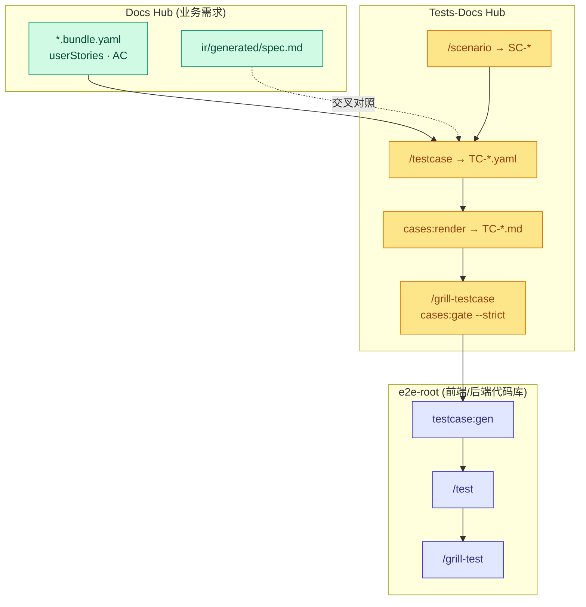
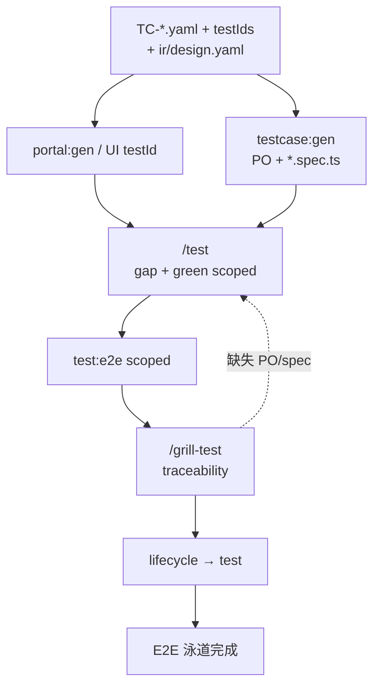
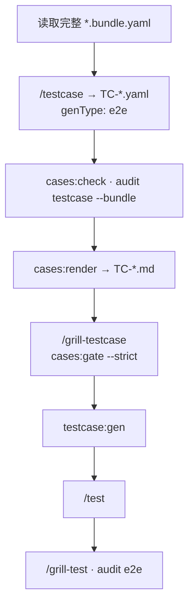
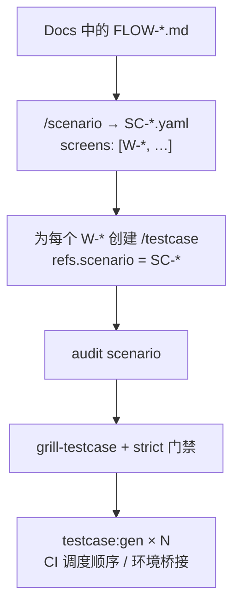
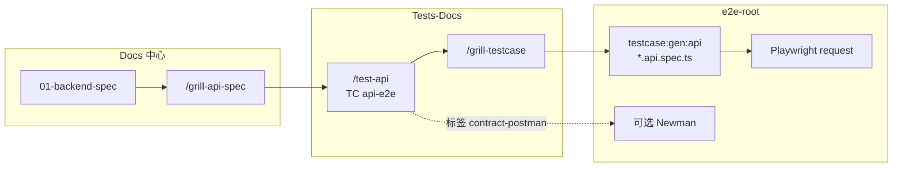

# 工作流 — 测试 (Tests-Docs 与 E2E)

**SSOT 职责范围：** **代码与测试 (Code + Test)** 泳道 —— 重点关注 **tests-docs hub** (`TC-*`, `SC-*`)、测试计划业务质询 (Grill)、质量门禁、为 QA/Dev 渲染人读测试用例，以及在 **e2e-root** 上执行自动化测试。

**本文档不包含：** 详细的 TC Schema、环境变量、CLI 命令参数 → [artifacts/index.md](../artifacts/index.md) · Playwright 目录布局 → [code.md](../artifacts/index.md#工作区代码仓库说明)。

**宏观工作流归属：** [index.md#full-cycle](./index.md#full-cycle) · Phase **2b 测试** · 质量门禁：[gates.md](./gates.md#close-one-function) (步骤 3–4, 7–8)。

---

## 测试生命周期 (Phase 2b) {#test-cycle}

---

## 三层核心架构 — 职责明确 {#three-layers}

| 层次 | 根目录 | SSOT 实体 | VitePress 文档中心 |
|---|---|---|---|
| **Docs** | `FLOWGRID_DOCS_ROOT` | `*.bundle.yaml`, `ir/*` | 端口 **5173** — `spec.md`, `data-model.md`, `api.md` |
| **Tests-docs** | `FLOWGRID_TESTS_DOC` | `cases/**/TC-*.yaml`, `scenarios/**/SC-*` | 端口 **5174** — 由 `cases:render` 生成的 `TC-*.md` |
| **Automation** | `e2e-root` | `*.spec.ts`, Page Objects | 测试代码执行目标，非规划期 SSOT |

**全项目覆盖标准：** Docs 中的每个功能叶子节点在 `TC-*` 中都有严格对应的镜像路径；跨端/跨功能业务流对应 `SC-*` + `audit scenario`；带有 `--strict` + `FLOWGRID_DOCS_ROOT` 的质量门禁强制要求用例百分之百**可追溯 (Traceability)** 到 Bundle。

---

## SSOT 读写职责分工 {#ssot-reading}

| 角色 | 读取 (评审 / 业务演练) | 写入与维护 |
|---|---|---|
| BA / PO | Docs VitePress 的 `spec.md` (AC, 业务场景) | 不直接编写 `TC` — 发现逻辑缺口时调用 `/update-spec` |
| QA | Tests VitePress 的 `TC-*.md` (用例步骤, 维度矩阵, 溯源追踪) | 在 YAML 中调用 `/testcase`, `/scenario` |
| 前端开发 | `TC-*.md` + `ir/design.yaml` (`testIds`) | 运行 `/test`，避免直接篡改 YAML 计划文件 |
| 发布负责人 | `cases:gate --strict` JSON 报告 | 严禁绕过溯源/矩阵门禁标准 |

**Grill testcase** 必须审查**完整**的 `*.bundle.yaml` — 在设计测试覆盖面时，绝不能将 `ir/spec` 与 `ir/design` 割裂开来。

---

## E2E 自动化测试泳道 {#test-e2e-lane}

Vitest/PHPUnit 等单元测试在前端/后端代码库的独立测试通道中运行；未包含在下方流程图中。

### 单一 E2E 规范的三层断言

| 层级 | 目标与断言内容 |
|---|---|
| 功能断言 (TC steps) | 业务流断言、Mock/真实 API 验证、`data-testid` 交互 |
| 语义断言 (`#e2e:*`) | 布局完整性、防溢出与自适应检查、浏览器 Console 零错误 |
| 无障碍断言 (Axe WCAG) | 关键可访问性违规合规审查 |

### `/grill-testcase` 与 `/grill-test` 的区别

| Skill 技能 | 执行根目录 | 核心职责 |
|---|---|---|
| **`/grill-testcase`** | **tests-docs** | 审查 YAML 规划：`cases:gate --strict`、`audit testcase --bundle`、测试维度矩阵、将规格遗漏回传 Docs |
| **`/grill-test`** | **e2e-root** | 校验 TC ↔ PO ↔ `*.spec.ts` 映射一致性与语义 `#e2e:*` — 在 `/test` 全部绿灯后执行 |

### 联调前 (Pre-Wire) 与联调后 (Post-Wire)

复用相同的 `TC-*.yaml`：在联调前（Mock 阶段），`lifecycle` ≠ wire 在模拟数据上运行；联调后（`wire` 阶段），测试用例直接对准真实后端 API。

---

## 深度质询 — 三种模式 {#grill-modes}

三种独立的业务流需在**独立会话**中运行 — 切勿在单次会话中混用 `/grill-testcase` (文档中心) 与 `/grill-test` (自动化代码库)。

| 模式 | SSOT 规划文件 | Hub 质询重点 | 自动化测试质询 |
|---|---|---|---|
| **单屏幕** `W-*` | `cases/…/TC-*.yaml` (`e2e`) | `/grill-testcase` + 门禁验证 | `/test` 通过后执行 `/grill-test` |
| **跨屏幕场景流** `SC-*` | `scenarios/…/SC-*` + N 个 `TC` | `audit scenario` + 集群门禁 | 各 TC 独立运行 / CI 串联执行 |
| **API Hook** | `TC` `api-e2e` | `/test-api` + `/grill-testcase` | `testcase:gen:api` (及可选 Newman) |

### 1 — 单功能屏幕 (`W-*`) {#grill-single-screen}

目标：在生成前端 UI E2E 代码之前，确保**单个**功能叶子节点具备**全维度测试覆盖**，且完全可追溯至 Bundle。

| # | 规划质询验证项 | 命令 / 技能 |
|---|---|---|
| 1 | Bundle 包含完整的 User Stories / AC — 严禁脱离实际编造测试步骤 | 阻断 → 调用 `/update-spec` |
| 2 | `traceability` 精准匹配 `W-*`、业务场景、`AC-*`、`btn_*` | `audit testcase --bundle` |
| 3 | 屏幕级别聚合完整的 `testMatrix` 维度（不仅包含正常成功路径） | `cases:gate --strict` |
| 4 | QA 在 VitePress 测试中心阅读渲染后的规范用例 | `cases:render` |
| 5 | `testIds.required` 与 Split 后的 Design 规范严格吻合 | grill-dev / 检查 DOM |
| 6 | 局部执行作用域内的测试用例全部绿灯通过 | `/test` |
| 7 | 确认 TC ↔ PO ↔ `*.spec.ts` 三者完全对齐 | `/grill-test`, `audit e2e` |

一个目录下可共存多个 `TC-*.yaml`（例如冒烟测试与完整回归测试）— 门禁系统会按 `refs.screen` 自动聚合覆盖率。

### 2 — 跨屏幕场景业务流 (`SC-*`) {#grill-scenario-flow}

目标：验证符合 Docs 中 `FLOW-*.md` 规范的**端到端用户业务旅程**。

| # | 场景质询项 | 核心注意事项 |
|---|---|---|
| 1 | 编写 SC 之前，必须先在 Docs 中建立 `FLOW-*.md` | 业务流不完善时 → Docs 调用 `/user-flow` |
| 2 | `SC.screens[]` 完整包含旅程中涉及的所有 `W-*` 页面 | 必须与 FLOW 中的业务步骤完全匹配 |
| 3 | 每个 `W-*` 必须有对应的 `TC-*.yaml` **或** 明确的 `QA-*` 暂缓标记 | 触发 `SC_SCREEN_NO_TC` 检查 |
| 4 | 每个 TC 单独在**各屏幕**上通过追踪与矩阵审核 | 对每个叶子节点运行 `audit testcase --bundle` |
| 5 | 业务演练：通过 SC 串联并在 VitePress 测试中心阅读 `TC-*.md` | 访问 VitePress 5174 端口 |
| 6 | 自动化落地 | 保证单屏幕独立 Spec；避免构建超过 50 步的臃肿用例 |

### 3 — API 钩子 (Playwright `request` · 可选 Newman) {#grill-api-hook}

目标：验证第三方合作伙伴、Webhook、公开对外接口的 HTTP 端点 —— 契约 SSOT 位于 Docs `01`，测试计划位于 tests-docs。

| 步骤 | 执行操作 | 技能 / 命令 |
|---|---|---|
| 1 | 契约 `01` 编写与 API 质询 | [backend.md](./backend.md) |
| 2 | 编写 `TC` — 覆盖 `apiSteps[]` 与错误矩阵（401/403/404/422…） | `/test-api` · `TC.example-api.yaml` |
| 3 | 测试计划质询（标准同 UI 用例） | `audit testcase`, `cases:gate --strict` |
| 4 | 生成 Playwright 测试套件 | `flowgrid testcase:gen:api` → `tests/api-e2e/**` |
| 5 | 在 CI 流水线中自动化运行 | 配置 `FLOWGRID_API_TEST_BASE_URL` 与密钥 |
| 6 | (可选) 合作伙伴集合 | 在 `integrations/postman/` 中运行 Newman；标记 `contract-postman` |

---

## 准入条件 {#preconditions}

- Docs 中的叶子节点拥有完备的 Bundle，包含清晰的 `userStories` / `acceptanceCriteria`（或通过 `QA-*` 明确挂起）。
- 在批量执行用例质询之前，Bundle 必须通过 `flowgrid check` 与 split 操作。
- 环境变量 `FLOWGRID_DOCS_ROOT` 与 `FLOWGRID_TESTS_DOC` 正确配置（通过 `flowgrid doctor` 验证）。
- `cases/…` 目录结构必须与 `surfaces/…` 保持完全**镜像映射**。

---

## 工作流步骤全览 {#steps}

| 顺序 | 执行操作 | 责任角色 | 技能 / 门禁 |
|---|---|---|---|
| 0 | (可选) 跨业务流梳理 | QA / BA | 当存在 `FLOW-*.md` 时调用 `/scenario` |
| 1 | 编写 Testcase YAML v2 | QA | `/testcase`, `cases:check` |
| 2 | 渲染人读测试用例 | QA / 全员 | `flowgrid cases:render` → 打开 VitePress 测试中心 |
| 3 | 质询测试计划 | QA + 团队成员 | `/grill-testcase`, `audit testcase --bundle` |
| 4 | 测试文档质量门禁 | QA / 发布负责人 | `cases:gate --strict` + `FLOWGRID_DOCS_ROOT` |
| 5 | 生成 Playwright 测试代码 | Dev / QA | `testcase:gen` (`genType: e2e`) |
| 5b | 编写 API 钩子测试计划 | QA / Dev | `/test-api`, `genType: api-e2e` |
| 6 | 修复与实现直至绿灯通过 | Dev | `/test`, 局部 `test:e2e` |
| 7 | 质询自动化实现质量 | Dev + QA | `/grill-test` |
| 8 | 审计测试计划与实际代码执行偏差 | QA | `flowgrid audit e2e` |

---

## 团队测试计划签字确认 (Sign-off) {#test-signoff}

在批量执行 `testcase:gen` 或进行集成测试发布前：

| # | 检查项 | 验证准则 |
|---|---|---|
| 1 | **门禁** | `cases:gate --strict` 在指定 `FLOWGRID_DOCS_ROOT` 下完全通过 |
| 2 | **溯源** | 每个 TC 均具备匹配 Bundle 屏幕/场景/AC/操作的 `traceability` |
| 3 | **矩阵** | 屏幕全量测试维度矩阵完整覆盖（非仅仅覆盖正常成功路径） |
| 4 | **可读性** | `TC-*.md` 在 VitePress 中渲染美观，QA 无需查阅原始 YAML 即可走查 |
| 5 | **文档一致性** | 抽查 `spec.md` 中的 AC 与用例中的 `acceptanceRefs` 保持对齐 |
| 6 | **遗留挂起** | 未覆盖项显式挂载到 `QA-*` 或标记为 `coverage_deferred` |
