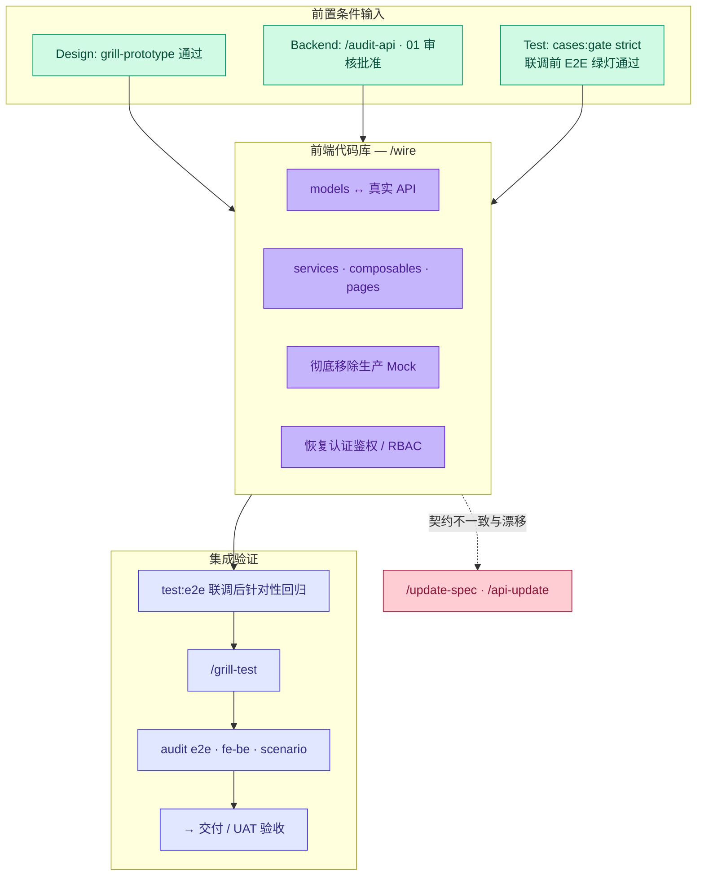

# 工作流 — 联调集成 Wire (前端 ↔ 后端集成)

**SSOT 职责范围：** 宏观 **联调集成 (Wire)** 阶段（Phase **3**）—— 将前端代码中的生产 Mock/桩数据替换为真实的后端 API，恢复权限认证与 RBAC 机制，执行联调后的 E2E 自动化回归，并在正式交付发版 (Ship) 前完成数据流收敛审计。

**本文档不包含：** 前端仓库中详细的 Portal 4 层分层架构 → [artifacts/index.md](../artifacts/index.md) · `/wire` 技能参数参考 → [references/cli-and-commands.md](../references/cli-and-commands.md)。

**宏观工作流归属：** [index.md#full-cycle](./index.md#full-cycle) · 前置泳道依赖：[design.md](./design.md) · [backend.md](./backend.md) · [test.md](./test.md)。

---

## 联调集成生命周期 (Phase 3) {#wire-cycle}



---

## 三层集成收敛结构 {#three-convergence}

| 层次 | 联调前 (Pre-Wire) 状态 | 联调集成责任 (Wire) | 联调后验证 (Post-Wire) |
|---|---|---|---|
| **Portal UI 前端** | 原型 Mock 数据，在 design/HANDOFF 标记 `#wire-only` | 运行 `/wire` — 对接真实服务，拆除 Mock 依赖 | 局部运行 `test:e2e` · `/grill-test` |
| **API 接口契约** | `01` 规范 + API 质询；前端在 design 标记 `apiRef` | 对齐类型与 DTO 模型；配置 CORS 与环境变量 | 对叶子 Bundle 运行 `audit fe-be` |
| **跨端场景流 `SC-*`** | TC 阶段的联调前模拟数据 | 沿用户业务旅程逐屏对接真实后端 | `audit scenario` + CI 环境串联 E2E |

**纯后端 / 合作伙伴集成：** 无需前端 `/wire` 步骤 —— 通过 `testcase:gen:api`、可选的 Newman 集合以及后端集成测试验证；在 SSOT 文档中心维护 `01` 契约，在 tests-docs 中维护 `api-e2e` 测试计划 ([test.md § API 钩子](./test.md#grill-api-hook))。

---

## 联调期间的 SSOT 读写规则 {#ssot-reading}

| 角色 | 规范读取源 | 严禁作为编辑来源的项目 |
|---|---|---|
| 前端开发 | `ir/design.yaml`, HANDOFF, `#wire-only` / `#update:*` | 自动生成文件 `ir/generated/*.md` |
| 前端开发 | 映射 DTO 时阅读 `01` / OpenAPI 预览 | 直接在前端代码库中强行修改 `01` —— 必须走 `/api-update` |
| QA | `TC-*.md` 联调后业务场景 | 联调会话中随意篡改 YAML 测试用例 |
| 技术主管 | [gates § 里程碑 9](./gates.md#close-one-function) | 仅凭“人工点点没问题”跳过自动化审计 |

**环境配置准入：** `FLOWGRID_DOCS_ROOT`、`FLOWGRID_TESTS_DOC`、e2e-root — 通过 `flowgrid doctor` 确保就绪。

---

## 准入条件 {#preconditions}

| 里程碑 | 最低准入要求 |
|---|---|
| **Design 设计** | `/grill-prototype` 零 SSOT 缺口（文案、状态、Mock 边界完全清晰）— [design.md](./design.md) |
| **Backend 后端** | API 已部署至 Staging/Dev 环境；`/audit-api` 无阻断；`01` 契约获得正式审批 |
| **测试计划** | 针对目标 `W-*` 的 `cases:gate --strict` 完全通过 |
| **自动化测试** | 联调前范围内的 E2E 测试全部**绿灯通过**或已标记缺口 — [test.md](./test.md#test-e2e-lane) |
| **标签管理** | HANDOFF 中明确枚举 `#wire-only` / `#manual-composable` 标签 |

**若前置条件未齐备：** 退回 Prototype/Test/Backend 泳道补齐 —— **严禁在接口规范残缺时草率进行前端联调**。

---

## 联调前 vs 联调后 (测试用例) {#pre-wire-post-wire}

在 tests-docs 中复用相同的 `TC-*.yaml` —— 切换**运行时环境**而无需重写测试规划：

| 维度 | 联调前 (Pre-Wire) | 联调后 (Post-Wire) |
|---|---|---|
| API 目标 | Playwright 内部的 Mock / `setup.mocks` | 真实的 API Base URL，携带有效登录态 Cookie |
| 认证鉴权 | 旁路中间件 (原型走查模式) | 根据 Bundle 规范恢复访客/RBAC 权限守卫 |
| 路由生命周期 | `prototype` / `test` 状态 | 晋级为 `wire` 状态 |
| 审计门禁 | `audit e2e` (联调前可选) | **强制执行 `audit e2e`** 并指定 `--screen W-*` |

---

## 工作流步骤全览 {#steps}

| # | 执行操作 | 责任角色 | 技能 / 门禁 |
|---|---|---|---|
| 1 | 对齐 Types/Models ↔ `01` / OpenAPI | 前端开发 | `/model` (若尚未完成) |
| 2 | 按四层结构推进：Service → Composable → Page | 前端开发 | `/wire` |
| 3 | 移除生产代码中的 Mock；保留 Mock 仅用于单元测试降级 | 前端开发 | HANDOFF 原型交付规范 |
| 4 | 恢复 Auth / RBAC / 路由元信息 | 前端开发 | 严禁将绕过鉴权的页面交付发版 |
| 5 | 执行联调后范围内的 E2E 回归测试 | 开发 + QA | 运行 `test:e2e`，针对缺口执行 `/test` |
| 6 | 质询自动化实现质量 | 开发 + QA | `/grill-test` |
| 7 | 运行收敛审计 | 开发 + QA | `/grill-wire` 或审计命令：`audit e2e`, `audit fe-be`, `audit scenario` |
| 8 | UAT 业务验收走查 | PM / PO | 业务验收；如产生新需求，在关闭功能**前**调用 `/update-spec` |

---

## 联调质询与门禁检查 {#wire-gates}

完成联调代码实现后，在**前端代码库**中运行：

```bash
flowgrid audit e2e --e2e-root <path> --tests-docs "$FLOWGRID_TESTS_DOC" --screen <W-*>
flowgrid audit fe-be <path/to.bundle.yaml>    # 针对具体页面 Bundle
flowgrid audit scenario <SC.yaml> --tests-docs "$FLOWGRID_TESTS_DOC"   # 若涉及跨端场景流
```

| 审计发现的缺口 | 纠正措施 |
|---|---|
| `missingInPlaywright` / Page Object 缺失 | 运行 `/test` 补齐 |
| 测试计划与 Bundle 规范发生漂移 | 运行 `/grill-testcase` 或 `/update-spec` 重新对齐 |
| `apiRef` ↔ `01` 契约字段不一致 | 运行 `/api-update` 并重新质询 API |
| 团队知晓并有意暂缓项 | 按规范登记至 `qa/` 待办 |

---

## 联调签字验收 (Sign-off) {#wire-signoff}

在合并发布范围或提交 UAT 签署前：

| # | 检查项 | 验证准则 |
|---|---|---|
| 1 | **无残留生产 Mock** | 目标 `W-*` 的生产代码路径中无任何 Mock 桩代码残留 |
| 2 | **标签清理完毕** | 目标范围内的 `#wire-only` / `#update:*` 标签已全部处理或移交 QA 追踪 |
| 3 | **权限健全** | 路由中间件与 RBAC 严格符合 Bundle 中的 `screenAccess` |
| 4 | **E2E 绿灯** | 联调后 E2E 自动化测试全量通过 |
| 5 | **audit e2e** | 无阻断性缺口（警告项均有明确负责人） |
| 6 | **FE–BE 契约** | 页面调用的 API 通过 `audit fe-be` 验证，无契约冲突 |
| 7 | **生命周期状态** | 路由阶段在注册表中标记为 `wire` |

---

## 缺口修复反馈闭环 {#gap-loop}

| 触发场景 | 修复闭环路径 |
|---|---|
| 后端契约有误 | `/api-update` → 后端重新部署 → 重新执行联调 |
| 交互或业务规格分歧 | `/update-spec` → Split 分解 → 必要时重新进行联调前测试 |
| E2E 覆盖不全 | `/test` → `/grill-test` —— 严禁跳过 `audit e2e` 强行合并 |
| 跨端业务流缺少页面 | 补充 `TC` 或记录 `QA-*` —— 通过 `audit scenario` 验证完整性 |

**单次会话只做一件事** —— 切勿在 `/wire` 会话中同时混合执行全系统回归测试与后端 `/api` 代码生成。
